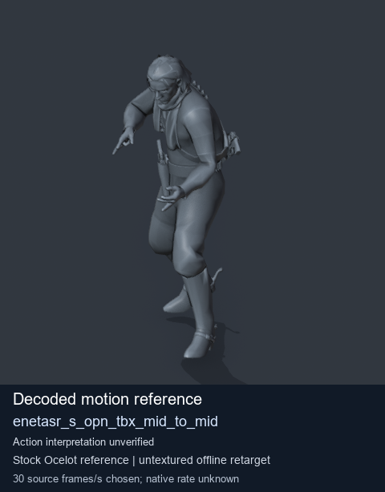
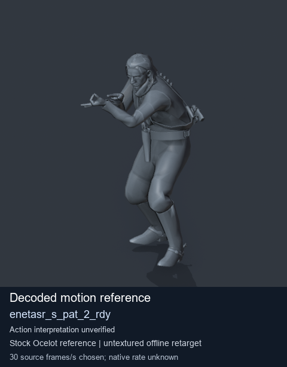
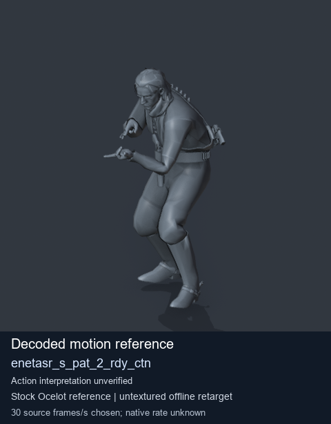
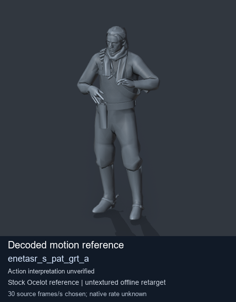

# Stock Soldier_common motion references / /Assets/tpp/motion/SI_game/fani/bodies/enet/enetasr - page 127

[Library](../README.md) · [Grouped directory](../browse/README.md) · [This source family](../browse/stock-soldier-enetasr-dd428991.md) · [Switch mode](browse-stock-soldier-enetasr-dd428991-127.md)

**Still images: no GIFs loaded** · 4 clips · 0.34 MiB downloaded.

Images reuse existing files. A small display width does not reduce download size. Open one clip for its larger titled GIF and original technical data.

Source-family grouping uses only recorded virtual directories; it does not establish an action, weapon, actor, rig or native compatibility. Existing descriptions and tags below are unchanged. Per-clip visual review may be pending; chosen preview speed is separate from unmeasured native timing.

| Preview | Animation | Category | Tags | Virtual GANI directory / file | MTAR / container location | Description | Frames / data |
| --- | --- | --- | --- | --- | --- | --- | --- |
|  | [Stock reference: enetasr_s_opn_tbx_mid_to_mid](../clips/mgsv-tpp-soldier_common-payloadsha256-baaa2aebc0fa381cd5efe4b5e99eaa0626a3e4339775579cff14a7aae06659cb.md) <code>enetasr_s_opn_tbx_mid_to_mid</code> | Stock Soldier_common motion references | <code>stock animation reference</code> <code>Soldier_common</code> <code>source-derived label</code> <code>Ocelot reference mesh</code> | <code>/Assets/tpp/motion/SI_game/fani/bodies/enet/enetasr</code> <code>enetasr_s_opn_tbx_mid_to_mid.gani</code> | Retained MTAR: <code>Soldier_common.mtar</code> DAT / FPK membership unverified | Decoded stock reference enetasr_s_opn_tbx_mid_to_mid; action interpretation unverified. | 217 raw 7.23 s chosen; native rate unknown [Full data](../clips/mgsv-tpp-soldier_common-payloadsha256-baaa2aebc0fa381cd5efe4b5e99eaa0626a3e4339775579cff14a7aae06659cb.md#technical-data) |
|  | [Stock reference: enetasr_s_pat_2_rdy](../clips/mgsv-tpp-soldier_common-payloadsha256-985db37c3e51b688e95d851a036368a92204669a6c8edf5317e736e62f1d9de6.md) <code>enetasr_s_pat_2_rdy</code> | Stock Soldier_common motion references | <code>stock animation reference</code> <code>Soldier_common</code> <code>source-derived label</code> <code>Ocelot reference mesh</code> | <code>/Assets/tpp/motion/SI_game/fani/bodies/enet/enetasr</code> <code>enetasr_s_pat_2_rdy.gani</code> | Retained MTAR: <code>Soldier_common.mtar</code> DAT / FPK membership unverified | Decoded stock reference enetasr_s_pat_2_rdy; action interpretation unverified. | 48 raw 1.6 s chosen; native rate unknown [Full data](../clips/mgsv-tpp-soldier_common-payloadsha256-985db37c3e51b688e95d851a036368a92204669a6c8edf5317e736e62f1d9de6.md#technical-data) |
|  | [Stock motion reference: enetasr_s_pat_2_rdy_ctn](../clips/mgsv-tpp-soldier_common-payloadsha256-e6a24048e5efd8858bbfc040080e26c5273cb00875aa01742b3b633a6efd216f.md) <code>enetasr_s_pat_2_rdy_ctn</code> | Stock Soldier_common motion references | <code>stock body motion</code> <code>Soldier_common</code> <code>source-derived label</code> <code>Ocelot reference mesh</code> | <code>/Assets/tpp/motion/SI_game/fani/bodies/enet/enetasr</code> <code>enetasr_s_pat_2_rdy_ctn.gani</code> | Retained MTAR: <code>Soldier_common.mtar</code> DAT / FPK membership unverified | Decoded stock body-motion reference enetasr_s_pat_2_rdy_ctn; action interpretation unverified. | 48 raw 1.6 s chosen; native rate unknown [Full data](../clips/mgsv-tpp-soldier_common-payloadsha256-e6a24048e5efd8858bbfc040080e26c5273cb00875aa01742b3b633a6efd216f.md#technical-data) |
|  | [Stock reference: enetasr_s_pat_grt_a](../clips/mgsv-tpp-soldier_common-payloadsha256-02e4c77b4e931b217cee3f4ca9ba8522e469137c991ebcb61b67de78e6c25d70.md) <code>enetasr_s_pat_grt_a</code> | Stock Soldier_common motion references | <code>stock animation reference</code> <code>Soldier_common</code> <code>source-derived label</code> <code>Ocelot reference mesh</code> | <code>/Assets/tpp/motion/SI_game/fani/bodies/enet/enetasr</code> <code>enetasr_s_pat_grt_a.gani</code> | Retained MTAR: <code>Soldier_common.mtar</code> DAT / FPK membership unverified | Decoded stock reference enetasr_s_pat_grt_a; action interpretation unverified. | 140 raw 4.67 s chosen; native rate unknown [Full data](../clips/mgsv-tpp-soldier_common-payloadsha256-02e4c77b4e931b217cee3f4ca9ba8522e469137c991ebcb61b67de78e6c25d70.md#technical-data) |

[Source descriptions, confidence and credits](../description-sources.md) · [Complete JSON](../catalogue.json) · [CSV](../catalogue.csv)
