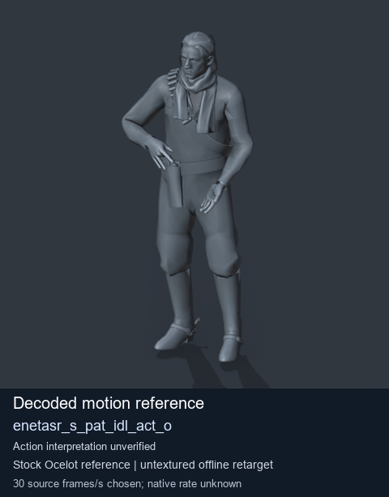
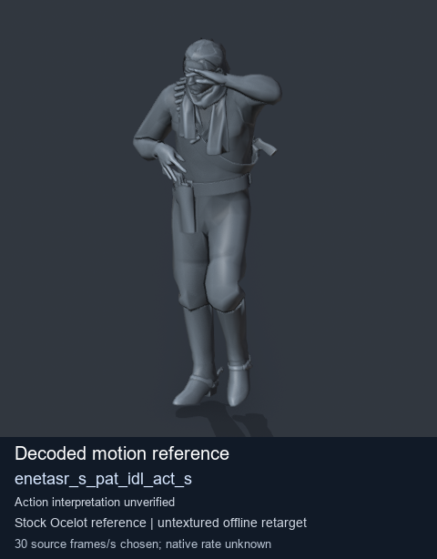

# Stock Soldier_common motion references / /Assets/tpp/motion/SI_game/fani/bodies/enet/enetasr - page 133

[Library](../README.md) · [Grouped directory](../browse/README.md) · [This source family](../browse/stock-soldier-enetasr-dd428991.md) · [Switch mode](browse-stock-soldier-enetasr-dd428991-133.md)

**Still images: no GIFs loaded** · 2 clips · 0.18 MiB downloaded.

Images reuse existing files. A small display width does not reduce download size. Open one clip for its larger titled GIF and original technical data.

Source-family grouping uses only recorded virtual directories; it does not establish an action, weapon, actor, rig or native compatibility. Existing descriptions and tags below are unchanged. Per-clip visual review may be pending; chosen preview speed is separate from unmeasured native timing.

| Preview | Animation | Category | Tags | Virtual GANI directory / file | MTAR / container location | Description | Frames / data |
| --- | --- | --- | --- | --- | --- | --- | --- |
|  | [Stock reference: enetasr_s_pat_idl_act_o](../clips/mgsv-tpp-soldier_common-payloadsha256-a42452368ddd4028e97e4392ae810be15d833ec0b4f7fb22bba7df719056ffa0.md) <code>enetasr_s_pat_idl_act_o</code> | Stock Soldier_common motion references | <code>stock animation reference</code> <code>Soldier_common</code> <code>source-derived label</code> <code>Ocelot reference mesh</code> | <code>/Assets/tpp/motion/SI_game/fani/bodies/enet/enetasr</code> <code>enetasr_s_pat_idl_act_o.gani</code> | Retained MTAR: <code>Soldier_common.mtar</code> DAT / FPK membership unverified | Decoded stock reference enetasr_s_pat_idl_act_o; action interpretation unverified. | 220 raw 7.33 s chosen; native rate unknown [Full data](../clips/mgsv-tpp-soldier_common-payloadsha256-a42452368ddd4028e97e4392ae810be15d833ec0b4f7fb22bba7df719056ffa0.md#technical-data) |
|  | [Stock motion reference: enetasr_s_pat_idl_act_s](../clips/mgsv-tpp-soldier_common-payloadsha256-7ec8c3144a510d557f2a7f0b332edf9463a8f8d9c2c1b27cc34b5a4a50ffc3c3.md) <code>enetasr_s_pat_idl_act_s</code> | Stock Soldier_common motion references | <code>stock body motion</code> <code>Soldier_common</code> <code>source-derived label</code> <code>Ocelot reference mesh</code> | <code>/Assets/tpp/motion/SI_game/fani/bodies/enet/enetasr</code> <code>enetasr_s_pat_idl_act_s.gani</code> | Retained MTAR: <code>Soldier_common.mtar</code> DAT / FPK membership unverified | Decoded stock body-motion reference enetasr_s_pat_idl_act_s; action interpretation unverified. | 156 raw 5.2 s chosen; native rate unknown [Full data](../clips/mgsv-tpp-soldier_common-payloadsha256-7ec8c3144a510d557f2a7f0b332edf9463a8f8d9c2c1b27cc34b5a4a50ffc3c3.md#technical-data) |

[Source descriptions, confidence and credits](../description-sources.md) · [Complete JSON](../catalogue.json) · [CSV](../catalogue.csv)
