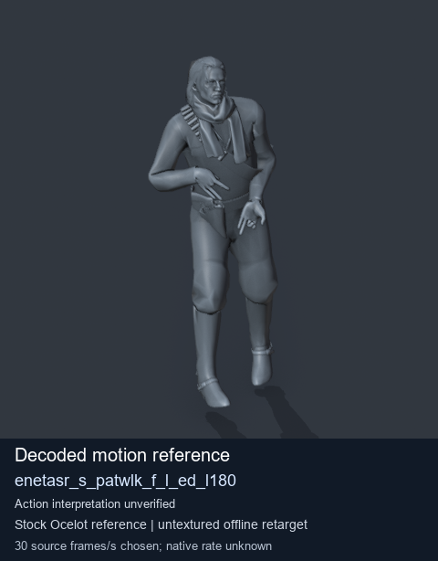
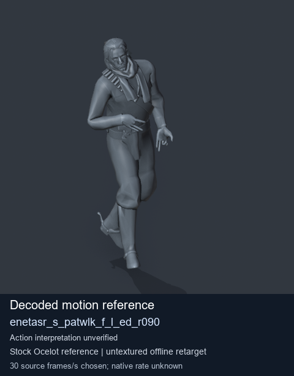

# Stock Soldier_common motion references / /Assets/tpp/motion/SI_game/fani/bodies/enet/enetasr - page 149

[Library](../README.md) · [Grouped directory](../browse/README.md) · [This source family](../browse/stock-soldier-enetasr-dd428991.md) · [Switch mode](browse-stock-soldier-enetasr-dd428991-149.md)

**Still images: no GIFs loaded** · 2 clips · 0.17 MiB downloaded.

Images reuse existing files. A small display width does not reduce download size. Open one clip for its larger titled GIF and original technical data.

Source-family grouping uses only recorded virtual directories; it does not establish an action, weapon, actor, rig or native compatibility. Existing descriptions and tags below are unchanged. Per-clip visual review may be pending; chosen preview speed is separate from unmeasured native timing.

| Preview | Animation | Category | Tags | Virtual GANI directory / file | MTAR / container location | Description | Frames / data |
| --- | --- | --- | --- | --- | --- | --- | --- |
|  | [Stock reference: enetasr_s_patwlk_f_l_ed_l180](../clips/mgsv-tpp-soldier_common-payloadsha256-45ad34d00b46a73ee03fc20d2a909e6b971a6911aec6d8fab107cbb7168bbad3.md) <code>enetasr_s_patwlk_f_l_ed_l180</code> | Stock Soldier_common motion references | <code>stock animation reference</code> <code>Soldier_common</code> <code>source-derived label</code> <code>Ocelot reference mesh</code> | <code>/Assets/tpp/motion/SI_game/fani/bodies/enet/enetasr</code> <code>enetasr_s_patwlk_f_l_ed_l180.gani</code> | Retained MTAR: <code>Soldier_common.mtar</code> DAT / FPK membership unverified | Decoded stock reference enetasr_s_patwlk_f_l_ed_l180; action interpretation unverified. | 230 raw 7.67 s chosen; native rate unknown [Full data](../clips/mgsv-tpp-soldier_common-payloadsha256-45ad34d00b46a73ee03fc20d2a909e6b971a6911aec6d8fab107cbb7168bbad3.md#technical-data) |
|  | [Stock reference: enetasr_s_patwlk_f_l_ed_r090](../clips/mgsv-tpp-soldier_common-payloadsha256-76e9f84ed0392484a977eab60181dd09cc1440d29106dc941268c9dacf6f97ec.md) <code>enetasr_s_patwlk_f_l_ed_r090</code> | Stock Soldier_common motion references | <code>stock animation reference</code> <code>Soldier_common</code> <code>source-derived label</code> <code>Ocelot reference mesh</code> | <code>/Assets/tpp/motion/SI_game/fani/bodies/enet/enetasr</code> <code>enetasr_s_patwlk_f_l_ed_r090.gani</code> | Retained MTAR: <code>Soldier_common.mtar</code> DAT / FPK membership unverified | Decoded stock reference enetasr_s_patwlk_f_l_ed_r090; action interpretation unverified. | 200 raw 6.67 s chosen; native rate unknown [Full data](../clips/mgsv-tpp-soldier_common-payloadsha256-76e9f84ed0392484a977eab60181dd09cc1440d29106dc941268c9dacf6f97ec.md#technical-data) |

[Source descriptions, confidence and credits](../description-sources.md) · [Complete JSON](../catalogue.json) · [CSV](../catalogue.csv)
