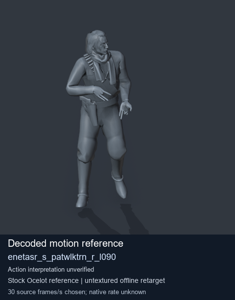
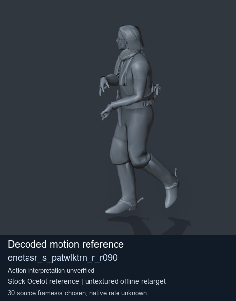
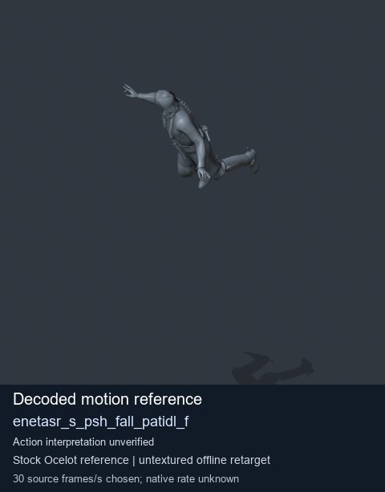
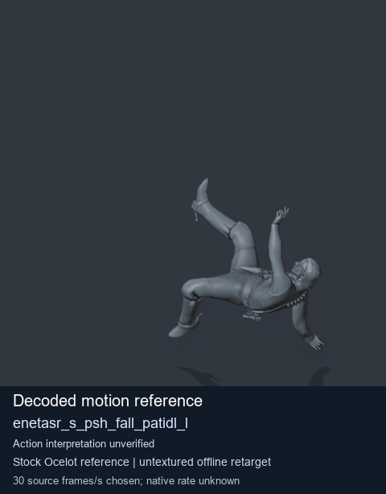

# Stock Soldier_common motion references / /Assets/tpp/motion/SI_game/fani/bodies/enet/enetasr - page 155

[Library](../README.md) · [Grouped directory](../browse/README.md) · [This source family](../browse/stock-soldier-enetasr-dd428991.md) · [Switch mode](browse-stock-soldier-enetasr-dd428991-155.md)

**Still images: no GIFs loaded** · 4 clips · 0.30 MiB downloaded.

Images reuse existing files. A small display width does not reduce download size. Open one clip for its larger titled GIF and original technical data.

Source-family grouping uses only recorded virtual directories; it does not establish an action, weapon, actor, rig or native compatibility. Existing descriptions and tags below are unchanged. Per-clip visual review may be pending; chosen preview speed is separate from unmeasured native timing.

| Preview | Animation | Category | Tags | Virtual GANI directory / file | MTAR / container location | Description | Frames / data |
| --- | --- | --- | --- | --- | --- | --- | --- |
|  | [Stock reference: enetasr_s_patwlktrn_r_l090](../clips/mgsv-tpp-soldier_common-payloadsha256-d2d24353f91ea5f32f5c649799d5fa9d0bf5d8a637bf644c2a2eb1a41ed46cfd.md) <code>enetasr_s_patwlktrn_r_l090</code> | Stock Soldier_common motion references | <code>stock animation reference</code> <code>Soldier_common</code> <code>source-derived label</code> <code>Ocelot reference mesh</code> | <code>/Assets/tpp/motion/SI_game/fani/bodies/enet/enetasr</code> <code>enetasr_s_patwlktrn_r_l090.gani</code> | Retained MTAR: <code>Soldier_common.mtar</code> DAT / FPK membership unverified | Decoded stock reference enetasr_s_patwlktrn_r_l090; action interpretation unverified. | 93 raw 3.1 s chosen; native rate unknown [Full data](../clips/mgsv-tpp-soldier_common-payloadsha256-d2d24353f91ea5f32f5c649799d5fa9d0bf5d8a637bf644c2a2eb1a41ed46cfd.md#technical-data) |
|  | [Stock motion reference: enetasr_s_patwlktrn_r_r090](../clips/mgsv-tpp-soldier_common-payloadsha256-fce95f191d62b268a8a63480fc8157e06fe1c3f89d6fd50a727e0fbf6c22fd36.md) <code>enetasr_s_patwlktrn_r_r090</code> | Stock Soldier_common motion references | <code>stock body motion</code> <code>Soldier_common</code> <code>source-derived label</code> <code>Ocelot reference mesh</code> | <code>/Assets/tpp/motion/SI_game/fani/bodies/enet/enetasr</code> <code>enetasr_s_patwlktrn_r_r090.gani</code> | Retained MTAR: <code>Soldier_common.mtar</code> DAT / FPK membership unverified | Decoded stock body-motion reference enetasr_s_patwlktrn_r_r090; action interpretation unverified. | 84 raw 2.8 s chosen; native rate unknown [Full data](../clips/mgsv-tpp-soldier_common-payloadsha256-fce95f191d62b268a8a63480fc8157e06fe1c3f89d6fd50a727e0fbf6c22fd36.md#technical-data) |
|  | [Stock reference: enetasr_s_psh_fall_patidl_f](../clips/mgsv-tpp-soldier_common-payloadsha256-602c2327dd8380a3a74eb3683def3bfd5ec5d21cb295437e6165a30755d8b232.md) <code>enetasr_s_psh_fall_patidl_f</code> | Stock Soldier_common motion references | <code>stock animation reference</code> <code>Soldier_common</code> <code>source-derived label</code> <code>Ocelot reference mesh</code> | <code>/Assets/tpp/motion/SI_game/fani/bodies/enet/enetasr</code> <code>enetasr_s_psh_fall_patidl_f.gani</code> | Retained MTAR: <code>Soldier_common.mtar</code> DAT / FPK membership unverified | Decoded stock reference enetasr_s_psh_fall_patidl_f; action interpretation unverified. | 53 raw 1.77 s chosen; native rate unknown [Full data](../clips/mgsv-tpp-soldier_common-payloadsha256-602c2327dd8380a3a74eb3683def3bfd5ec5d21cb295437e6165a30755d8b232.md#technical-data) |
|  | [Stock reference: enetasr_s_psh_fall_patidl_l](../clips/mgsv-tpp-soldier_common-payloadsha256-325db9a492263f726d3d37b529b4699b96d5bd0b412715aa0ec15a2250bd8f2f.md) <code>enetasr_s_psh_fall_patidl_l</code> | Stock Soldier_common motion references | <code>stock animation reference</code> <code>Soldier_common</code> <code>source-derived label</code> <code>Ocelot reference mesh</code> | <code>/Assets/tpp/motion/SI_game/fani/bodies/enet/enetasr</code> <code>enetasr_s_psh_fall_patidl_l.gani</code> | Retained MTAR: <code>Soldier_common.mtar</code> DAT / FPK membership unverified | Decoded stock reference enetasr_s_psh_fall_patidl_l; action interpretation unverified. | 33 raw 1.1 s chosen; native rate unknown [Full data](../clips/mgsv-tpp-soldier_common-payloadsha256-325db9a492263f726d3d37b529b4699b96d5bd0b412715aa0ec15a2250bd8f2f.md#technical-data) |

[Source descriptions, confidence and credits](../description-sources.md) · [Complete JSON](../catalogue.json) · [CSV](../catalogue.csv)
