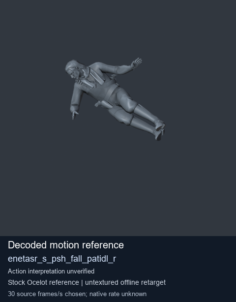
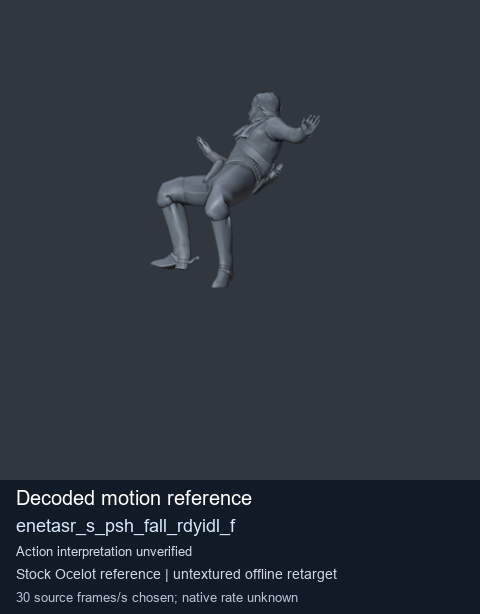
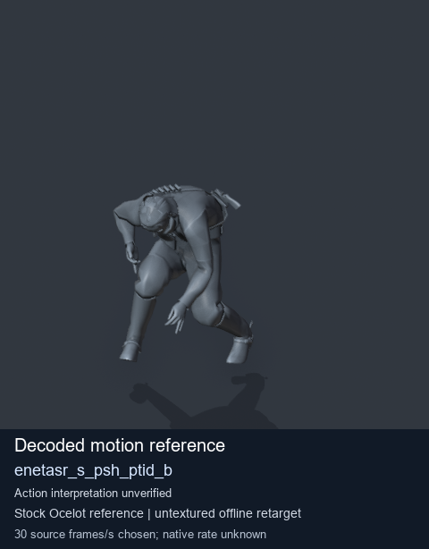
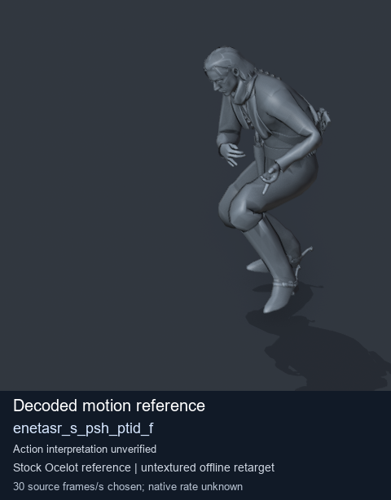

# Stock Soldier_common motion references / /Assets/tpp/motion/SI_game/fani/bodies/enet/enetasr - page 156

[Library](../README.md) · [Grouped directory](../browse/README.md) · [This source family](../browse/stock-soldier-enetasr-dd428991.md) · [Switch mode](browse-stock-soldier-enetasr-dd428991-156.md)

**Still images: no GIFs loaded** · 4 clips · 0.28 MiB downloaded.

Images reuse existing files. A small display width does not reduce download size. Open one clip for its larger titled GIF and original technical data.

Source-family grouping uses only recorded virtual directories; it does not establish an action, weapon, actor, rig or native compatibility. Existing descriptions and tags below are unchanged. Per-clip visual review may be pending; chosen preview speed is separate from unmeasured native timing.

| Preview | Animation | Category | Tags | Virtual GANI directory / file | MTAR / container location | Description | Frames / data |
| --- | --- | --- | --- | --- | --- | --- | --- |
|  | [Stock reference: enetasr_s_psh_fall_patidl_r](../clips/mgsv-tpp-soldier_common-payloadsha256-9b4464ae75e1c2398fa2d180e80ef85eb78cfbcd6ead247d864aae67d2af40e2.md) <code>enetasr_s_psh_fall_patidl_r</code> | Stock Soldier_common motion references | <code>stock animation reference</code> <code>Soldier_common</code> <code>source-derived label</code> <code>Ocelot reference mesh</code> | <code>/Assets/tpp/motion/SI_game/fani/bodies/enet/enetasr</code> <code>enetasr_s_psh_fall_patidl_r.gani</code> | Retained MTAR: <code>Soldier_common.mtar</code> DAT / FPK membership unverified | Decoded stock reference enetasr_s_psh_fall_patidl_r; action interpretation unverified. | 49 raw 1.63 s chosen; native rate unknown [Full data](../clips/mgsv-tpp-soldier_common-payloadsha256-9b4464ae75e1c2398fa2d180e80ef85eb78cfbcd6ead247d864aae67d2af40e2.md#technical-data) |
|  | [Stock reference: enetasr_s_psh_fall_rdyidl_f](../clips/mgsv-tpp-soldier_common-payloadsha256-6a27138662a29c2792337461f994af30fd9b0510caac1ac362f42f00e50d1d2c.md) <code>enetasr_s_psh_fall_rdyidl_f</code> | Stock Soldier_common motion references | <code>stock animation reference</code> <code>Soldier_common</code> <code>source-derived label</code> <code>Ocelot reference mesh</code> | <code>/Assets/tpp/motion/SI_game/fani/bodies/enet/enetasr</code> <code>enetasr_s_psh_fall_rdyidl_f.gani</code> | Retained MTAR: <code>Soldier_common.mtar</code> DAT / FPK membership unverified | Decoded stock reference enetasr_s_psh_fall_rdyidl_f; action interpretation unverified. | 55 raw 1.83 s chosen; native rate unknown [Full data](../clips/mgsv-tpp-soldier_common-payloadsha256-6a27138662a29c2792337461f994af30fd9b0510caac1ac362f42f00e50d1d2c.md#technical-data) |
|  | [Stock reference: enetasr_s_psh_ptid_b](../clips/mgsv-tpp-soldier_common-payloadsha256-d5d595ce0b162eb4384b2f742572fd12951b4cf6d273d45913f43bbb0f9fa53c.md) <code>enetasr_s_psh_ptid_b</code> | Stock Soldier_common motion references | <code>stock animation reference</code> <code>Soldier_common</code> <code>source-derived label</code> <code>Ocelot reference mesh</code> | <code>/Assets/tpp/motion/SI_game/fani/bodies/enet/enetasr</code> <code>enetasr_s_psh_ptid_b.gani</code> | Retained MTAR: <code>Soldier_common.mtar</code> DAT / FPK membership unverified | Decoded stock reference enetasr_s_psh_ptid_b; action interpretation unverified. | 80 raw 2.67 s chosen; native rate unknown [Full data](../clips/mgsv-tpp-soldier_common-payloadsha256-d5d595ce0b162eb4384b2f742572fd12951b4cf6d273d45913f43bbb0f9fa53c.md#technical-data) |
|  | [Stock motion reference: enetasr_s_psh_ptid_f](../clips/mgsv-tpp-soldier_common-payloadsha256-4c89e992eb302dc92aa6a3b356b054fb7ea8971dfefca878cd94a6754cb0d91f.md) <code>enetasr_s_psh_ptid_f</code> | Stock Soldier_common motion references | <code>stock body motion</code> <code>Soldier_common</code> <code>source-derived label</code> <code>Ocelot reference mesh</code> | <code>/Assets/tpp/motion/SI_game/fani/bodies/enet/enetasr</code> <code>enetasr_s_psh_ptid_f.gani</code> | Retained MTAR: <code>Soldier_common.mtar</code> DAT / FPK membership unverified | Decoded stock body-motion reference enetasr_s_psh_ptid_f; action interpretation unverified. | 50 raw 1.67 s chosen; native rate unknown [Full data](../clips/mgsv-tpp-soldier_common-payloadsha256-4c89e992eb302dc92aa6a3b356b054fb7ea8971dfefca878cd94a6754cb0d91f.md#technical-data) |

[Source descriptions, confidence and credits](../description-sources.md) · [Complete JSON](../catalogue.json) · [CSV](../catalogue.csv)
