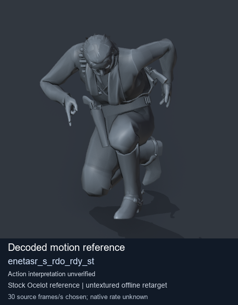
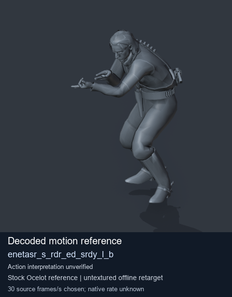
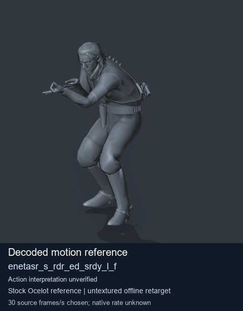
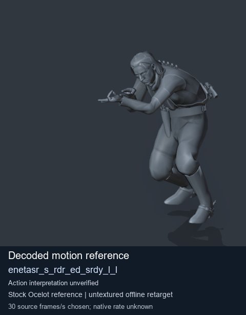

# Stock Soldier_common motion references / /Assets/tpp/motion/SI_game/fani/bodies/enet/enetasr - page 160

[Library](../README.md) · [Grouped directory](../browse/README.md) · [This source family](../browse/stock-soldier-enetasr-dd428991.md) · [Switch mode](browse-stock-soldier-enetasr-dd428991-160.md)

**Still images: no GIFs loaded** · 4 clips · 0.39 MiB downloaded.

Images reuse existing files. A small display width does not reduce download size. Open one clip for its larger titled GIF and original technical data.

Source-family grouping uses only recorded virtual directories; it does not establish an action, weapon, actor, rig or native compatibility. Existing descriptions and tags below are unchanged. Per-clip visual review may be pending; chosen preview speed is separate from unmeasured native timing.

| Preview | Animation | Category | Tags | Virtual GANI directory / file | MTAR / container location | Description | Frames / data |
| --- | --- | --- | --- | --- | --- | --- | --- |
|  | [Stock motion reference: enetasr_s_rdo_rdy_st](../clips/mgsv-tpp-soldier_common-payloadsha256-526bc9f6aff6ddc806db6ef5c3cc2a6db91519fdc6d773da3ab81b2376b8b101.md) <code>enetasr_s_rdo_rdy_st</code> | Stock Soldier_common motion references | <code>stock body motion</code> <code>Soldier_common</code> <code>source-derived label</code> <code>Ocelot reference mesh</code> | <code>/Assets/tpp/motion/SI_game/fani/bodies/enet/enetasr</code> <code>enetasr_s_rdo_rdy_st.gani</code> | Retained MTAR: <code>Soldier_common.mtar</code> DAT / FPK membership unverified | Decoded stock body-motion reference enetasr_s_rdo_rdy_st; action interpretation unverified. | 100 raw 3.33 s chosen; native rate unknown [Full data](../clips/mgsv-tpp-soldier_common-payloadsha256-526bc9f6aff6ddc806db6ef5c3cc2a6db91519fdc6d773da3ab81b2376b8b101.md#technical-data) |
|  | [Stock reference: enetasr_s_rdr_ed_srdy_l_b](../clips/mgsv-tpp-soldier_common-payloadsha256-f707624eba6c47d7230434c8228d42665404080c38758ea7e417d8cb959756b0.md) <code>enetasr_s_rdr_ed_srdy_l_b</code> | Stock Soldier_common motion references | <code>stock animation reference</code> <code>Soldier_common</code> <code>source-derived label</code> <code>Ocelot reference mesh</code> | <code>/Assets/tpp/motion/SI_game/fani/bodies/enet/enetasr</code> <code>enetasr_s_rdr_ed_srdy_l_b.gani</code> | Retained MTAR: <code>Soldier_common.mtar</code> DAT / FPK membership unverified | Decoded stock reference enetasr_s_rdr_ed_srdy_l_b; action interpretation unverified. | 65 raw 2.17 s chosen; native rate unknown [Full data](../clips/mgsv-tpp-soldier_common-payloadsha256-f707624eba6c47d7230434c8228d42665404080c38758ea7e417d8cb959756b0.md#technical-data) |
|  | [Stock reference: enetasr_s_rdr_ed_srdy_l_f](../clips/mgsv-tpp-soldier_common-payloadsha256-01653b860f101af249d58d7be19d05253e686b5910974a5dd49efcff8046faf4.md) <code>enetasr_s_rdr_ed_srdy_l_f</code> | Stock Soldier_common motion references | <code>stock animation reference</code> <code>Soldier_common</code> <code>source-derived label</code> <code>Ocelot reference mesh</code> | <code>/Assets/tpp/motion/SI_game/fani/bodies/enet/enetasr</code> <code>enetasr_s_rdr_ed_srdy_l_f.gani</code> | Retained MTAR: <code>Soldier_common.mtar</code> DAT / FPK membership unverified | Decoded stock reference enetasr_s_rdr_ed_srdy_l_f; action interpretation unverified. | 50 raw 1.67 s chosen; native rate unknown [Full data](../clips/mgsv-tpp-soldier_common-payloadsha256-01653b860f101af249d58d7be19d05253e686b5910974a5dd49efcff8046faf4.md#technical-data) |
|  | [Stock reference: enetasr_s_rdr_ed_srdy_l_l](../clips/mgsv-tpp-soldier_common-payloadsha256-7c00c13855626ee880cc74575c30f21e86c61a6765432eb31d6cb59e53607e65.md) <code>enetasr_s_rdr_ed_srdy_l_l</code> | Stock Soldier_common motion references | <code>stock animation reference</code> <code>Soldier_common</code> <code>source-derived label</code> <code>Ocelot reference mesh</code> | <code>/Assets/tpp/motion/SI_game/fani/bodies/enet/enetasr</code> <code>enetasr_s_rdr_ed_srdy_l_l.gani</code> | Retained MTAR: <code>Soldier_common.mtar</code> DAT / FPK membership unverified | Decoded stock reference enetasr_s_rdr_ed_srdy_l_l; action interpretation unverified. | 63 raw 2.1 s chosen; native rate unknown [Full data](../clips/mgsv-tpp-soldier_common-payloadsha256-7c00c13855626ee880cc74575c30f21e86c61a6765432eb31d6cb59e53607e65.md#technical-data) |

[Source descriptions, confidence and credits](../description-sources.md) · [Complete JSON](../catalogue.json) · [CSV](../catalogue.csv)
