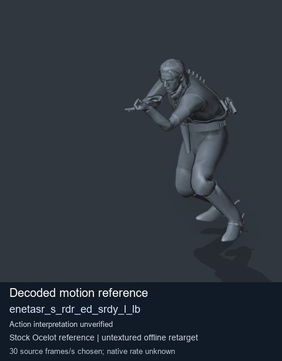
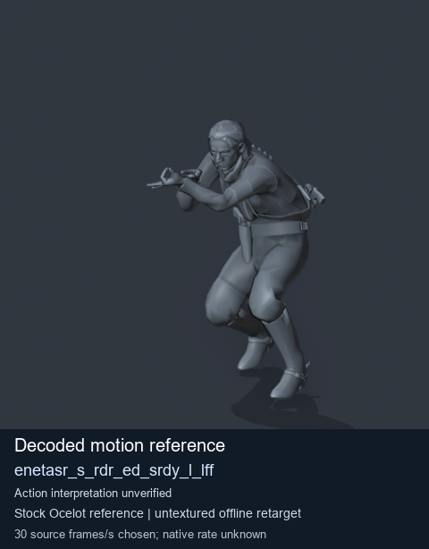
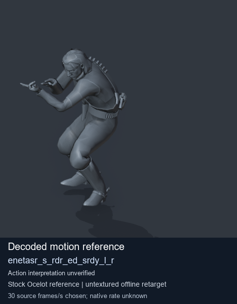
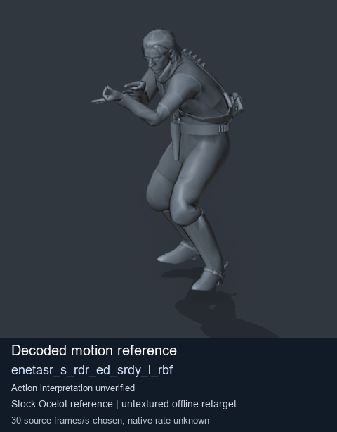

# Stock Soldier_common motion references / /Assets/tpp/motion/SI_game/fani/bodies/enet/enetasr - page 161

[Library](../README.md) · [Grouped directory](../browse/README.md) · [This source family](../browse/stock-soldier-enetasr-dd428991.md) · [Switch mode](browse-stock-soldier-enetasr-dd428991-161.md)

**Still images: no GIFs loaded** · 4 clips · 0.34 MiB downloaded.

Images reuse existing files. A small display width does not reduce download size. Open one clip for its larger titled GIF and original technical data.

Source-family grouping uses only recorded virtual directories; it does not establish an action, weapon, actor, rig or native compatibility. Existing descriptions and tags below are unchanged. Per-clip visual review may be pending; chosen preview speed is separate from unmeasured native timing.

| Preview | Animation | Category | Tags | Virtual GANI directory / file | MTAR / container location | Description | Frames / data |
| --- | --- | --- | --- | --- | --- | --- | --- |
|  | [Stock reference: enetasr_s_rdr_ed_srdy_l_lb](../clips/mgsv-tpp-soldier_common-payloadsha256-20f2bc400975e3128dc896c566f24bccadabbb540215a20dc09b90d71cd346a6.md) <code>enetasr_s_rdr_ed_srdy_l_lb</code> | Stock Soldier_common motion references | <code>stock animation reference</code> <code>Soldier_common</code> <code>source-derived label</code> <code>Ocelot reference mesh</code> | <code>/Assets/tpp/motion/SI_game/fani/bodies/enet/enetasr</code> <code>enetasr_s_rdr_ed_srdy_l_lb.gani</code> | Retained MTAR: <code>Soldier_common.mtar</code> DAT / FPK membership unverified | Decoded stock reference enetasr_s_rdr_ed_srdy_l_lb; action interpretation unverified. | 60 raw 2.0 s chosen; native rate unknown [Full data](../clips/mgsv-tpp-soldier_common-payloadsha256-20f2bc400975e3128dc896c566f24bccadabbb540215a20dc09b90d71cd346a6.md#technical-data) |
|  | [Stock reference: enetasr_s_rdr_ed_srdy_l_lff](../clips/mgsv-tpp-soldier_common-payloadsha256-31463bbd43618d5582613d1ec558208c6c4832c007efe1f3f53f1681078eaac9.md) <code>enetasr_s_rdr_ed_srdy_l_lff</code> | Stock Soldier_common motion references | <code>stock animation reference</code> <code>Soldier_common</code> <code>source-derived label</code> <code>Ocelot reference mesh</code> | <code>/Assets/tpp/motion/SI_game/fani/bodies/enet/enetasr</code> <code>enetasr_s_rdr_ed_srdy_l_lff.gani</code> | Retained MTAR: <code>Soldier_common.mtar</code> DAT / FPK membership unverified | Decoded stock reference enetasr_s_rdr_ed_srdy_l_lff; action interpretation unverified. | 56 raw 1.87 s chosen; native rate unknown [Full data](../clips/mgsv-tpp-soldier_common-payloadsha256-31463bbd43618d5582613d1ec558208c6c4832c007efe1f3f53f1681078eaac9.md#technical-data) |
|  | [Stock motion reference: enetasr_s_rdr_ed_srdy_l_r](../clips/mgsv-tpp-soldier_common-payloadsha256-0c58f27953ae5ef24bddacf71a0dc4c906066926652466bcb776c0e5135c1aa1.md) <code>enetasr_s_rdr_ed_srdy_l_r</code> | Stock Soldier_common motion references | <code>stock body motion</code> <code>Soldier_common</code> <code>source-derived label</code> <code>Ocelot reference mesh</code> | <code>/Assets/tpp/motion/SI_game/fani/bodies/enet/enetasr</code> <code>enetasr_s_rdr_ed_srdy_l_r.gani</code> | Retained MTAR: <code>Soldier_common.mtar</code> DAT / FPK membership unverified | Decoded stock body-motion reference enetasr_s_rdr_ed_srdy_l_r; action interpretation unverified. | 71 raw 2.37 s chosen; native rate unknown [Full data](../clips/mgsv-tpp-soldier_common-payloadsha256-0c58f27953ae5ef24bddacf71a0dc4c906066926652466bcb776c0e5135c1aa1.md#technical-data) |
|  | [Stock reference: enetasr_s_rdr_ed_srdy_l_rbf](../clips/mgsv-tpp-soldier_common-payloadsha256-2d7a0ec363109098cd4c2dd59900eb8b7a47cd19e3a09101967655e798abcf98.md) <code>enetasr_s_rdr_ed_srdy_l_rbf</code> | Stock Soldier_common motion references | <code>stock animation reference</code> <code>Soldier_common</code> <code>source-derived label</code> <code>Ocelot reference mesh</code> | <code>/Assets/tpp/motion/SI_game/fani/bodies/enet/enetasr</code> <code>enetasr_s_rdr_ed_srdy_l_rbf.gani</code> | Retained MTAR: <code>Soldier_common.mtar</code> DAT / FPK membership unverified | Decoded stock reference enetasr_s_rdr_ed_srdy_l_rbf; action interpretation unverified. | 42 raw 1.4 s chosen; native rate unknown [Full data](../clips/mgsv-tpp-soldier_common-payloadsha256-2d7a0ec363109098cd4c2dd59900eb8b7a47cd19e3a09101967655e798abcf98.md#technical-data) |

[Source descriptions, confidence and credits](../description-sources.md) · [Complete JSON](../catalogue.json) · [CSV](../catalogue.csv)
