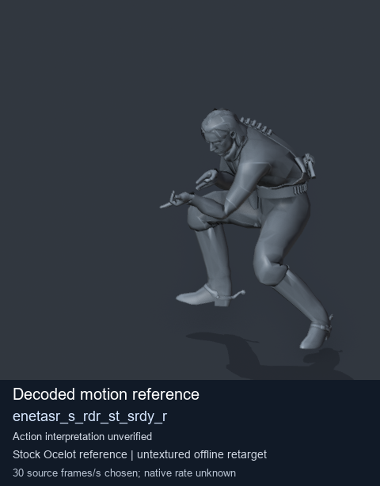
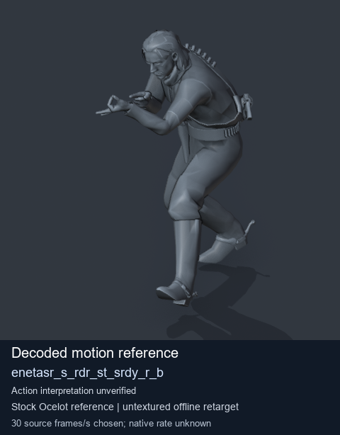
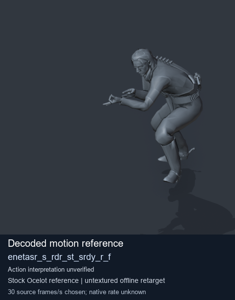
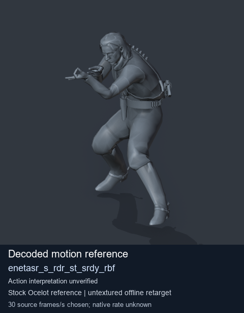

# Stock Soldier_common motion references / /Assets/tpp/motion/SI_game/fani/bodies/enet/enetasr - page 165

[Library](../README.md) · [Grouped directory](../browse/README.md) · [This source family](../browse/stock-soldier-enetasr-dd428991.md) · [Switch mode](browse-stock-soldier-enetasr-dd428991-165.md)

**Still images: no GIFs loaded** · 4 clips · 0.37 MiB downloaded.

Images reuse existing files. A small display width does not reduce download size. Open one clip for its larger titled GIF and original technical data.

Source-family grouping uses only recorded virtual directories; it does not establish an action, weapon, actor, rig or native compatibility. Existing descriptions and tags below are unchanged. Per-clip visual review may be pending; chosen preview speed is separate from unmeasured native timing.

| Preview | Animation | Category | Tags | Virtual GANI directory / file | MTAR / container location | Description | Frames / data |
| --- | --- | --- | --- | --- | --- | --- | --- |
|  | [Stock motion reference: enetasr_s_rdr_st_srdy_r](../clips/mgsv-tpp-soldier_common-payloadsha256-56e2181bc0a875547b1c887c5a6da5f859188d04b430ddb1727c15697786dd97.md) <code>enetasr_s_rdr_st_srdy_r</code> | Stock Soldier_common motion references | <code>stock body motion</code> <code>Soldier_common</code> <code>source-derived label</code> <code>Ocelot reference mesh</code> | <code>/Assets/tpp/motion/SI_game/fani/bodies/enet/enetasr</code> <code>enetasr_s_rdr_st_srdy_r.gani</code> | Retained MTAR: <code>Soldier_common.mtar</code> DAT / FPK membership unverified | Decoded stock body-motion reference enetasr_s_rdr_st_srdy_r; action interpretation unverified. | 55 raw 1.83 s chosen; native rate unknown [Full data](../clips/mgsv-tpp-soldier_common-payloadsha256-56e2181bc0a875547b1c887c5a6da5f859188d04b430ddb1727c15697786dd97.md#technical-data) |
|  | [Stock reference: enetasr_s_rdr_st_srdy_r_b](../clips/mgsv-tpp-soldier_common-payloadsha256-09ed9104f3538d60c87622a378bbf707929b7f5f68c8742deb32b796414664bb.md) <code>enetasr_s_rdr_st_srdy_r_b</code> | Stock Soldier_common motion references | <code>stock animation reference</code> <code>Soldier_common</code> <code>source-derived label</code> <code>Ocelot reference mesh</code> | <code>/Assets/tpp/motion/SI_game/fani/bodies/enet/enetasr</code> <code>enetasr_s_rdr_st_srdy_r_b.gani</code> | Retained MTAR: <code>Soldier_common.mtar</code> DAT / FPK membership unverified | Decoded stock reference enetasr_s_rdr_st_srdy_r_b; action interpretation unverified. | 45 raw 1.5 s chosen; native rate unknown [Full data](../clips/mgsv-tpp-soldier_common-payloadsha256-09ed9104f3538d60c87622a378bbf707929b7f5f68c8742deb32b796414664bb.md#technical-data) |
|  | [Stock motion reference: enetasr_s_rdr_st_srdy_r_f](../clips/mgsv-tpp-soldier_common-payloadsha256-b628a3c840133a41e21ac63f2d360954e177ef2dc6001336b691c9729285b4ad.md) <code>enetasr_s_rdr_st_srdy_r_f</code> | Stock Soldier_common motion references | <code>stock body motion</code> <code>Soldier_common</code> <code>source-derived label</code> <code>Ocelot reference mesh</code> | <code>/Assets/tpp/motion/SI_game/fani/bodies/enet/enetasr</code> <code>enetasr_s_rdr_st_srdy_r_f.gani</code> | Retained MTAR: <code>Soldier_common.mtar</code> DAT / FPK membership unverified | Decoded stock body-motion reference enetasr_s_rdr_st_srdy_r_f; action interpretation unverified. | 66 raw 2.2 s chosen; native rate unknown [Full data](../clips/mgsv-tpp-soldier_common-payloadsha256-b628a3c840133a41e21ac63f2d360954e177ef2dc6001336b691c9729285b4ad.md#technical-data) |
|  | [Stock motion reference: enetasr_s_rdr_st_srdy_rbf](../clips/mgsv-tpp-soldier_common-payloadsha256-bb33fdd063a023ff03b8269646ec4686ee3c6c3a0a8f65de583d970bccdb06ab.md) <code>enetasr_s_rdr_st_srdy_rbf</code> | Stock Soldier_common motion references | <code>stock body motion</code> <code>Soldier_common</code> <code>source-derived label</code> <code>Ocelot reference mesh</code> | <code>/Assets/tpp/motion/SI_game/fani/bodies/enet/enetasr</code> <code>enetasr_s_rdr_st_srdy_rbf.gani</code> | Retained MTAR: <code>Soldier_common.mtar</code> DAT / FPK membership unverified | Decoded stock body-motion reference enetasr_s_rdr_st_srdy_rbf; action interpretation unverified. | 43 raw 1.43 s chosen; native rate unknown [Full data](../clips/mgsv-tpp-soldier_common-payloadsha256-bb33fdd063a023ff03b8269646ec4686ee3c6c3a0a8f65de583d970bccdb06ab.md#technical-data) |

[Source descriptions, confidence and credits](../description-sources.md) · [Complete JSON](../catalogue.json) · [CSV](../catalogue.csv)
