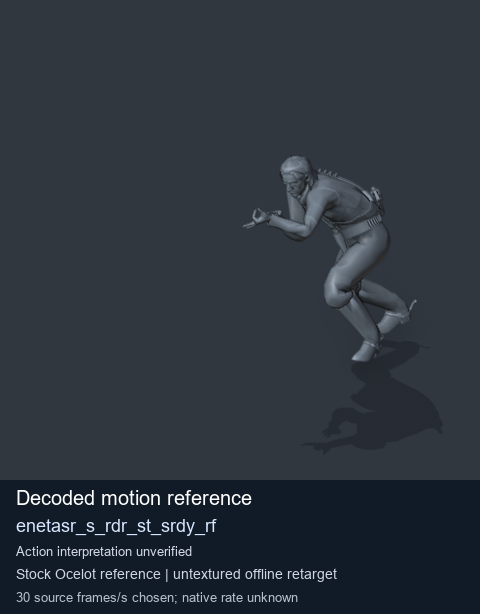
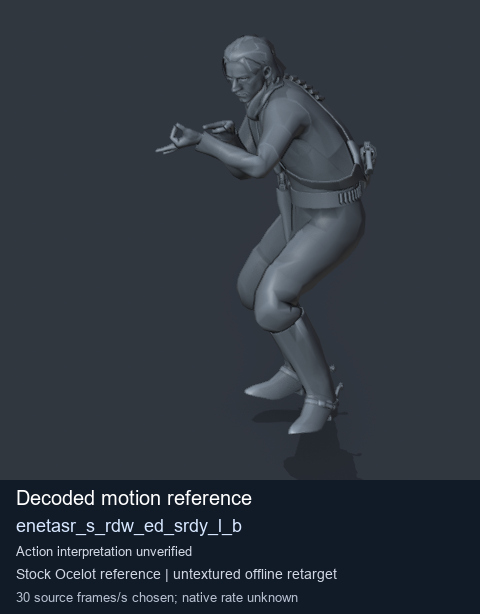
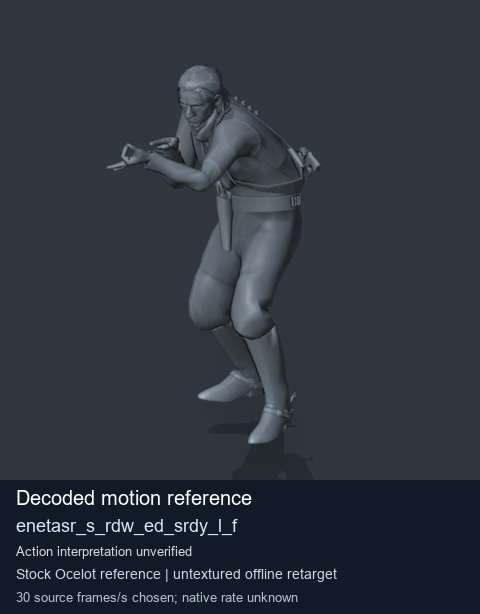
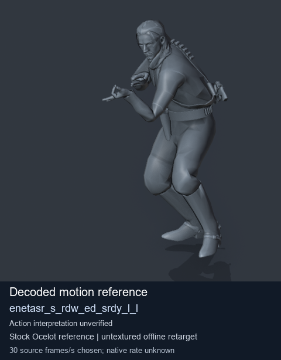

# Stock Soldier_common motion references / /Assets/tpp/motion/SI_game/fani/bodies/enet/enetasr - page 166

[Library](../README.md) · [Grouped directory](../browse/README.md) · [This source family](../browse/stock-soldier-enetasr-dd428991.md) · [Switch mode](browse-stock-soldier-enetasr-dd428991-166.md)

**Still images: no GIFs loaded** · 4 clips · 0.35 MiB downloaded.

Images reuse existing files. A small display width does not reduce download size. Open one clip for its larger titled GIF and original technical data.

Source-family grouping uses only recorded virtual directories; it does not establish an action, weapon, actor, rig or native compatibility. Existing descriptions and tags below are unchanged. Per-clip visual review may be pending; chosen preview speed is separate from unmeasured native timing.

| Preview | Animation | Category | Tags | Virtual GANI directory / file | MTAR / container location | Description | Frames / data |
| --- | --- | --- | --- | --- | --- | --- | --- |
|  | [Stock reference: enetasr_s_rdr_st_srdy_rf](../clips/mgsv-tpp-soldier_common-payloadsha256-d0a1153872daf036086cf46f5ef6c7ffdb7d70ee4f73554ae2de62e8892de804.md) <code>enetasr_s_rdr_st_srdy_rf</code> | Stock Soldier_common motion references | <code>stock animation reference</code> <code>Soldier_common</code> <code>source-derived label</code> <code>Ocelot reference mesh</code> | <code>/Assets/tpp/motion/SI_game/fani/bodies/enet/enetasr</code> <code>enetasr_s_rdr_st_srdy_rf.gani</code> | Retained MTAR: <code>Soldier_common.mtar</code> DAT / FPK membership unverified | Decoded stock reference enetasr_s_rdr_st_srdy_rf; action interpretation unverified. | 61 raw 2.03 s chosen; native rate unknown [Full data](../clips/mgsv-tpp-soldier_common-payloadsha256-d0a1153872daf036086cf46f5ef6c7ffdb7d70ee4f73554ae2de62e8892de804.md#technical-data) |
|  | [Stock motion reference: enetasr_s_rdw_ed_srdy_l_b](../clips/mgsv-tpp-soldier_common-payloadsha256-07cf13197ee0d48fa9354fbcd30f5a13139afc3fb81f0c39a65097b232df0f99.md) <code>enetasr_s_rdw_ed_srdy_l_b</code> | Stock Soldier_common motion references | <code>stock body motion</code> <code>Soldier_common</code> <code>source-derived label</code> <code>Ocelot reference mesh</code> | <code>/Assets/tpp/motion/SI_game/fani/bodies/enet/enetasr</code> <code>enetasr_s_rdw_ed_srdy_l_b.gani</code> | Retained MTAR: <code>Soldier_common.mtar</code> DAT / FPK membership unverified | Decoded stock body-motion reference enetasr_s_rdw_ed_srdy_l_b; action interpretation unverified. | 65 raw 2.17 s chosen; native rate unknown [Full data](../clips/mgsv-tpp-soldier_common-payloadsha256-07cf13197ee0d48fa9354fbcd30f5a13139afc3fb81f0c39a65097b232df0f99.md#technical-data) |
|  | [Stock reference: enetasr_s_rdw_ed_srdy_l_f](../clips/mgsv-tpp-soldier_common-payloadsha256-29de28e15b0b113adca1d97eedb585941be5128a618092c8c28172097e8494cc.md) <code>enetasr_s_rdw_ed_srdy_l_f</code> | Stock Soldier_common motion references | <code>stock animation reference</code> <code>Soldier_common</code> <code>source-derived label</code> <code>Ocelot reference mesh</code> | <code>/Assets/tpp/motion/SI_game/fani/bodies/enet/enetasr</code> <code>enetasr_s_rdw_ed_srdy_l_f.gani</code> | Retained MTAR: <code>Soldier_common.mtar</code> DAT / FPK membership unverified | Decoded stock reference enetasr_s_rdw_ed_srdy_l_f; action interpretation unverified. | 45 raw 1.5 s chosen; native rate unknown [Full data](../clips/mgsv-tpp-soldier_common-payloadsha256-29de28e15b0b113adca1d97eedb585941be5128a618092c8c28172097e8494cc.md#technical-data) |
|  | [Stock reference: enetasr_s_rdw_ed_srdy_l_l](../clips/mgsv-tpp-soldier_common-payloadsha256-8623fa1ee29d90445827867b80adadc27e8fa7349de886438493efb20d43b33d.md) <code>enetasr_s_rdw_ed_srdy_l_l</code> | Stock Soldier_common motion references | <code>stock animation reference</code> <code>Soldier_common</code> <code>source-derived label</code> <code>Ocelot reference mesh</code> | <code>/Assets/tpp/motion/SI_game/fani/bodies/enet/enetasr</code> <code>enetasr_s_rdw_ed_srdy_l_l.gani</code> | Retained MTAR: <code>Soldier_common.mtar</code> DAT / FPK membership unverified | Decoded stock reference enetasr_s_rdw_ed_srdy_l_l; action interpretation unverified. | 81 raw 2.7 s chosen; native rate unknown [Full data](../clips/mgsv-tpp-soldier_common-payloadsha256-8623fa1ee29d90445827867b80adadc27e8fa7349de886438493efb20d43b33d.md#technical-data) |

[Source descriptions, confidence and credits](../description-sources.md) · [Complete JSON](../catalogue.json) · [CSV](../catalogue.csv)
