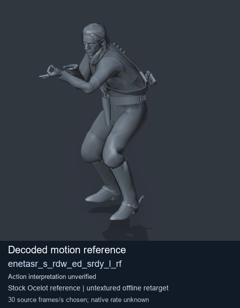
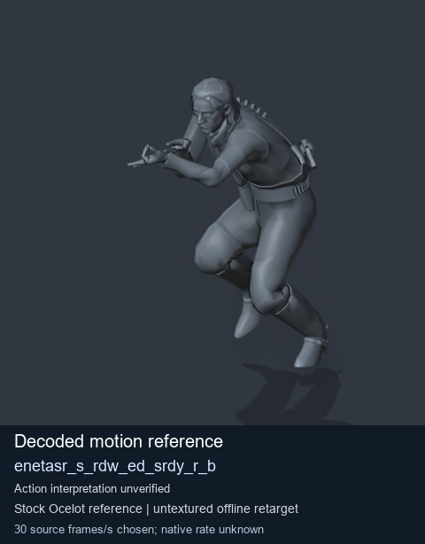
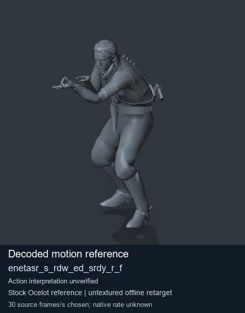
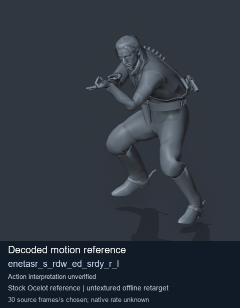

# Stock Soldier_common motion references / /Assets/tpp/motion/SI_game/fani/bodies/enet/enetasr - page 168

[Library](../README.md) · [Grouped directory](../browse/README.md) · [This source family](../browse/stock-soldier-enetasr-dd428991.md) · [Switch mode](browse-stock-soldier-enetasr-dd428991-168.md)

**Still images: no GIFs loaded** · 4 clips · 0.38 MiB downloaded.

Images reuse existing files. A small display width does not reduce download size. Open one clip for its larger titled GIF and original technical data.

Source-family grouping uses only recorded virtual directories; it does not establish an action, weapon, actor, rig or native compatibility. Existing descriptions and tags below are unchanged. Per-clip visual review may be pending; chosen preview speed is separate from unmeasured native timing.

| Preview | Animation | Category | Tags | Virtual GANI directory / file | MTAR / container location | Description | Frames / data |
| --- | --- | --- | --- | --- | --- | --- | --- |
|  | [Stock reference: enetasr_s_rdw_ed_srdy_l_rf](../clips/mgsv-tpp-soldier_common-payloadsha256-8da75ee217abfa5f77bce2166af8321a7aa779ac5bbe7e64621a737fcc750a5f.md) <code>enetasr_s_rdw_ed_srdy_l_rf</code> | Stock Soldier_common motion references | <code>stock animation reference</code> <code>Soldier_common</code> <code>source-derived label</code> <code>Ocelot reference mesh</code> | <code>/Assets/tpp/motion/SI_game/fani/bodies/enet/enetasr</code> <code>enetasr_s_rdw_ed_srdy_l_rf.gani</code> | Retained MTAR: <code>Soldier_common.mtar</code> DAT / FPK membership unverified | Decoded stock reference enetasr_s_rdw_ed_srdy_l_rf; action interpretation unverified. | 58 raw 1.93 s chosen; native rate unknown [Full data](../clips/mgsv-tpp-soldier_common-payloadsha256-8da75ee217abfa5f77bce2166af8321a7aa779ac5bbe7e64621a737fcc750a5f.md#technical-data) |
|  | [Stock motion reference: enetasr_s_rdw_ed_srdy_r_b](../clips/mgsv-tpp-soldier_common-payloadsha256-465469cc5bee3246d447ac044a2dd139760937ff237dce2720bf6ade2b8acd89.md) <code>enetasr_s_rdw_ed_srdy_r_b</code> | Stock Soldier_common motion references | <code>stock body motion</code> <code>Soldier_common</code> <code>source-derived label</code> <code>Ocelot reference mesh</code> | <code>/Assets/tpp/motion/SI_game/fani/bodies/enet/enetasr</code> <code>enetasr_s_rdw_ed_srdy_r_b.gani</code> | Retained MTAR: <code>Soldier_common.mtar</code> DAT / FPK membership unverified | Decoded stock body-motion reference enetasr_s_rdw_ed_srdy_r_b; action interpretation unverified. | 75 raw 2.5 s chosen; native rate unknown [Full data](../clips/mgsv-tpp-soldier_common-payloadsha256-465469cc5bee3246d447ac044a2dd139760937ff237dce2720bf6ade2b8acd89.md#technical-data) |
|  | [Stock motion reference: enetasr_s_rdw_ed_srdy_r_f](../clips/mgsv-tpp-soldier_common-payloadsha256-285baf477f4c14e66365e18e06cbd56d43d310e7737955cc4d1483fb29485969.md) <code>enetasr_s_rdw_ed_srdy_r_f</code> | Stock Soldier_common motion references | <code>stock body motion</code> <code>Soldier_common</code> <code>source-derived label</code> <code>Ocelot reference mesh</code> | <code>/Assets/tpp/motion/SI_game/fani/bodies/enet/enetasr</code> <code>enetasr_s_rdw_ed_srdy_r_f.gani</code> | Retained MTAR: <code>Soldier_common.mtar</code> DAT / FPK membership unverified | Decoded stock body-motion reference enetasr_s_rdw_ed_srdy_r_f; action interpretation unverified. | 47 raw 1.57 s chosen; native rate unknown [Full data](../clips/mgsv-tpp-soldier_common-payloadsha256-285baf477f4c14e66365e18e06cbd56d43d310e7737955cc4d1483fb29485969.md#technical-data) |
|  | [Stock reference: enetasr_s_rdw_ed_srdy_r_l](../clips/mgsv-tpp-soldier_common-payloadsha256-7389226d2de191a92be33d76ef2e59e31a4773605ab2ce08adc4004167ce265b.md) <code>enetasr_s_rdw_ed_srdy_r_l</code> | Stock Soldier_common motion references | <code>stock animation reference</code> <code>Soldier_common</code> <code>source-derived label</code> <code>Ocelot reference mesh</code> | <code>/Assets/tpp/motion/SI_game/fani/bodies/enet/enetasr</code> <code>enetasr_s_rdw_ed_srdy_r_l.gani</code> | Retained MTAR: <code>Soldier_common.mtar</code> DAT / FPK membership unverified | Decoded stock reference enetasr_s_rdw_ed_srdy_r_l; action interpretation unverified. | 79 raw 2.63 s chosen; native rate unknown [Full data](../clips/mgsv-tpp-soldier_common-payloadsha256-7389226d2de191a92be33d76ef2e59e31a4773605ab2ce08adc4004167ce265b.md#technical-data) |

[Source descriptions, confidence and credits](../description-sources.md) · [Complete JSON](../catalogue.json) · [CSV](../catalogue.csv)
