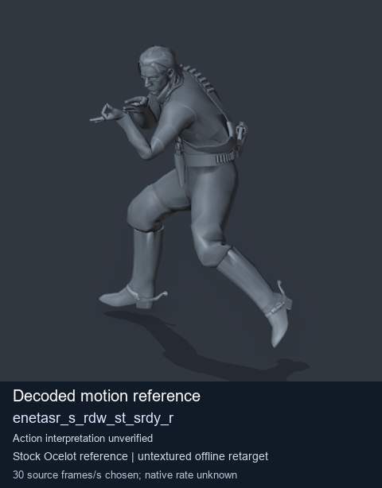
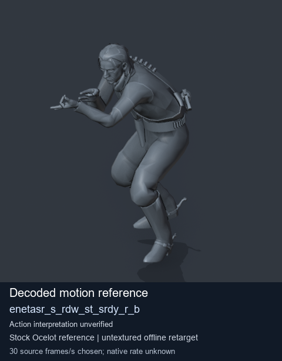
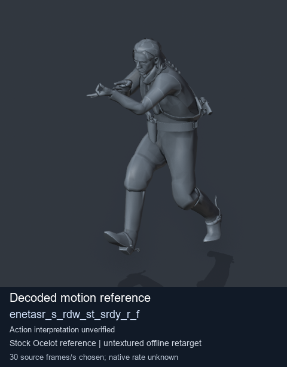
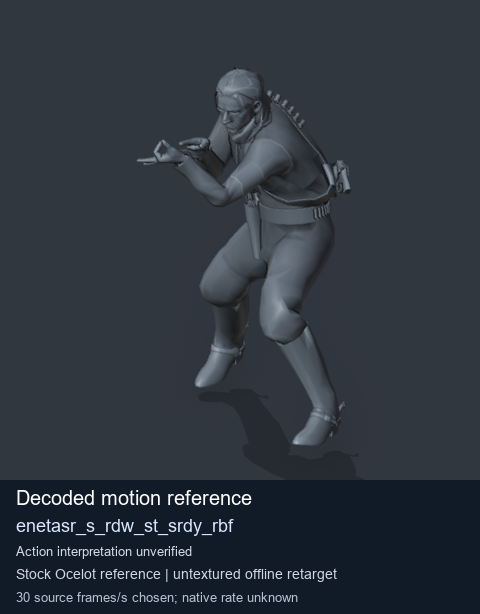

# Stock Soldier_common motion references / /Assets/tpp/motion/SI_game/fani/bodies/enet/enetasr - page 172

[Library](../README.md) · [Grouped directory](../browse/README.md) · [This source family](../browse/stock-soldier-enetasr-dd428991.md) · [Switch mode](browse-stock-soldier-enetasr-dd428991-172.md)

**Still images: no GIFs loaded** · 4 clips · 0.39 MiB downloaded.

Images reuse existing files. A small display width does not reduce download size. Open one clip for its larger titled GIF and original technical data.

Source-family grouping uses only recorded virtual directories; it does not establish an action, weapon, actor, rig or native compatibility. Existing descriptions and tags below are unchanged. Per-clip visual review may be pending; chosen preview speed is separate from unmeasured native timing.

| Preview | Animation | Category | Tags | Virtual GANI directory / file | MTAR / container location | Description | Frames / data |
| --- | --- | --- | --- | --- | --- | --- | --- |
|  | [Stock motion reference: enetasr_s_rdw_st_srdy_r](../clips/mgsv-tpp-soldier_common-payloadsha256-4f5413c043fbcf7d5fcf8afc5213e37d3e9b710a0bb739b9bfca23ea1f53ae50.md) <code>enetasr_s_rdw_st_srdy_r</code> | Stock Soldier_common motion references | <code>stock body motion</code> <code>Soldier_common</code> <code>source-derived label</code> <code>Ocelot reference mesh</code> | <code>/Assets/tpp/motion/SI_game/fani/bodies/enet/enetasr</code> <code>enetasr_s_rdw_st_srdy_r.gani</code> | Retained MTAR: <code>Soldier_common.mtar</code> DAT / FPK membership unverified | Decoded stock body-motion reference enetasr_s_rdw_st_srdy_r; action interpretation unverified. | 49 raw 1.63 s chosen; native rate unknown [Full data](../clips/mgsv-tpp-soldier_common-payloadsha256-4f5413c043fbcf7d5fcf8afc5213e37d3e9b710a0bb739b9bfca23ea1f53ae50.md#technical-data) |
|  | [Stock reference: enetasr_s_rdw_st_srdy_r_b](../clips/mgsv-tpp-soldier_common-payloadsha256-1e386b8486fae34635f74c8a77da7cb59597a5df7111951fce763a428b8300ec.md) <code>enetasr_s_rdw_st_srdy_r_b</code> | Stock Soldier_common motion references | <code>stock animation reference</code> <code>Soldier_common</code> <code>source-derived label</code> <code>Ocelot reference mesh</code> | <code>/Assets/tpp/motion/SI_game/fani/bodies/enet/enetasr</code> <code>enetasr_s_rdw_st_srdy_r_b.gani</code> | Retained MTAR: <code>Soldier_common.mtar</code> DAT / FPK membership unverified | Decoded stock reference enetasr_s_rdw_st_srdy_r_b; action interpretation unverified. | 85 raw 2.83 s chosen; native rate unknown [Full data](../clips/mgsv-tpp-soldier_common-payloadsha256-1e386b8486fae34635f74c8a77da7cb59597a5df7111951fce763a428b8300ec.md#technical-data) |
|  | [Stock reference: enetasr_s_rdw_st_srdy_r_f](../clips/mgsv-tpp-soldier_common-payloadsha256-275cf9507d0ebf9c1e1e500a83a5ca435c2ab27967776a09404ad7828d523d13.md) <code>enetasr_s_rdw_st_srdy_r_f</code> | Stock Soldier_common motion references | <code>stock animation reference</code> <code>Soldier_common</code> <code>source-derived label</code> <code>Ocelot reference mesh</code> | <code>/Assets/tpp/motion/SI_game/fani/bodies/enet/enetasr</code> <code>enetasr_s_rdw_st_srdy_r_f.gani</code> | Retained MTAR: <code>Soldier_common.mtar</code> DAT / FPK membership unverified | Decoded stock reference enetasr_s_rdw_st_srdy_r_f; action interpretation unverified. | 49 raw 1.63 s chosen; native rate unknown [Full data](../clips/mgsv-tpp-soldier_common-payloadsha256-275cf9507d0ebf9c1e1e500a83a5ca435c2ab27967776a09404ad7828d523d13.md#technical-data) |
|  | [Stock motion reference: enetasr_s_rdw_st_srdy_rbf](../clips/mgsv-tpp-soldier_common-payloadsha256-c4172e3c2548ba0ed6970178f5261d4d058bcf0390fa06d398f69ea4ec66edfb.md) <code>enetasr_s_rdw_st_srdy_rbf</code> | Stock Soldier_common motion references | <code>stock body motion</code> <code>Soldier_common</code> <code>source-derived label</code> <code>Ocelot reference mesh</code> | <code>/Assets/tpp/motion/SI_game/fani/bodies/enet/enetasr</code> <code>enetasr_s_rdw_st_srdy_rbf.gani</code> | Retained MTAR: <code>Soldier_common.mtar</code> DAT / FPK membership unverified | Decoded stock body-motion reference enetasr_s_rdw_st_srdy_rbf; action interpretation unverified. | 57 raw 1.9 s chosen; native rate unknown [Full data](../clips/mgsv-tpp-soldier_common-payloadsha256-c4172e3c2548ba0ed6970178f5261d4d058bcf0390fa06d398f69ea4ec66edfb.md#technical-data) |

[Source descriptions, confidence and credits](../description-sources.md) · [Complete JSON](../catalogue.json) · [CSV](../catalogue.csv)
