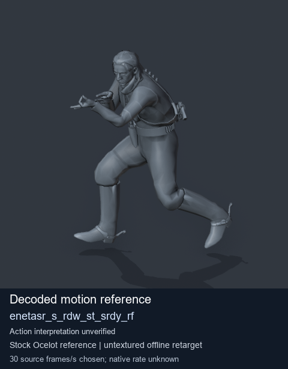
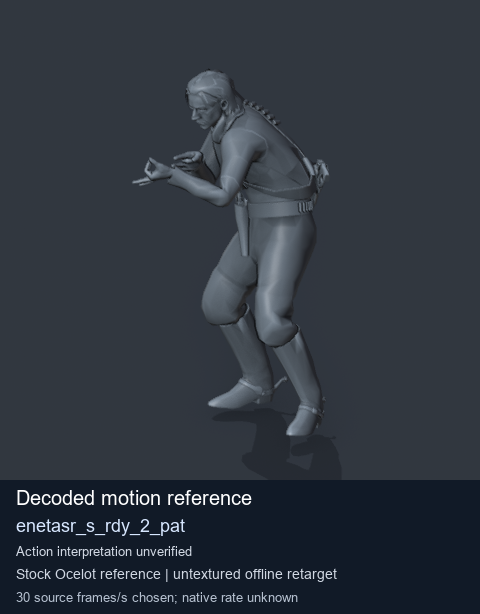
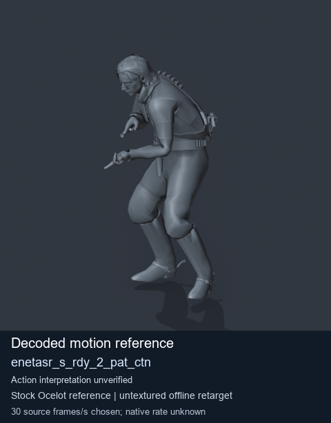
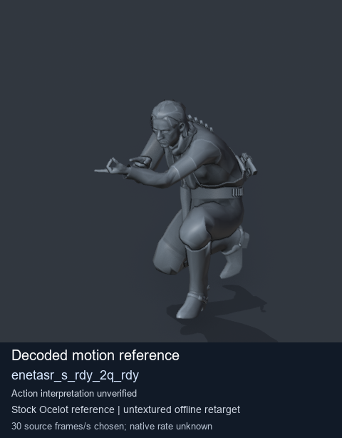

# Stock Soldier_common motion references / /Assets/tpp/motion/SI_game/fani/bodies/enet/enetasr - page 173

[Library](../README.md) · [Grouped directory](../browse/README.md) · [This source family](../browse/stock-soldier-enetasr-dd428991.md) · [Switch mode](browse-stock-soldier-enetasr-dd428991-173.md)

**Still images: no GIFs loaded** · 4 clips · 0.37 MiB downloaded.

Images reuse existing files. A small display width does not reduce download size. Open one clip for its larger titled GIF and original technical data.

Source-family grouping uses only recorded virtual directories; it does not establish an action, weapon, actor, rig or native compatibility. Existing descriptions and tags below are unchanged. Per-clip visual review may be pending; chosen preview speed is separate from unmeasured native timing.

| Preview | Animation | Category | Tags | Virtual GANI directory / file | MTAR / container location | Description | Frames / data |
| --- | --- | --- | --- | --- | --- | --- | --- |
|  | [Stock motion reference: enetasr_s_rdw_st_srdy_rf](../clips/mgsv-tpp-soldier_common-payloadsha256-6850ac98a9fd0c260f5af42bb1df300eeeca2b8c10835264d486e2aa3325a6aa.md) <code>enetasr_s_rdw_st_srdy_rf</code> | Stock Soldier_common motion references | <code>stock body motion</code> <code>Soldier_common</code> <code>source-derived label</code> <code>Ocelot reference mesh</code> | <code>/Assets/tpp/motion/SI_game/fani/bodies/enet/enetasr</code> <code>enetasr_s_rdw_st_srdy_rf.gani</code> | Retained MTAR: <code>Soldier_common.mtar</code> DAT / FPK membership unverified | Decoded stock body-motion reference enetasr_s_rdw_st_srdy_rf; action interpretation unverified. | 49 raw 1.63 s chosen; native rate unknown [Full data](../clips/mgsv-tpp-soldier_common-payloadsha256-6850ac98a9fd0c260f5af42bb1df300eeeca2b8c10835264d486e2aa3325a6aa.md#technical-data) |
|  | [Stock motion reference: enetasr_s_rdy_2_pat](../clips/mgsv-tpp-soldier_common-payloadsha256-a0f2362559c0be8664c7a86284d5d548a9b5b06fe3b439c3c3310628e152ee48.md) <code>enetasr_s_rdy_2_pat</code> | Stock Soldier_common motion references | <code>stock body motion</code> <code>Soldier_common</code> <code>source-derived label</code> <code>Ocelot reference mesh</code> | <code>/Assets/tpp/motion/SI_game/fani/bodies/enet/enetasr</code> <code>enetasr_s_rdy_2_pat.gani</code> | Retained MTAR: <code>Soldier_common.mtar</code> DAT / FPK membership unverified | Decoded stock body-motion reference enetasr_s_rdy_2_pat; action interpretation unverified. | 140 raw 4.67 s chosen; native rate unknown [Full data](../clips/mgsv-tpp-soldier_common-payloadsha256-a0f2362559c0be8664c7a86284d5d548a9b5b06fe3b439c3c3310628e152ee48.md#technical-data) |
|  | [Stock motion reference: enetasr_s_rdy_2_pat_ctn](../clips/mgsv-tpp-soldier_common-payloadsha256-386e3fa576c3586d511df159db0b03e1579c459a7eab6593d7f34d9d916382a5.md) <code>enetasr_s_rdy_2_pat_ctn</code> | Stock Soldier_common motion references | <code>stock body motion</code> <code>Soldier_common</code> <code>source-derived label</code> <code>Ocelot reference mesh</code> | <code>/Assets/tpp/motion/SI_game/fani/bodies/enet/enetasr</code> <code>enetasr_s_rdy_2_pat_ctn.gani</code> | Retained MTAR: <code>Soldier_common.mtar</code> DAT / FPK membership unverified | Decoded stock body-motion reference enetasr_s_rdy_2_pat_ctn; action interpretation unverified. | 140 raw 4.67 s chosen; native rate unknown [Full data](../clips/mgsv-tpp-soldier_common-payloadsha256-386e3fa576c3586d511df159db0b03e1579c459a7eab6593d7f34d9d916382a5.md#technical-data) |
|  | [Stock motion reference: enetasr_s_rdy_2q_rdy](../clips/mgsv-tpp-soldier_common-payloadsha256-5dd30159647c4921475e7c3593f0b9da55cc4450459abb2d6ffc8159082cbab7.md) <code>enetasr_s_rdy_2q_rdy</code> | Stock Soldier_common motion references | <code>stock body motion</code> <code>Soldier_common</code> <code>source-derived label</code> <code>Ocelot reference mesh</code> | <code>/Assets/tpp/motion/SI_game/fani/bodies/enet/enetasr</code> <code>enetasr_s_rdy_2q_rdy.gani</code> | Retained MTAR: <code>Soldier_common.mtar</code> DAT / FPK membership unverified | Decoded stock body-motion reference enetasr_s_rdy_2q_rdy; action interpretation unverified. | 54 raw 1.8 s chosen; native rate unknown [Full data](../clips/mgsv-tpp-soldier_common-payloadsha256-5dd30159647c4921475e7c3593f0b9da55cc4450459abb2d6ffc8159082cbab7.md#technical-data) |

[Source descriptions, confidence and credits](../description-sources.md) · [Complete JSON](../catalogue.json) · [CSV](../catalogue.csv)
