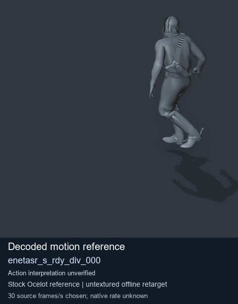
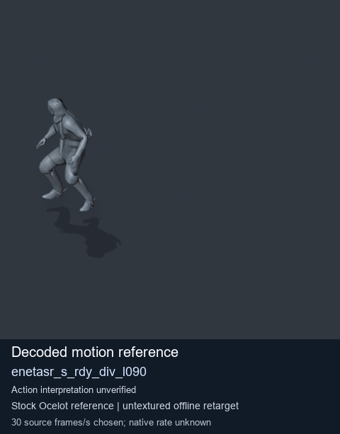
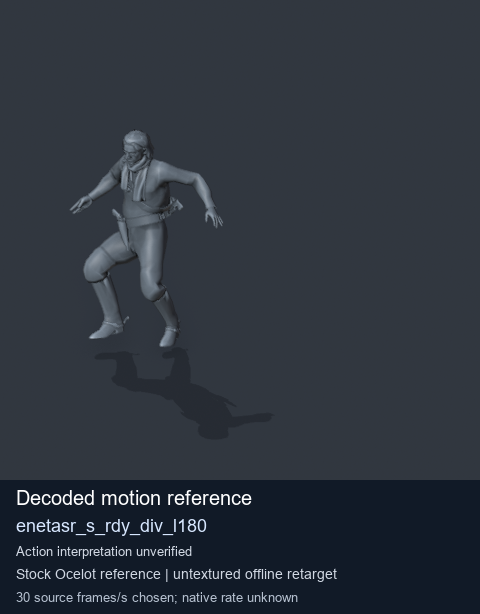

# Stock Soldier_common motion references / /Assets/tpp/motion/SI_game/fani/bodies/enet/enetasr - page 174

[Library](../README.md) · [Grouped directory](../browse/README.md) · [This source family](../browse/stock-soldier-enetasr-dd428991.md) · [Switch mode](browse-stock-soldier-enetasr-dd428991-174.md)

**Still images: no GIFs loaded** · 3 clips · 0.21 MiB downloaded.

Images reuse existing files. A small display width does not reduce download size. Open one clip for its larger titled GIF and original technical data.

Source-family grouping uses only recorded virtual directories; it does not establish an action, weapon, actor, rig or native compatibility. Existing descriptions and tags below are unchanged. Per-clip visual review may be pending; chosen preview speed is separate from unmeasured native timing.

| Preview | Animation | Category | Tags | Virtual GANI directory / file | MTAR / container location | Description | Frames / data |
| --- | --- | --- | --- | --- | --- | --- | --- |
|  | [Stock motion reference: enetasr_s_rdy_div_000](../clips/mgsv-tpp-soldier_common-payloadsha256-f4b9a2cc64adef1ab8ba42b74be5eab55699b0ede5d070a2754dc6e764d0f66a.md) <code>enetasr_s_rdy_div_000</code> | Stock Soldier_common motion references | <code>stock body motion</code> <code>Soldier_common</code> <code>source-derived label</code> <code>Ocelot reference mesh</code> | <code>/Assets/tpp/motion/SI_game/fani/bodies/enet/enetasr</code> <code>enetasr_s_rdy_div_000.gani</code> | Retained MTAR: <code>Soldier_common.mtar</code> DAT / FPK membership unverified | Decoded stock body-motion reference enetasr_s_rdy_div_000; action interpretation unverified. | 172 raw 5.73 s chosen; native rate unknown [Full data](../clips/mgsv-tpp-soldier_common-payloadsha256-f4b9a2cc64adef1ab8ba42b74be5eab55699b0ede5d070a2754dc6e764d0f66a.md#technical-data) |
|  | [Stock motion reference: enetasr_s_rdy_div_l090](../clips/mgsv-tpp-soldier_common-payloadsha256-754a3e3f219e3e6e3a225a556acb568875dc84ba87b30c5647ce708e1185f6b9.md) <code>enetasr_s_rdy_div_l090</code> | Stock Soldier_common motion references | <code>stock body motion</code> <code>Soldier_common</code> <code>source-derived label</code> <code>Ocelot reference mesh</code> | <code>/Assets/tpp/motion/SI_game/fani/bodies/enet/enetasr</code> <code>enetasr_s_rdy_div_l090.gani</code> | Retained MTAR: <code>Soldier_common.mtar</code> DAT / FPK membership unverified | Decoded stock body-motion reference enetasr_s_rdy_div_l090; action interpretation unverified. | 149 raw 4.97 s chosen; native rate unknown [Full data](../clips/mgsv-tpp-soldier_common-payloadsha256-754a3e3f219e3e6e3a225a556acb568875dc84ba87b30c5647ce708e1185f6b9.md#technical-data) |
|  | [Stock motion reference: enetasr_s_rdy_div_l180](../clips/mgsv-tpp-soldier_common-payloadsha256-76c08b9d0daf6bfe29b6af302254963b42224b2724e423b9bac26492df81cd52.md) <code>enetasr_s_rdy_div_l180</code> | Stock Soldier_common motion references | <code>stock body motion</code> <code>Soldier_common</code> <code>source-derived label</code> <code>Ocelot reference mesh</code> | <code>/Assets/tpp/motion/SI_game/fani/bodies/enet/enetasr</code> <code>enetasr_s_rdy_div_l180.gani</code> | Retained MTAR: <code>Soldier_common.mtar</code> DAT / FPK membership unverified | Decoded stock body-motion reference enetasr_s_rdy_div_l180; action interpretation unverified. | 177 raw 5.9 s chosen; native rate unknown [Full data](../clips/mgsv-tpp-soldier_common-payloadsha256-76c08b9d0daf6bfe29b6af302254963b42224b2724e423b9bac26492df81cd52.md#technical-data) |

[Source descriptions, confidence and credits](../description-sources.md) · [Complete JSON](../catalogue.json) · [CSV](../catalogue.csv)
