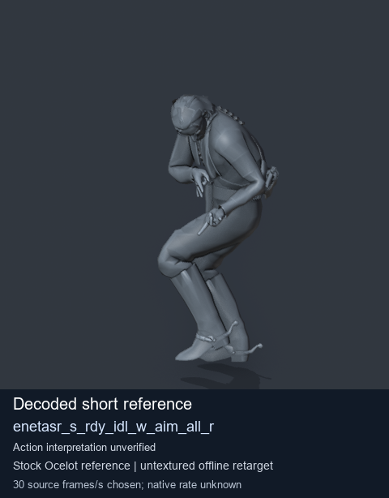
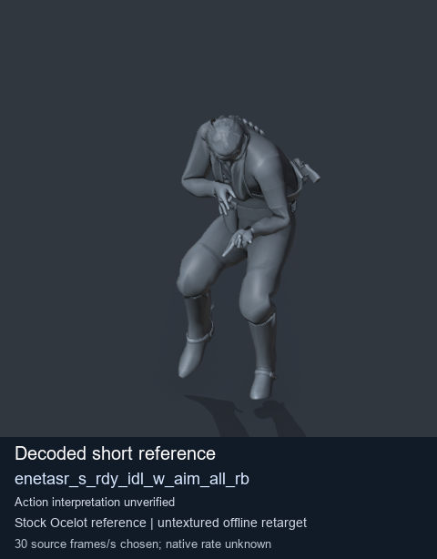
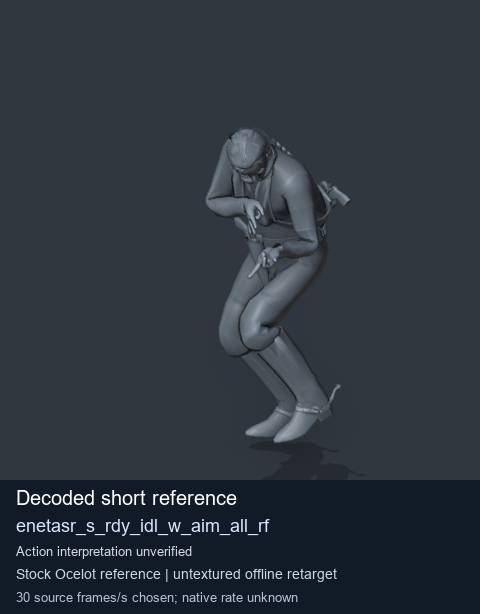
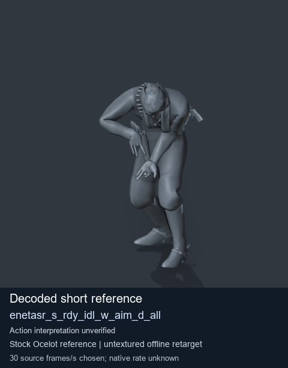

# Stock Soldier_common motion references / /Assets/tpp/motion/SI_game/fani/bodies/enet/enetasr - page 178

[Library](../README.md) · [Grouped directory](../browse/README.md) · [This source family](../browse/stock-soldier-enetasr-dd428991.md) · [Switch mode](browse-stock-soldier-enetasr-dd428991-178.md)

**Still images: no GIFs loaded** · 4 clips · 0.33 MiB downloaded.

Images reuse existing files. A small display width does not reduce download size. Open one clip for its larger titled GIF and original technical data.

Source-family grouping uses only recorded virtual directories; it does not establish an action, weapon, actor, rig or native compatibility. Existing descriptions and tags below are unchanged. Per-clip visual review may be pending; chosen preview speed is separate from unmeasured native timing.

| Preview | Animation | Category | Tags | Virtual GANI directory / file | MTAR / container location | Description | Frames / data |
| --- | --- | --- | --- | --- | --- | --- | --- |
|  | [Stock reference: enetasr_s_rdy_idl_w_aim_all_r](../clips/mgsv-tpp-soldier_common-payloadsha256-5e8882e8f859f6424baf6255e90a6820b25b343d9f409819fe17acd87da07935.md) <code>enetasr_s_rdy_idl_w_aim_all_r</code> | Stock Soldier_common motion references | <code>stock animation reference</code> <code>Soldier_common</code> <code>source-derived label</code> <code>Ocelot reference mesh</code> | <code>/Assets/tpp/motion/SI_game/fani/bodies/enet/enetasr</code> <code>enetasr_s_rdy_idl_w_aim_all_r.gani</code> | Retained MTAR: <code>Soldier_common.mtar</code> DAT / FPK membership unverified | Decoded stock reference enetasr_s_rdy_idl_w_aim_all_r; action interpretation unverified. | 8 raw 0.27 s chosen; native rate unknown [Full data](../clips/mgsv-tpp-soldier_common-payloadsha256-5e8882e8f859f6424baf6255e90a6820b25b343d9f409819fe17acd87da07935.md#technical-data) |
|  | [Stock reference: enetasr_s_rdy_idl_w_aim_all_rb](../clips/mgsv-tpp-soldier_common-payloadsha256-8bc81915e1051477296745cf287967f332b8b833eb1c50cb8a85beac0b051192.md) <code>enetasr_s_rdy_idl_w_aim_all_rb</code> | Stock Soldier_common motion references | <code>stock animation reference</code> <code>Soldier_common</code> <code>source-derived label</code> <code>Ocelot reference mesh</code> | <code>/Assets/tpp/motion/SI_game/fani/bodies/enet/enetasr</code> <code>enetasr_s_rdy_idl_w_aim_all_rb.gani</code> | Retained MTAR: <code>Soldier_common.mtar</code> DAT / FPK membership unverified | Decoded stock reference enetasr_s_rdy_idl_w_aim_all_rb; action interpretation unverified. | 8 raw 0.27 s chosen; native rate unknown [Full data](../clips/mgsv-tpp-soldier_common-payloadsha256-8bc81915e1051477296745cf287967f332b8b833eb1c50cb8a85beac0b051192.md#technical-data) |
|  | [Stock reference: enetasr_s_rdy_idl_w_aim_all_rf](../clips/mgsv-tpp-soldier_common-payloadsha256-575b776be62c753feeb84b274ff82461ae908a89b7d792466f7ee64c7a7a2776.md) <code>enetasr_s_rdy_idl_w_aim_all_rf</code> | Stock Soldier_common motion references | <code>stock animation reference</code> <code>Soldier_common</code> <code>source-derived label</code> <code>Ocelot reference mesh</code> | <code>/Assets/tpp/motion/SI_game/fani/bodies/enet/enetasr</code> <code>enetasr_s_rdy_idl_w_aim_all_rf.gani</code> | Retained MTAR: <code>Soldier_common.mtar</code> DAT / FPK membership unverified | Decoded stock reference enetasr_s_rdy_idl_w_aim_all_rf; action interpretation unverified. | 8 raw 0.27 s chosen; native rate unknown [Full data](../clips/mgsv-tpp-soldier_common-payloadsha256-575b776be62c753feeb84b274ff82461ae908a89b7d792466f7ee64c7a7a2776.md#technical-data) |
|  | [Stock reference: enetasr_s_rdy_idl_w_aim_d_all](../clips/mgsv-tpp-soldier_common-payloadsha256-af25439f1f6c715b42b789c580f1a99487baed8af2e042e933ebad3ab4ea62af.md) <code>enetasr_s_rdy_idl_w_aim_d_all</code> | Stock Soldier_common motion references | <code>stock animation reference</code> <code>Soldier_common</code> <code>source-derived label</code> <code>Ocelot reference mesh</code> | <code>/Assets/tpp/motion/SI_game/fani/bodies/enet/enetasr</code> <code>enetasr_s_rdy_idl_w_aim_d_all.gani</code> | Retained MTAR: <code>Soldier_common.mtar</code> DAT / FPK membership unverified | Decoded stock reference enetasr_s_rdy_idl_w_aim_d_all; action interpretation unverified. | 8 raw 0.27 s chosen; native rate unknown [Full data](../clips/mgsv-tpp-soldier_common-payloadsha256-af25439f1f6c715b42b789c580f1a99487baed8af2e042e933ebad3ab4ea62af.md#technical-data) |

[Source descriptions, confidence and credits](../description-sources.md) · [Complete JSON](../catalogue.json) · [CSV](../catalogue.csv)
