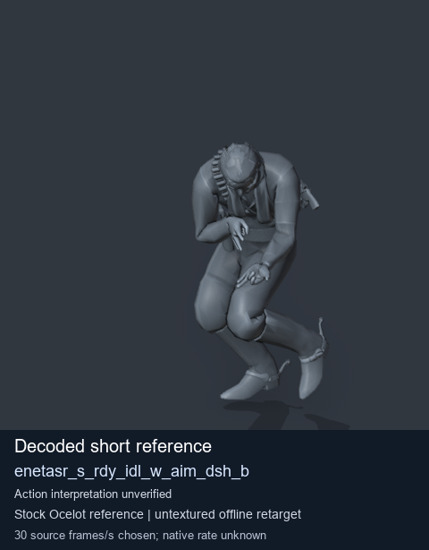
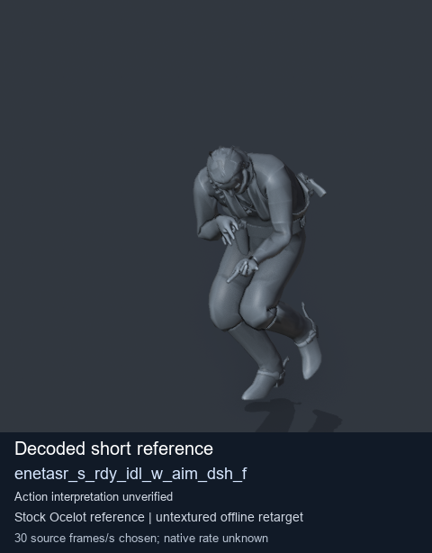
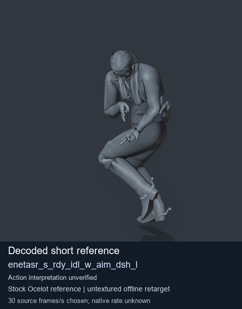
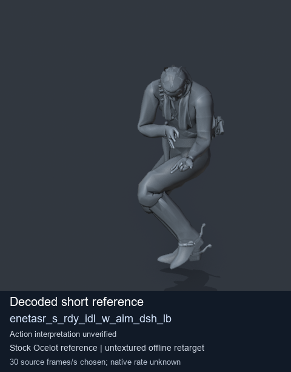

# Stock Soldier_common motion references / /Assets/tpp/motion/SI_game/fani/bodies/enet/enetasr - page 179

[Library](../README.md) · [Grouped directory](../browse/README.md) · [This source family](../browse/stock-soldier-enetasr-dd428991.md) · [Switch mode](browse-stock-soldier-enetasr-dd428991-179.md)

**Still images: no GIFs loaded** · 4 clips · 0.34 MiB downloaded.

Images reuse existing files. A small display width does not reduce download size. Open one clip for its larger titled GIF and original technical data.

Source-family grouping uses only recorded virtual directories; it does not establish an action, weapon, actor, rig or native compatibility. Existing descriptions and tags below are unchanged. Per-clip visual review may be pending; chosen preview speed is separate from unmeasured native timing.

| Preview | Animation | Category | Tags | Virtual GANI directory / file | MTAR / container location | Description | Frames / data |
| --- | --- | --- | --- | --- | --- | --- | --- |
|  | [Stock reference: enetasr_s_rdy_idl_w_aim_dsh_b](../clips/mgsv-tpp-soldier_common-payloadsha256-da7cd7622fe69b605b243f578163a7ca2eadcc2639936695517a64d99bd815ac.md) <code>enetasr_s_rdy_idl_w_aim_dsh_b</code> | Stock Soldier_common motion references | <code>stock animation reference</code> <code>Soldier_common</code> <code>source-derived label</code> <code>Ocelot reference mesh</code> | <code>/Assets/tpp/motion/SI_game/fani/bodies/enet/enetasr</code> <code>enetasr_s_rdy_idl_w_aim_dsh_b.gani</code> | Retained MTAR: <code>Soldier_common.mtar</code> DAT / FPK membership unverified | Decoded stock reference enetasr_s_rdy_idl_w_aim_dsh_b; action interpretation unverified. | 8 raw 0.27 s chosen; native rate unknown [Full data](../clips/mgsv-tpp-soldier_common-payloadsha256-da7cd7622fe69b605b243f578163a7ca2eadcc2639936695517a64d99bd815ac.md#technical-data) |
|  | [Stock reference: enetasr_s_rdy_idl_w_aim_dsh_f](../clips/mgsv-tpp-soldier_common-payloadsha256-e5d923378349359bc46223732bacb8f8a35087f8b72d981e940b4cc7a90fd870.md) <code>enetasr_s_rdy_idl_w_aim_dsh_f</code> | Stock Soldier_common motion references | <code>stock animation reference</code> <code>Soldier_common</code> <code>source-derived label</code> <code>Ocelot reference mesh</code> | <code>/Assets/tpp/motion/SI_game/fani/bodies/enet/enetasr</code> <code>enetasr_s_rdy_idl_w_aim_dsh_f.gani</code> | Retained MTAR: <code>Soldier_common.mtar</code> DAT / FPK membership unverified | Decoded stock reference enetasr_s_rdy_idl_w_aim_dsh_f; action interpretation unverified. | 8 raw 0.27 s chosen; native rate unknown [Full data](../clips/mgsv-tpp-soldier_common-payloadsha256-e5d923378349359bc46223732bacb8f8a35087f8b72d981e940b4cc7a90fd870.md#technical-data) |
|  | [Stock reference: enetasr_s_rdy_idl_w_aim_dsh_l](../clips/mgsv-tpp-soldier_common-payloadsha256-64bd4519093eb77fd7089f283521dedc08f8e6ed546d5da48d5cba58803285e4.md) <code>enetasr_s_rdy_idl_w_aim_dsh_l</code> | Stock Soldier_common motion references | <code>stock animation reference</code> <code>Soldier_common</code> <code>source-derived label</code> <code>Ocelot reference mesh</code> | <code>/Assets/tpp/motion/SI_game/fani/bodies/enet/enetasr</code> <code>enetasr_s_rdy_idl_w_aim_dsh_l.gani</code> | Retained MTAR: <code>Soldier_common.mtar</code> DAT / FPK membership unverified | Decoded stock reference enetasr_s_rdy_idl_w_aim_dsh_l; action interpretation unverified. | 8 raw 0.27 s chosen; native rate unknown [Full data](../clips/mgsv-tpp-soldier_common-payloadsha256-64bd4519093eb77fd7089f283521dedc08f8e6ed546d5da48d5cba58803285e4.md#technical-data) |
|  | [Stock reference: enetasr_s_rdy_idl_w_aim_dsh_lb](../clips/mgsv-tpp-soldier_common-payloadsha256-5f6083eb42aed8fabf5f9e7e178e82d802798f2969ed0f7ba8e42cb6ee83be61.md) <code>enetasr_s_rdy_idl_w_aim_dsh_lb</code> | Stock Soldier_common motion references | <code>stock animation reference</code> <code>Soldier_common</code> <code>source-derived label</code> <code>Ocelot reference mesh</code> | <code>/Assets/tpp/motion/SI_game/fani/bodies/enet/enetasr</code> <code>enetasr_s_rdy_idl_w_aim_dsh_lb.gani</code> | Retained MTAR: <code>Soldier_common.mtar</code> DAT / FPK membership unverified | Decoded stock reference enetasr_s_rdy_idl_w_aim_dsh_lb; action interpretation unverified. | 8 raw 0.27 s chosen; native rate unknown [Full data](../clips/mgsv-tpp-soldier_common-payloadsha256-5f6083eb42aed8fabf5f9e7e178e82d802798f2969ed0f7ba8e42cb6ee83be61.md#technical-data) |

[Source descriptions, confidence and credits](../description-sources.md) · [Complete JSON](../catalogue.json) · [CSV](../catalogue.csv)
