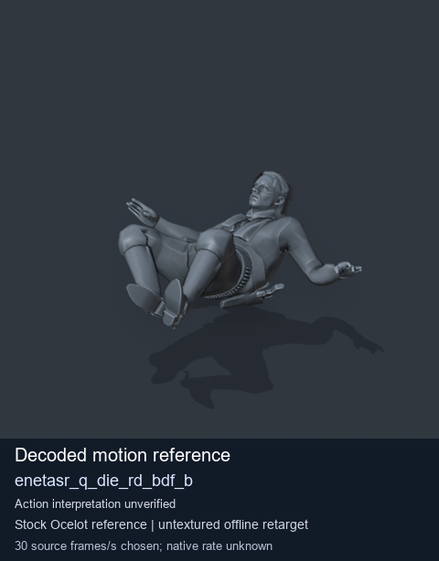
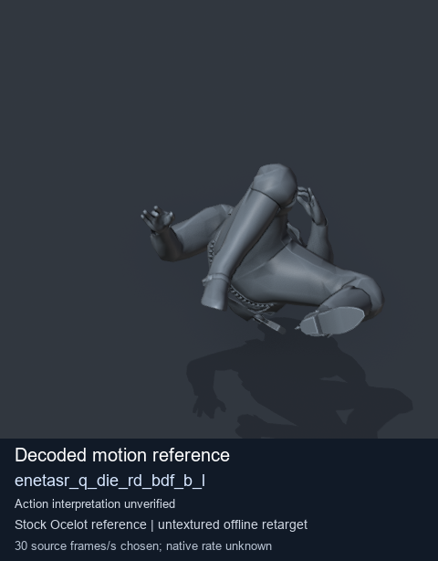
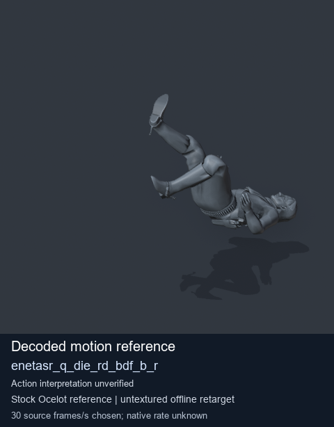
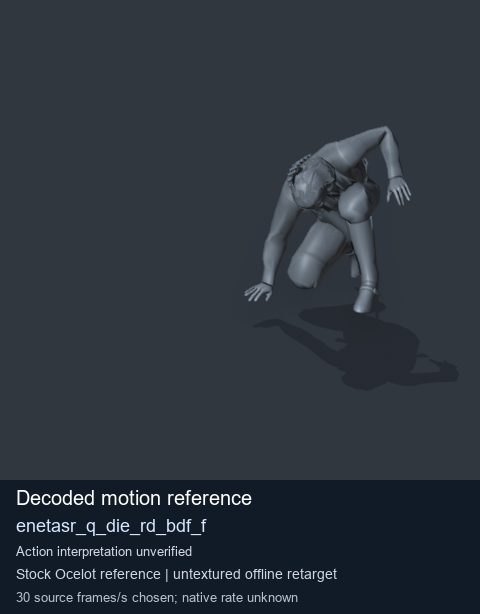

# Stock Soldier_common motion references / /Assets/tpp/motion/SI_game/fani/bodies/enet/enetasr - page 18

[Library](../README.md) · [Grouped directory](../browse/README.md) · [This source family](../browse/stock-soldier-enetasr-dd428991.md) · [Switch mode](browse-stock-soldier-enetasr-dd428991-18.md)

**Still images: no GIFs loaded** · 4 clips · 0.31 MiB downloaded.

Images reuse existing files. A small display width does not reduce download size. Open one clip for its larger titled GIF and original technical data.

Source-family grouping uses only recorded virtual directories; it does not establish an action, weapon, actor, rig or native compatibility. Existing descriptions and tags below are unchanged. Per-clip visual review may be pending; chosen preview speed is separate from unmeasured native timing.

| Preview | Animation | Category | Tags | Virtual GANI directory / file | MTAR / container location | Description | Frames / data |
| --- | --- | --- | --- | --- | --- | --- | --- |
|  | [Stock reference: enetasr_q_die_rd_bdf_b](../clips/mgsv-tpp-soldier_common-payloadsha256-5de1d315e201cc4c315fac9de98ce3ab8b2c79ef426ac086be3255cf2b783079.md) <code>enetasr_q_die_rd_bdf_b</code> | Stock Soldier_common motion references | <code>stock animation reference</code> <code>Soldier_common</code> <code>source-derived label</code> <code>Ocelot reference mesh</code> | <code>/Assets/tpp/motion/SI_game/fani/bodies/enet/enetasr</code> <code>enetasr_q_die_rd_bdf_b.gani</code> | Retained MTAR: <code>Soldier_common.mtar</code> DAT / FPK membership unverified | Decoded stock reference enetasr_q_die_rd_bdf_b; action interpretation unverified. | 80 raw 2.67 s chosen; native rate unknown [Full data](../clips/mgsv-tpp-soldier_common-payloadsha256-5de1d315e201cc4c315fac9de98ce3ab8b2c79ef426ac086be3255cf2b783079.md#technical-data) |
|  | [Stock motion reference: enetasr_q_die_rd_bdf_b_l](../clips/mgsv-tpp-soldier_common-payloadsha256-544f74e2ef58fd6a79996b72adb0f5ae0790e0ed9f4f5ac7105897b796db7cc9.md) <code>enetasr_q_die_rd_bdf_b_l</code> | Stock Soldier_common motion references | <code>stock body motion</code> <code>Soldier_common</code> <code>source-derived label</code> <code>Ocelot reference mesh</code> | <code>/Assets/tpp/motion/SI_game/fani/bodies/enet/enetasr</code> <code>enetasr_q_die_rd_bdf_b_l.gani</code> | Retained MTAR: <code>Soldier_common.mtar</code> DAT / FPK membership unverified | Decoded stock body-motion reference enetasr_q_die_rd_bdf_b_l; action interpretation unverified. | 75 raw 2.5 s chosen; native rate unknown [Full data](../clips/mgsv-tpp-soldier_common-payloadsha256-544f74e2ef58fd6a79996b72adb0f5ae0790e0ed9f4f5ac7105897b796db7cc9.md#technical-data) |
|  | [Stock motion reference: enetasr_q_die_rd_bdf_b_r](../clips/mgsv-tpp-soldier_common-payloadsha256-1482f9fff230433ca76832aa5eb4e1ee3228ef7f8e0567f9b9e69b9dcc305eca.md) <code>enetasr_q_die_rd_bdf_b_r</code> | Stock Soldier_common motion references | <code>stock body motion</code> <code>Soldier_common</code> <code>source-derived label</code> <code>Ocelot reference mesh</code> | <code>/Assets/tpp/motion/SI_game/fani/bodies/enet/enetasr</code> <code>enetasr_q_die_rd_bdf_b_r.gani</code> | Retained MTAR: <code>Soldier_common.mtar</code> DAT / FPK membership unverified | Decoded stock body-motion reference enetasr_q_die_rd_bdf_b_r; action interpretation unverified. | 84 raw 2.8 s chosen; native rate unknown [Full data](../clips/mgsv-tpp-soldier_common-payloadsha256-1482f9fff230433ca76832aa5eb4e1ee3228ef7f8e0567f9b9e69b9dcc305eca.md#technical-data) |
|  | [Stock motion reference: enetasr_q_die_rd_bdf_f](../clips/mgsv-tpp-soldier_common-payloadsha256-ce376439abba47ffce4e5aa9e5d6acc95d9ee17c92ebeecfd38b5a5a801186d1.md) <code>enetasr_q_die_rd_bdf_f</code> | Stock Soldier_common motion references | <code>stock body motion</code> <code>Soldier_common</code> <code>source-derived label</code> <code>Ocelot reference mesh</code> | <code>/Assets/tpp/motion/SI_game/fani/bodies/enet/enetasr</code> <code>enetasr_q_die_rd_bdf_f.gani</code> | Retained MTAR: <code>Soldier_common.mtar</code> DAT / FPK membership unverified | Decoded stock body-motion reference enetasr_q_die_rd_bdf_f; action interpretation unverified. | 159 raw 5.3 s chosen; native rate unknown [Full data](../clips/mgsv-tpp-soldier_common-payloadsha256-ce376439abba47ffce4e5aa9e5d6acc95d9ee17c92ebeecfd38b5a5a801186d1.md#technical-data) |

[Source descriptions, confidence and credits](../description-sources.md) · [Complete JSON](../catalogue.json) · [CSV](../catalogue.csv)
