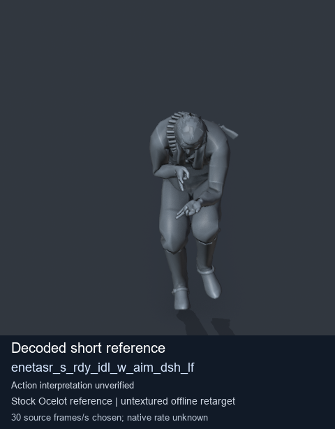
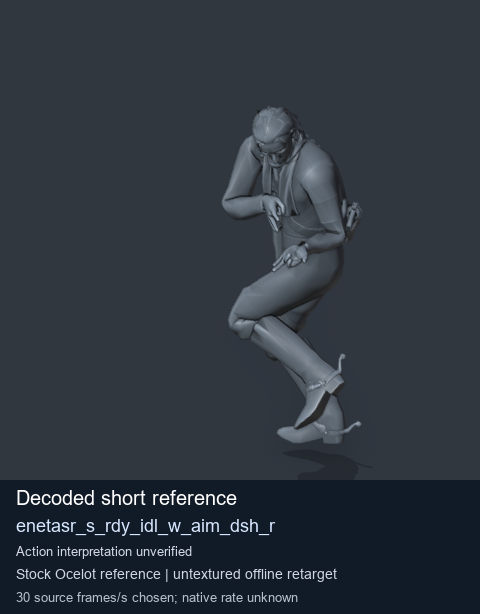
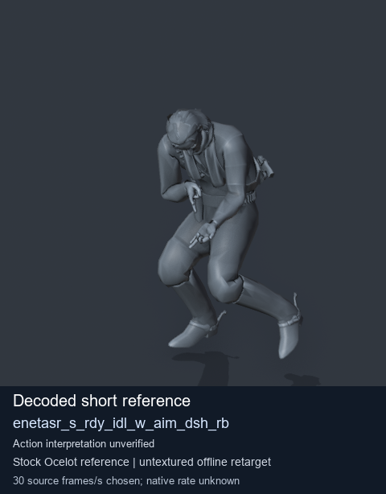
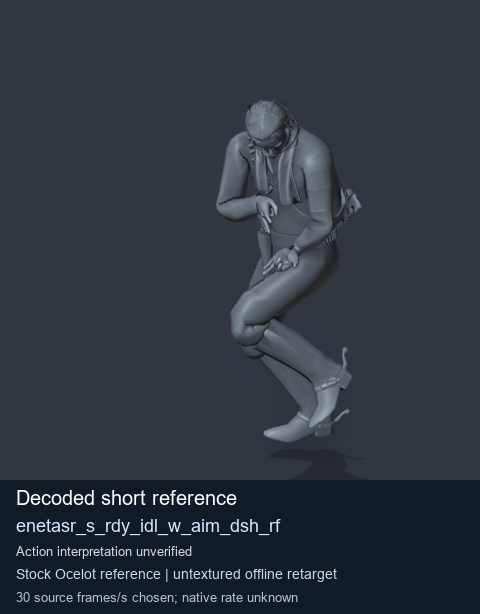

# Stock Soldier_common motion references / /Assets/tpp/motion/SI_game/fani/bodies/enet/enetasr - page 180

[Library](../README.md) · [Grouped directory](../browse/README.md) · [This source family](../browse/stock-soldier-enetasr-dd428991.md) · [Switch mode](browse-stock-soldier-enetasr-dd428991-180.md)

**Still images: no GIFs loaded** · 4 clips · 0.33 MiB downloaded.

Images reuse existing files. A small display width does not reduce download size. Open one clip for its larger titled GIF and original technical data.

Source-family grouping uses only recorded virtual directories; it does not establish an action, weapon, actor, rig or native compatibility. Existing descriptions and tags below are unchanged. Per-clip visual review may be pending; chosen preview speed is separate from unmeasured native timing.

| Preview | Animation | Category | Tags | Virtual GANI directory / file | MTAR / container location | Description | Frames / data |
| --- | --- | --- | --- | --- | --- | --- | --- |
|  | [Stock reference: enetasr_s_rdy_idl_w_aim_dsh_lf](../clips/mgsv-tpp-soldier_common-payloadsha256-54ae219d2deee4b2749eec1bf0bfc3e2b920f86fba7078a7f1f81cc444ca5e0d.md) <code>enetasr_s_rdy_idl_w_aim_dsh_lf</code> | Stock Soldier_common motion references | <code>stock animation reference</code> <code>Soldier_common</code> <code>source-derived label</code> <code>Ocelot reference mesh</code> | <code>/Assets/tpp/motion/SI_game/fani/bodies/enet/enetasr</code> <code>enetasr_s_rdy_idl_w_aim_dsh_lf.gani</code> | Retained MTAR: <code>Soldier_common.mtar</code> DAT / FPK membership unverified | Decoded stock reference enetasr_s_rdy_idl_w_aim_dsh_lf; action interpretation unverified. | 8 raw 0.27 s chosen; native rate unknown [Full data](../clips/mgsv-tpp-soldier_common-payloadsha256-54ae219d2deee4b2749eec1bf0bfc3e2b920f86fba7078a7f1f81cc444ca5e0d.md#technical-data) |
|  | [Stock reference: enetasr_s_rdy_idl_w_aim_dsh_r](../clips/mgsv-tpp-soldier_common-payloadsha256-a05b26226ac2ea4f2643ce1c277e3351587652362e7ec81966c37b0dd31c6d56.md) <code>enetasr_s_rdy_idl_w_aim_dsh_r</code> | Stock Soldier_common motion references | <code>stock animation reference</code> <code>Soldier_common</code> <code>source-derived label</code> <code>Ocelot reference mesh</code> | <code>/Assets/tpp/motion/SI_game/fani/bodies/enet/enetasr</code> <code>enetasr_s_rdy_idl_w_aim_dsh_r.gani</code> | Retained MTAR: <code>Soldier_common.mtar</code> DAT / FPK membership unverified | Decoded stock reference enetasr_s_rdy_idl_w_aim_dsh_r; action interpretation unverified. | 8 raw 0.27 s chosen; native rate unknown [Full data](../clips/mgsv-tpp-soldier_common-payloadsha256-a05b26226ac2ea4f2643ce1c277e3351587652362e7ec81966c37b0dd31c6d56.md#technical-data) |
|  | [Stock reference: enetasr_s_rdy_idl_w_aim_dsh_rb](../clips/mgsv-tpp-soldier_common-payloadsha256-9f4f44faf682afa97aa16b27b79b898e7342c9ecb8e4a93f3477612923d319c4.md) <code>enetasr_s_rdy_idl_w_aim_dsh_rb</code> | Stock Soldier_common motion references | <code>stock animation reference</code> <code>Soldier_common</code> <code>source-derived label</code> <code>Ocelot reference mesh</code> | <code>/Assets/tpp/motion/SI_game/fani/bodies/enet/enetasr</code> <code>enetasr_s_rdy_idl_w_aim_dsh_rb.gani</code> | Retained MTAR: <code>Soldier_common.mtar</code> DAT / FPK membership unverified | Decoded stock reference enetasr_s_rdy_idl_w_aim_dsh_rb; action interpretation unverified. | 8 raw 0.27 s chosen; native rate unknown [Full data](../clips/mgsv-tpp-soldier_common-payloadsha256-9f4f44faf682afa97aa16b27b79b898e7342c9ecb8e4a93f3477612923d319c4.md#technical-data) |
|  | [Stock reference: enetasr_s_rdy_idl_w_aim_dsh_rf](../clips/mgsv-tpp-soldier_common-payloadsha256-9b755537e63963f7b3ae94721e0a5220cf74da58313ace0a8b1a32dcb49437e9.md) <code>enetasr_s_rdy_idl_w_aim_dsh_rf</code> | Stock Soldier_common motion references | <code>stock animation reference</code> <code>Soldier_common</code> <code>source-derived label</code> <code>Ocelot reference mesh</code> | <code>/Assets/tpp/motion/SI_game/fani/bodies/enet/enetasr</code> <code>enetasr_s_rdy_idl_w_aim_dsh_rf.gani</code> | Retained MTAR: <code>Soldier_common.mtar</code> DAT / FPK membership unverified | Decoded stock reference enetasr_s_rdy_idl_w_aim_dsh_rf; action interpretation unverified. | 8 raw 0.27 s chosen; native rate unknown [Full data](../clips/mgsv-tpp-soldier_common-payloadsha256-9b755537e63963f7b3ae94721e0a5220cf74da58313ace0a8b1a32dcb49437e9.md#technical-data) |

[Source descriptions, confidence and credits](../description-sources.md) · [Complete JSON](../catalogue.json) · [CSV](../catalogue.csv)
