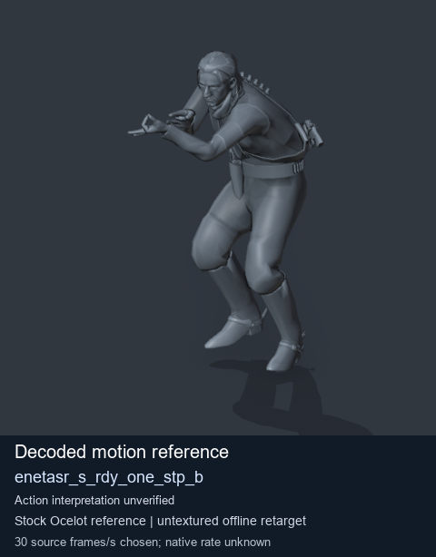
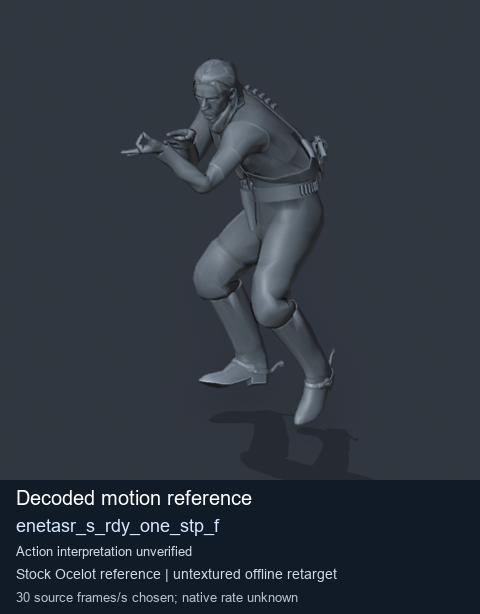
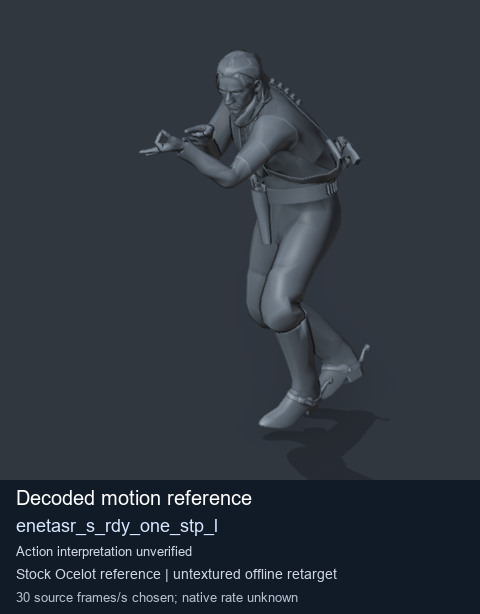
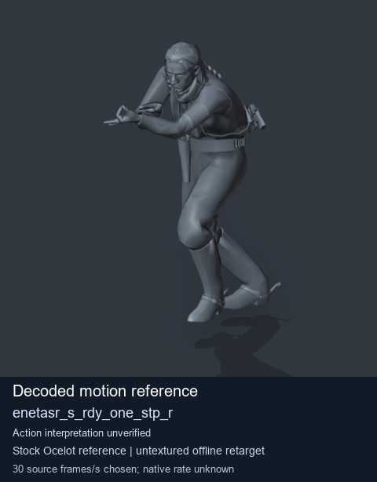

# Stock Soldier_common motion references / /Assets/tpp/motion/SI_game/fani/bodies/enet/enetasr - page 181

[Library](../README.md) · [Grouped directory](../browse/README.md) · [This source family](../browse/stock-soldier-enetasr-dd428991.md) · [Switch mode](browse-stock-soldier-enetasr-dd428991-181.md)

**Still images: no GIFs loaded** · 4 clips · 0.37 MiB downloaded.

Images reuse existing files. A small display width does not reduce download size. Open one clip for its larger titled GIF and original technical data.

Source-family grouping uses only recorded virtual directories; it does not establish an action, weapon, actor, rig or native compatibility. Existing descriptions and tags below are unchanged. Per-clip visual review may be pending; chosen preview speed is separate from unmeasured native timing.

| Preview | Animation | Category | Tags | Virtual GANI directory / file | MTAR / container location | Description | Frames / data |
| --- | --- | --- | --- | --- | --- | --- | --- |
|  | [Stock motion reference: enetasr_s_rdy_one_stp_b](../clips/mgsv-tpp-soldier_common-payloadsha256-0c3cf3ec96d51364aae1bc7bb37bf323696888685507248305472e1c18bf32a8.md) <code>enetasr_s_rdy_one_stp_b</code> | Stock Soldier_common motion references | <code>stock body motion</code> <code>Soldier_common</code> <code>source-derived label</code> <code>Ocelot reference mesh</code> | <code>/Assets/tpp/motion/SI_game/fani/bodies/enet/enetasr</code> <code>enetasr_s_rdy_one_stp_b.gani</code> | Retained MTAR: <code>Soldier_common.mtar</code> DAT / FPK membership unverified | Decoded stock body-motion reference enetasr_s_rdy_one_stp_b; action interpretation unverified. | 59 raw 1.97 s chosen; native rate unknown [Full data](../clips/mgsv-tpp-soldier_common-payloadsha256-0c3cf3ec96d51364aae1bc7bb37bf323696888685507248305472e1c18bf32a8.md#technical-data) |
|  | [Stock motion reference: enetasr_s_rdy_one_stp_f](../clips/mgsv-tpp-soldier_common-payloadsha256-6393861d942dae6a6b4bdd75e33c6deff6cc9ae717172a6a1608e2284ae37cd2.md) <code>enetasr_s_rdy_one_stp_f</code> | Stock Soldier_common motion references | <code>stock body motion</code> <code>Soldier_common</code> <code>source-derived label</code> <code>Ocelot reference mesh</code> | <code>/Assets/tpp/motion/SI_game/fani/bodies/enet/enetasr</code> <code>enetasr_s_rdy_one_stp_f.gani</code> | Retained MTAR: <code>Soldier_common.mtar</code> DAT / FPK membership unverified | Decoded stock body-motion reference enetasr_s_rdy_one_stp_f; action interpretation unverified. | 63 raw 2.1 s chosen; native rate unknown [Full data](../clips/mgsv-tpp-soldier_common-payloadsha256-6393861d942dae6a6b4bdd75e33c6deff6cc9ae717172a6a1608e2284ae37cd2.md#technical-data) |
|  | [Stock motion reference: enetasr_s_rdy_one_stp_l](../clips/mgsv-tpp-soldier_common-payloadsha256-22cff69e129de0f1da951cf5caaae3a641a380cbe962b108b17d6cbeb6abecae.md) <code>enetasr_s_rdy_one_stp_l</code> | Stock Soldier_common motion references | <code>stock body motion</code> <code>Soldier_common</code> <code>source-derived label</code> <code>Ocelot reference mesh</code> | <code>/Assets/tpp/motion/SI_game/fani/bodies/enet/enetasr</code> <code>enetasr_s_rdy_one_stp_l.gani</code> | Retained MTAR: <code>Soldier_common.mtar</code> DAT / FPK membership unverified | Decoded stock body-motion reference enetasr_s_rdy_one_stp_l; action interpretation unverified. | 63 raw 2.1 s chosen; native rate unknown [Full data](../clips/mgsv-tpp-soldier_common-payloadsha256-22cff69e129de0f1da951cf5caaae3a641a380cbe962b108b17d6cbeb6abecae.md#technical-data) |
|  | [Stock motion reference: enetasr_s_rdy_one_stp_r](../clips/mgsv-tpp-soldier_common-payloadsha256-3283679cc280bf62f3fe10329a63079303a3bf508513ad010d4e79ae6fdf0062.md) <code>enetasr_s_rdy_one_stp_r</code> | Stock Soldier_common motion references | <code>stock body motion</code> <code>Soldier_common</code> <code>source-derived label</code> <code>Ocelot reference mesh</code> | <code>/Assets/tpp/motion/SI_game/fani/bodies/enet/enetasr</code> <code>enetasr_s_rdy_one_stp_r.gani</code> | Retained MTAR: <code>Soldier_common.mtar</code> DAT / FPK membership unverified | Decoded stock body-motion reference enetasr_s_rdy_one_stp_r; action interpretation unverified. | 68 raw 2.27 s chosen; native rate unknown [Full data](../clips/mgsv-tpp-soldier_common-payloadsha256-3283679cc280bf62f3fe10329a63079303a3bf508513ad010d4e79ae6fdf0062.md#technical-data) |

[Source descriptions, confidence and credits](../description-sources.md) · [Complete JSON](../catalogue.json) · [CSV](../catalogue.csv)
