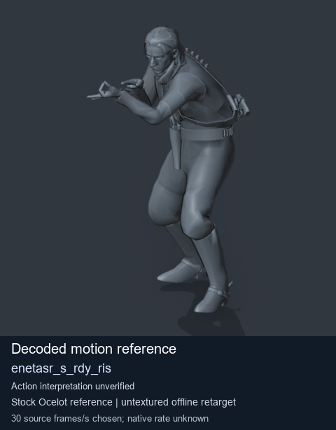
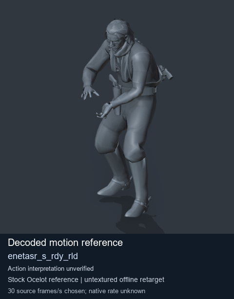
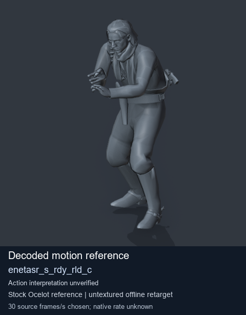
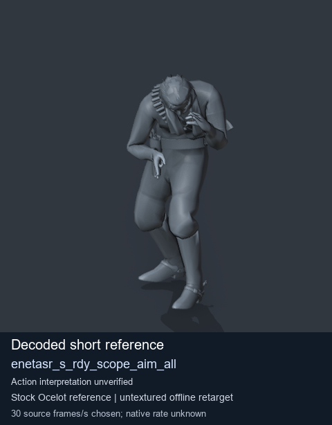

# Stock Soldier_common motion references / /Assets/tpp/motion/SI_game/fani/bodies/enet/enetasr - page 182

[Library](../README.md) · [Grouped directory](../browse/README.md) · [This source family](../browse/stock-soldier-enetasr-dd428991.md) · [Switch mode](browse-stock-soldier-enetasr-dd428991-182.md)

**Still images: no GIFs loaded** · 4 clips · 0.37 MiB downloaded.

Images reuse existing files. A small display width does not reduce download size. Open one clip for its larger titled GIF and original technical data.

Source-family grouping uses only recorded virtual directories; it does not establish an action, weapon, actor, rig or native compatibility. Existing descriptions and tags below are unchanged. Per-clip visual review may be pending; chosen preview speed is separate from unmeasured native timing.

| Preview | Animation | Category | Tags | Virtual GANI directory / file | MTAR / container location | Description | Frames / data |
| --- | --- | --- | --- | --- | --- | --- | --- |
|  | [Stock motion reference: enetasr_s_rdy_ris](../clips/mgsv-tpp-soldier_common-payloadsha256-a708587bcad40eaba89a8bda75b6e8edeff0d873dddb69aa4a7a1747b1fb7f0d.md) <code>enetasr_s_rdy_ris</code> | Stock Soldier_common motion references | <code>stock body motion</code> <code>Soldier_common</code> <code>source-derived label</code> <code>Ocelot reference mesh</code> | <code>/Assets/tpp/motion/SI_game/fani/bodies/enet/enetasr</code> <code>enetasr_s_rdy_ris.gani</code> | Retained MTAR: <code>Soldier_common.mtar</code> DAT / FPK membership unverified | Decoded stock body-motion reference enetasr_s_rdy_ris; action interpretation unverified. | 20 raw 0.67 s chosen; native rate unknown [Full data](../clips/mgsv-tpp-soldier_common-payloadsha256-a708587bcad40eaba89a8bda75b6e8edeff0d873dddb69aa4a7a1747b1fb7f0d.md#technical-data) |
|  | [Stock reference: enetasr_s_rdy_rld](../clips/mgsv-tpp-soldier_common-payloadsha256-5ce50bf6ed6c99d394e54419896d36332e1f5df0917b71c3f6746880d69b2db1.md) <code>enetasr_s_rdy_rld</code> | Stock Soldier_common motion references | <code>stock animation reference</code> <code>Soldier_common</code> <code>source-derived label</code> <code>Ocelot reference mesh</code> | <code>/Assets/tpp/motion/SI_game/fani/bodies/enet/enetasr</code> <code>enetasr_s_rdy_rld.gani</code> | Retained MTAR: <code>Soldier_common.mtar</code> DAT / FPK membership unverified | Decoded stock reference enetasr_s_rdy_rld; action interpretation unverified. | 216 raw 7.2 s chosen; native rate unknown [Full data](../clips/mgsv-tpp-soldier_common-payloadsha256-5ce50bf6ed6c99d394e54419896d36332e1f5df0917b71c3f6746880d69b2db1.md#technical-data) |
|  | [Stock reference: enetasr_s_rdy_rld_c](../clips/mgsv-tpp-soldier_common-payloadsha256-e583201333b1ebf178528bcc18796adc3f592fad8be145066f112c8e2e15e182.md) <code>enetasr_s_rdy_rld_c</code> | Stock Soldier_common motion references | <code>stock animation reference</code> <code>Soldier_common</code> <code>source-derived label</code> <code>Ocelot reference mesh</code> | <code>/Assets/tpp/motion/SI_game/fani/bodies/enet/enetasr</code> <code>enetasr_s_rdy_rld_c.gani</code> | Retained MTAR: <code>Soldier_common.mtar</code> DAT / FPK membership unverified | Decoded stock reference enetasr_s_rdy_rld_c; action interpretation unverified. | 185 raw 6.17 s chosen; native rate unknown [Full data](../clips/mgsv-tpp-soldier_common-payloadsha256-e583201333b1ebf178528bcc18796adc3f592fad8be145066f112c8e2e15e182.md#technical-data) |
|  | [Stock reference: enetasr_s_rdy_scope_aim_all](../clips/mgsv-tpp-soldier_common-payloadsha256-8a166b73ef9bed1eb5b46d020727e2dc504fbc49fe888c758686dfb7054e024e.md) <code>enetasr_s_rdy_scope_aim_all</code> | Stock Soldier_common motion references | <code>stock animation reference</code> <code>Soldier_common</code> <code>source-derived label</code> <code>Ocelot reference mesh</code> | <code>/Assets/tpp/motion/SI_game/fani/bodies/enet/enetasr</code> <code>enetasr_s_rdy_scope_aim_all.gani</code> | Retained MTAR: <code>Soldier_common.mtar</code> DAT / FPK membership unverified | Decoded stock reference enetasr_s_rdy_scope_aim_all; action interpretation unverified. | 8 raw 0.27 s chosen; native rate unknown [Full data](../clips/mgsv-tpp-soldier_common-payloadsha256-8a166b73ef9bed1eb5b46d020727e2dc504fbc49fe888c758686dfb7054e024e.md#technical-data) |

[Source descriptions, confidence and credits](../description-sources.md) · [Complete JSON](../catalogue.json) · [CSV](../catalogue.csv)
