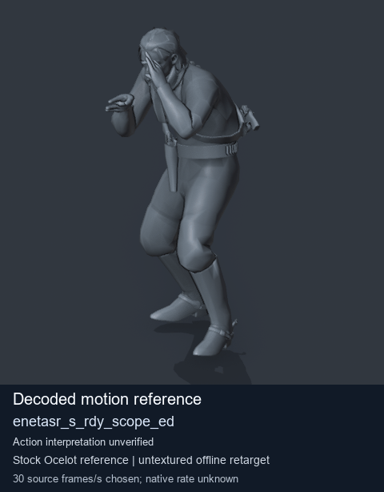
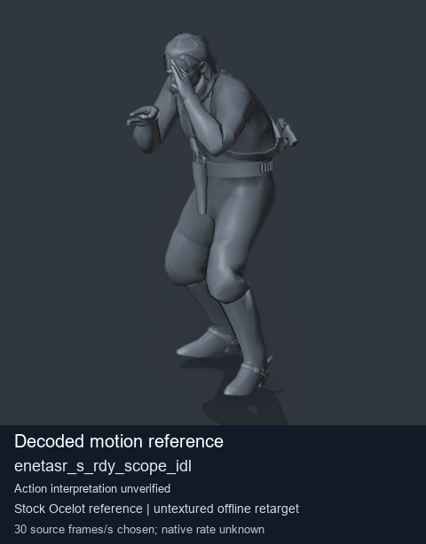
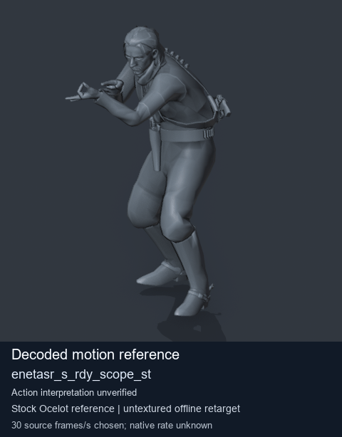
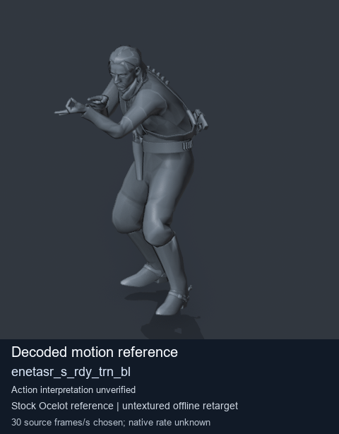

# Stock Soldier_common motion references / /Assets/tpp/motion/SI_game/fani/bodies/enet/enetasr - page 183

[Library](../README.md) · [Grouped directory](../browse/README.md) · [This source family](../browse/stock-soldier-enetasr-dd428991.md) · [Switch mode](browse-stock-soldier-enetasr-dd428991-183-stills.md)

**Animated references** · 4 clips · 11.24 MiB downloaded.

Images reuse existing files. A small display width does not reduce download size. Animated previews use full existing GIFs where no separate thumbnail exists. Open one clip for its larger titled GIF and original technical data.

Source-family grouping uses only recorded virtual directories; it does not establish an action, weapon, actor, rig or native compatibility. Existing descriptions and tags below are unchanged. Per-clip visual review may be pending; chosen preview speed is separate from unmeasured native timing.

| Preview | Animation | Category | Tags | Virtual GANI directory / file | MTAR / container location | Description | Frames / data |
| --- | --- | --- | --- | --- | --- | --- | --- |
|  | [Stock motion reference: enetasr_s_rdy_scope_ed](../clips/mgsv-tpp-soldier_common-payloadsha256-f547e852a4a6902ad5e9c0a209badb93e4bb0c9cae2d90aa64d32a02d313a401.md) <code>enetasr_s_rdy_scope_ed</code> | Stock Soldier_common motion references | <code>stock body motion</code> <code>Soldier_common</code> <code>source-derived label</code> <code>Ocelot reference mesh</code> | <code>/Assets/tpp/motion/SI_game/fani/bodies/enet/enetasr</code> <code>enetasr_s_rdy_scope_ed.gani</code> | Retained MTAR: <code>Soldier_common.mtar</code> DAT / FPK membership unverified | Decoded stock body-motion reference enetasr_s_rdy_scope_ed; action interpretation unverified. | 60 raw 2.0 s chosen; native rate unknown [Full data](../clips/mgsv-tpp-soldier_common-payloadsha256-f547e852a4a6902ad5e9c0a209badb93e4bb0c9cae2d90aa64d32a02d313a401.md#technical-data) |
|  | [Stock motion reference: enetasr_s_rdy_scope_idl](../clips/mgsv-tpp-soldier_common-payloadsha256-38cd30ccaa42a84f5f53b9b17372e99bea064f389ee202faa2eadd6d1c098fec.md) <code>enetasr_s_rdy_scope_idl</code> | Stock Soldier_common motion references | <code>stock body motion</code> <code>Soldier_common</code> <code>source-derived label</code> <code>Ocelot reference mesh</code> | <code>/Assets/tpp/motion/SI_game/fani/bodies/enet/enetasr</code> <code>enetasr_s_rdy_scope_idl.gani</code> | Retained MTAR: <code>Soldier_common.mtar</code> DAT / FPK membership unverified | Decoded stock body-motion reference enetasr_s_rdy_scope_idl; action interpretation unverified. | 120 raw 4.0 s chosen; native rate unknown [Full data](../clips/mgsv-tpp-soldier_common-payloadsha256-38cd30ccaa42a84f5f53b9b17372e99bea064f389ee202faa2eadd6d1c098fec.md#technical-data) |
|  | [Stock motion reference: enetasr_s_rdy_scope_st](../clips/mgsv-tpp-soldier_common-payloadsha256-2441a28136b44edd58b40abe1a366bab6150813b78a0be8de04a09e9944583e6.md) <code>enetasr_s_rdy_scope_st</code> | Stock Soldier_common motion references | <code>stock body motion</code> <code>Soldier_common</code> <code>source-derived label</code> <code>Ocelot reference mesh</code> | <code>/Assets/tpp/motion/SI_game/fani/bodies/enet/enetasr</code> <code>enetasr_s_rdy_scope_st.gani</code> | Retained MTAR: <code>Soldier_common.mtar</code> DAT / FPK membership unverified | Decoded stock body-motion reference enetasr_s_rdy_scope_st; action interpretation unverified. | 80 raw 2.67 s chosen; native rate unknown [Full data](../clips/mgsv-tpp-soldier_common-payloadsha256-2441a28136b44edd58b40abe1a366bab6150813b78a0be8de04a09e9944583e6.md#technical-data) |
|  | [Stock motion reference: enetasr_s_rdy_trn_bl](../clips/mgsv-tpp-soldier_common-payloadsha256-b46c8d8a3d41b18ebcd4ea5585af34677365c970bcafacc7a052303e1971e2e3.md) <code>enetasr_s_rdy_trn_bl</code> | Stock Soldier_common motion references | <code>stock body motion</code> <code>Soldier_common</code> <code>source-derived label</code> <code>Ocelot reference mesh</code> | <code>/Assets/tpp/motion/SI_game/fani/bodies/enet/enetasr</code> <code>enetasr_s_rdy_trn_bl.gani</code> | Retained MTAR: <code>Soldier_common.mtar</code> DAT / FPK membership unverified | Decoded stock body-motion reference enetasr_s_rdy_trn_bl; action interpretation unverified. | 103 raw 3.43 s chosen; native rate unknown [Full data](../clips/mgsv-tpp-soldier_common-payloadsha256-b46c8d8a3d41b18ebcd4ea5585af34677365c970bcafacc7a052303e1971e2e3.md#technical-data) |

[Source descriptions, confidence and credits](../description-sources.md) · [Complete JSON](../catalogue.json) · [CSV](../catalogue.csv)
