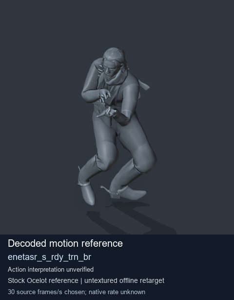
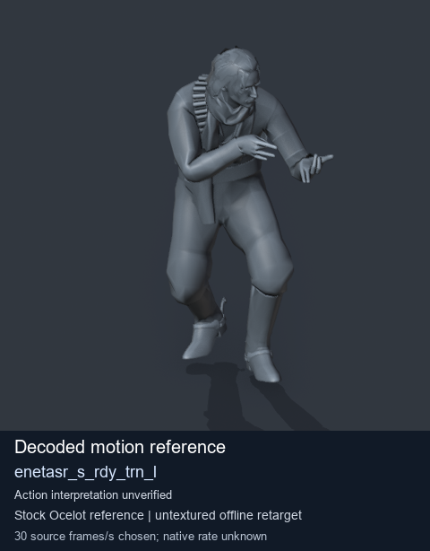
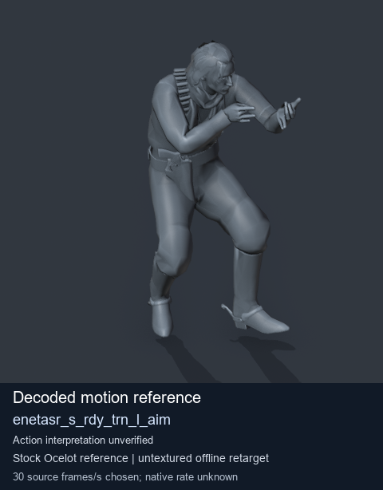
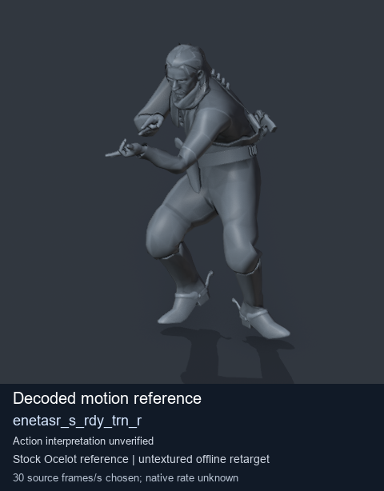

# Stock Soldier_common motion references / /Assets/tpp/motion/SI_game/fani/bodies/enet/enetasr - page 184

[Library](../README.md) · [Grouped directory](../browse/README.md) · [This source family](../browse/stock-soldier-enetasr-dd428991.md) · [Switch mode](browse-stock-soldier-enetasr-dd428991-184.md)

**Still images: no GIFs loaded** · 4 clips · 0.38 MiB downloaded.

Images reuse existing files. A small display width does not reduce download size. Open one clip for its larger titled GIF and original technical data.

Source-family grouping uses only recorded virtual directories; it does not establish an action, weapon, actor, rig or native compatibility. Existing descriptions and tags below are unchanged. Per-clip visual review may be pending; chosen preview speed is separate from unmeasured native timing.

| Preview | Animation | Category | Tags | Virtual GANI directory / file | MTAR / container location | Description | Frames / data |
| --- | --- | --- | --- | --- | --- | --- | --- |
|  | [Stock motion reference: enetasr_s_rdy_trn_br](../clips/mgsv-tpp-soldier_common-payloadsha256-0440f5e33b3b88da066e75029c093fc8bf21eb7518f735f3f63a2066b03a5232.md) <code>enetasr_s_rdy_trn_br</code> | Stock Soldier_common motion references | <code>stock body motion</code> <code>Soldier_common</code> <code>source-derived label</code> <code>Ocelot reference mesh</code> | <code>/Assets/tpp/motion/SI_game/fani/bodies/enet/enetasr</code> <code>enetasr_s_rdy_trn_br.gani</code> | Retained MTAR: <code>Soldier_common.mtar</code> DAT / FPK membership unverified | Decoded stock body-motion reference enetasr_s_rdy_trn_br; action interpretation unverified. | 97 raw 3.23 s chosen; native rate unknown [Full data](../clips/mgsv-tpp-soldier_common-payloadsha256-0440f5e33b3b88da066e75029c093fc8bf21eb7518f735f3f63a2066b03a5232.md#technical-data) |
|  | [Stock motion reference: enetasr_s_rdy_trn_l](../clips/mgsv-tpp-soldier_common-payloadsha256-0d8ea2e70e14572956523a6cf8ef2e35e8059ba9f4c1b7544ddd7e6d35685507.md) <code>enetasr_s_rdy_trn_l</code> | Stock Soldier_common motion references | <code>stock body motion</code> <code>Soldier_common</code> <code>source-derived label</code> <code>Ocelot reference mesh</code> | <code>/Assets/tpp/motion/SI_game/fani/bodies/enet/enetasr</code> <code>enetasr_s_rdy_trn_l.gani</code> | Retained MTAR: <code>Soldier_common.mtar</code> DAT / FPK membership unverified | Decoded stock body-motion reference enetasr_s_rdy_trn_l; action interpretation unverified. | 75 raw 2.5 s chosen; native rate unknown [Full data](../clips/mgsv-tpp-soldier_common-payloadsha256-0d8ea2e70e14572956523a6cf8ef2e35e8059ba9f4c1b7544ddd7e6d35685507.md#technical-data) |
|  | [Stock motion reference: enetasr_s_rdy_trn_l_aim](../clips/mgsv-tpp-soldier_common-payloadsha256-efb6ccd3675a6bdc6855aefcd296edff6b9691cb777b55427a607c00c1b9e0ff.md) <code>enetasr_s_rdy_trn_l_aim</code> | Stock Soldier_common motion references | <code>stock body motion</code> <code>Soldier_common</code> <code>source-derived label</code> <code>Ocelot reference mesh</code> | <code>/Assets/tpp/motion/SI_game/fani/bodies/enet/enetasr</code> <code>enetasr_s_rdy_trn_l_aim.gani</code> | Retained MTAR: <code>Soldier_common.mtar</code> DAT / FPK membership unverified | Decoded stock body-motion reference enetasr_s_rdy_trn_l_aim; action interpretation unverified. | 54 raw 1.8 s chosen; native rate unknown [Full data](../clips/mgsv-tpp-soldier_common-payloadsha256-efb6ccd3675a6bdc6855aefcd296edff6b9691cb777b55427a607c00c1b9e0ff.md#technical-data) |
|  | [Stock motion reference: enetasr_s_rdy_trn_r](../clips/mgsv-tpp-soldier_common-payloadsha256-23eedb3a9aeefda354035eef461a960fdf63840ac8f77751db47d06b27bdf28c.md) <code>enetasr_s_rdy_trn_r</code> | Stock Soldier_common motion references | <code>stock body motion</code> <code>Soldier_common</code> <code>source-derived label</code> <code>Ocelot reference mesh</code> | <code>/Assets/tpp/motion/SI_game/fani/bodies/enet/enetasr</code> <code>enetasr_s_rdy_trn_r.gani</code> | Retained MTAR: <code>Soldier_common.mtar</code> DAT / FPK membership unverified | Decoded stock body-motion reference enetasr_s_rdy_trn_r; action interpretation unverified. | 85 raw 2.83 s chosen; native rate unknown [Full data](../clips/mgsv-tpp-soldier_common-payloadsha256-23eedb3a9aeefda354035eef461a960fdf63840ac8f77751db47d06b27bdf28c.md#technical-data) |

[Source descriptions, confidence and credits](../description-sources.md) · [Complete JSON](../catalogue.json) · [CSV](../catalogue.csv)
