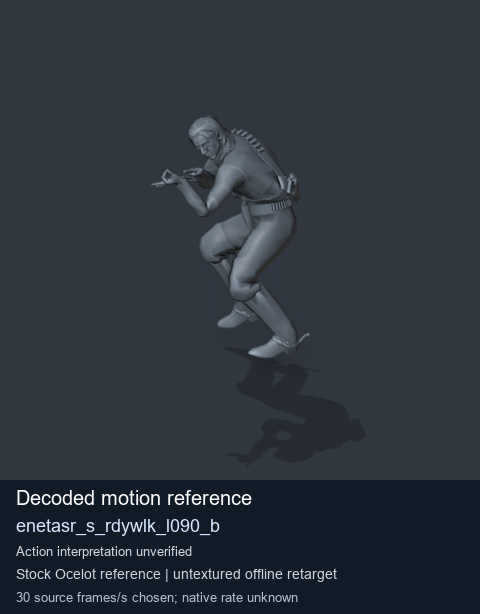
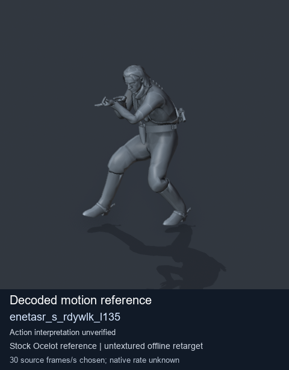
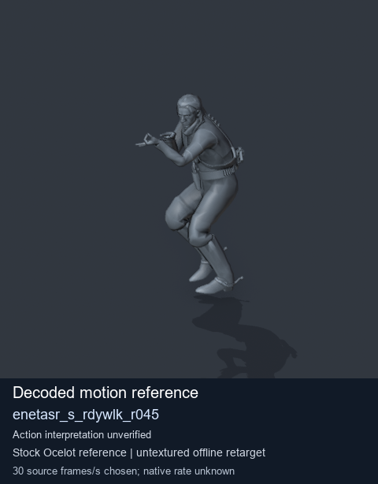
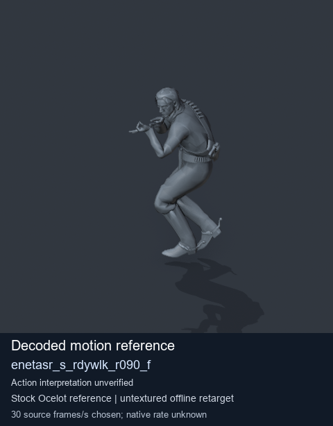

# Stock Soldier_common motion references / /Assets/tpp/motion/SI_game/fani/bodies/enet/enetasr - page 188

[Library](../README.md) · [Grouped directory](../browse/README.md) · [This source family](../browse/stock-soldier-enetasr-dd428991.md) · [Switch mode](browse-stock-soldier-enetasr-dd428991-188.md)

**Still images: no GIFs loaded** · 4 clips · 0.30 MiB downloaded.

Images reuse existing files. A small display width does not reduce download size. Open one clip for its larger titled GIF and original technical data.

Source-family grouping uses only recorded virtual directories; it does not establish an action, weapon, actor, rig or native compatibility. Existing descriptions and tags below are unchanged. Per-clip visual review may be pending; chosen preview speed is separate from unmeasured native timing.

| Preview | Animation | Category | Tags | Virtual GANI directory / file | MTAR / container location | Description | Frames / data |
| --- | --- | --- | --- | --- | --- | --- | --- |
|  | [Stock motion reference: enetasr_s_rdywlk_l090_b](../clips/mgsv-tpp-soldier_common-payloadsha256-02954cc7ac8347de4a6d7a08f5f869e419be36966b4e250de8de1a3c62b84909.md) <code>enetasr_s_rdywlk_l090_b</code> | Stock Soldier_common motion references | <code>stock body motion</code> <code>Soldier_common</code> <code>source-derived label</code> <code>Ocelot reference mesh</code> | <code>/Assets/tpp/motion/SI_game/fani/bodies/enet/enetasr</code> <code>enetasr_s_rdywlk_l090_b.gani</code> | Retained MTAR: <code>Soldier_common.mtar</code> DAT / FPK membership unverified | Decoded stock body-motion reference enetasr_s_rdywlk_l090_b; action interpretation unverified. | 76 raw 2.53 s chosen; native rate unknown [Full data](../clips/mgsv-tpp-soldier_common-payloadsha256-02954cc7ac8347de4a6d7a08f5f869e419be36966b4e250de8de1a3c62b84909.md#technical-data) |
|  | [Stock reference: enetasr_s_rdywlk_l135](../clips/mgsv-tpp-soldier_common-payloadsha256-2ddcef5c5e24fd7ea9aec758a217eb74e66e7dd159fc939be743013971428ca7.md) <code>enetasr_s_rdywlk_l135</code> | Stock Soldier_common motion references | <code>stock animation reference</code> <code>Soldier_common</code> <code>source-derived label</code> <code>Ocelot reference mesh</code> | <code>/Assets/tpp/motion/SI_game/fani/bodies/enet/enetasr</code> <code>enetasr_s_rdywlk_l135.gani</code> | Retained MTAR: <code>Soldier_common.mtar</code> DAT / FPK membership unverified | Decoded stock reference enetasr_s_rdywlk_l135; action interpretation unverified. | 78 raw 2.6 s chosen; native rate unknown [Full data](../clips/mgsv-tpp-soldier_common-payloadsha256-2ddcef5c5e24fd7ea9aec758a217eb74e66e7dd159fc939be743013971428ca7.md#technical-data) |
|  | [Stock reference: enetasr_s_rdywlk_r045](../clips/mgsv-tpp-soldier_common-payloadsha256-319c40e66ecbe1b6350e22fcbc0e2951a80fa51673cc56b1c9f0cf3bb74ca851.md) <code>enetasr_s_rdywlk_r045</code> | Stock Soldier_common motion references | <code>stock animation reference</code> <code>Soldier_common</code> <code>source-derived label</code> <code>Ocelot reference mesh</code> | <code>/Assets/tpp/motion/SI_game/fani/bodies/enet/enetasr</code> <code>enetasr_s_rdywlk_r045.gani</code> | Retained MTAR: <code>Soldier_common.mtar</code> DAT / FPK membership unverified | Decoded stock reference enetasr_s_rdywlk_r045; action interpretation unverified. | 61 raw 2.03 s chosen; native rate unknown [Full data](../clips/mgsv-tpp-soldier_common-payloadsha256-319c40e66ecbe1b6350e22fcbc0e2951a80fa51673cc56b1c9f0cf3bb74ca851.md#technical-data) |
|  | [Stock motion reference: enetasr_s_rdywlk_r090_f](../clips/mgsv-tpp-soldier_common-payloadsha256-9c609343651a179816aa5ddef380da1ca74bb7d22889521240c85b14c74fc09d.md) <code>enetasr_s_rdywlk_r090_f</code> | Stock Soldier_common motion references | <code>stock body motion</code> <code>Soldier_common</code> <code>source-derived label</code> <code>Ocelot reference mesh</code> | <code>/Assets/tpp/motion/SI_game/fani/bodies/enet/enetasr</code> <code>enetasr_s_rdywlk_r090_f.gani</code> | Retained MTAR: <code>Soldier_common.mtar</code> DAT / FPK membership unverified | Decoded stock body-motion reference enetasr_s_rdywlk_r090_f; action interpretation unverified. | 70 raw 2.33 s chosen; native rate unknown [Full data](../clips/mgsv-tpp-soldier_common-payloadsha256-9c609343651a179816aa5ddef380da1ca74bb7d22889521240c85b14c74fc09d.md#technical-data) |

[Source descriptions, confidence and credits](../description-sources.md) · [Complete JSON](../catalogue.json) · [CSV](../catalogue.csv)
