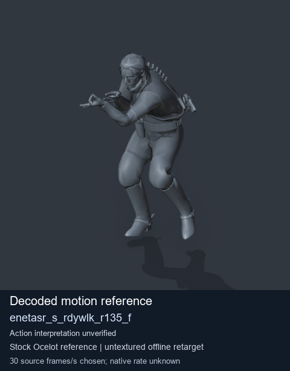
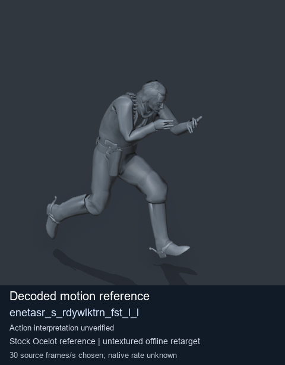
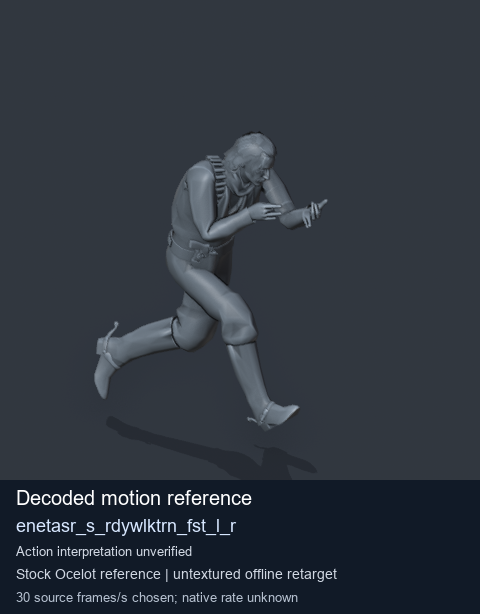
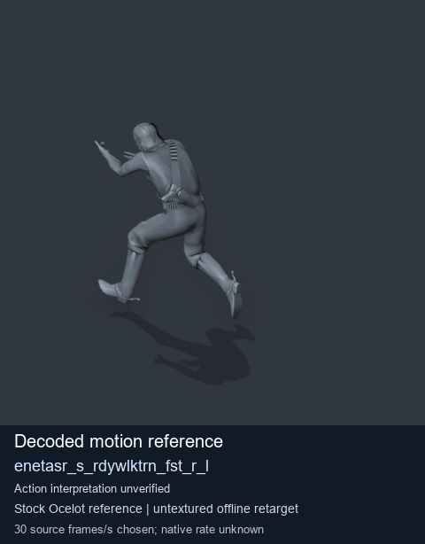

# Stock Soldier_common motion references / /Assets/tpp/motion/SI_game/fani/bodies/enet/enetasr - page 189

[Library](../README.md) · [Grouped directory](../browse/README.md) · [This source family](../browse/stock-soldier-enetasr-dd428991.md) · [Switch mode](browse-stock-soldier-enetasr-dd428991-189.md)

**Still images: no GIFs loaded** · 4 clips · 0.33 MiB downloaded.

Images reuse existing files. A small display width does not reduce download size. Open one clip for its larger titled GIF and original technical data.

Source-family grouping uses only recorded virtual directories; it does not establish an action, weapon, actor, rig or native compatibility. Existing descriptions and tags below are unchanged. Per-clip visual review may be pending; chosen preview speed is separate from unmeasured native timing.

| Preview | Animation | Category | Tags | Virtual GANI directory / file | MTAR / container location | Description | Frames / data |
| --- | --- | --- | --- | --- | --- | --- | --- |
|  | [Stock motion reference: enetasr_s_rdywlk_r135_f](../clips/mgsv-tpp-soldier_common-payloadsha256-a71a343a7b7a044db97676a508491c6ed575accf1c0db04829c00041b43ddc97.md) <code>enetasr_s_rdywlk_r135_f</code> | Stock Soldier_common motion references | <code>stock body motion</code> <code>Soldier_common</code> <code>source-derived label</code> <code>Ocelot reference mesh</code> | <code>/Assets/tpp/motion/SI_game/fani/bodies/enet/enetasr</code> <code>enetasr_s_rdywlk_r135_f.gani</code> | Retained MTAR: <code>Soldier_common.mtar</code> DAT / FPK membership unverified | Decoded stock body-motion reference enetasr_s_rdywlk_r135_f; action interpretation unverified. | 72 raw 2.4 s chosen; native rate unknown [Full data](../clips/mgsv-tpp-soldier_common-payloadsha256-a71a343a7b7a044db97676a508491c6ed575accf1c0db04829c00041b43ddc97.md#technical-data) |
|  | [Stock reference: enetasr_s_rdywlktrn_fst_l_l](../clips/mgsv-tpp-soldier_common-payloadsha256-f655a0a095d91f8e4b37b8cf7a2661e56dd8f3d1eb62f210aff13dcac855243f.md) <code>enetasr_s_rdywlktrn_fst_l_l</code> | Stock Soldier_common motion references | <code>stock animation reference</code> <code>Soldier_common</code> <code>source-derived label</code> <code>Ocelot reference mesh</code> | <code>/Assets/tpp/motion/SI_game/fani/bodies/enet/enetasr</code> <code>enetasr_s_rdywlktrn_fst_l_l.gani</code> | Retained MTAR: <code>Soldier_common.mtar</code> DAT / FPK membership unverified | Decoded stock reference enetasr_s_rdywlktrn_fst_l_l; action interpretation unverified. | 41 raw 1.37 s chosen; native rate unknown [Full data](../clips/mgsv-tpp-soldier_common-payloadsha256-f655a0a095d91f8e4b37b8cf7a2661e56dd8f3d1eb62f210aff13dcac855243f.md#technical-data) |
|  | [Stock reference: enetasr_s_rdywlktrn_fst_l_r](../clips/mgsv-tpp-soldier_common-payloadsha256-356f7cb4c95bb79b27e1954e33565fa543d03f1b7200800e4aeb640a423e247a.md) <code>enetasr_s_rdywlktrn_fst_l_r</code> | Stock Soldier_common motion references | <code>stock animation reference</code> <code>Soldier_common</code> <code>source-derived label</code> <code>Ocelot reference mesh</code> | <code>/Assets/tpp/motion/SI_game/fani/bodies/enet/enetasr</code> <code>enetasr_s_rdywlktrn_fst_l_r.gani</code> | Retained MTAR: <code>Soldier_common.mtar</code> DAT / FPK membership unverified | Decoded stock reference enetasr_s_rdywlktrn_fst_l_r; action interpretation unverified. | 41 raw 1.37 s chosen; native rate unknown [Full data](../clips/mgsv-tpp-soldier_common-payloadsha256-356f7cb4c95bb79b27e1954e33565fa543d03f1b7200800e4aeb640a423e247a.md#technical-data) |
|  | [Stock motion reference: enetasr_s_rdywlktrn_fst_r_l](../clips/mgsv-tpp-soldier_common-payloadsha256-675f66101864685ded22096128e627ed5e025d4e2ac95e20cc36618a81be6195.md) <code>enetasr_s_rdywlktrn_fst_r_l</code> | Stock Soldier_common motion references | <code>stock body motion</code> <code>Soldier_common</code> <code>source-derived label</code> <code>Ocelot reference mesh</code> | <code>/Assets/tpp/motion/SI_game/fani/bodies/enet/enetasr</code> <code>enetasr_s_rdywlktrn_fst_r_l.gani</code> | Retained MTAR: <code>Soldier_common.mtar</code> DAT / FPK membership unverified | Decoded stock body-motion reference enetasr_s_rdywlktrn_fst_r_l; action interpretation unverified. | 41 raw 1.37 s chosen; native rate unknown [Full data](../clips/mgsv-tpp-soldier_common-payloadsha256-675f66101864685ded22096128e627ed5e025d4e2ac95e20cc36618a81be6195.md#technical-data) |

[Source descriptions, confidence and credits](../description-sources.md) · [Complete JSON](../catalogue.json) · [CSV](../catalogue.csv)
