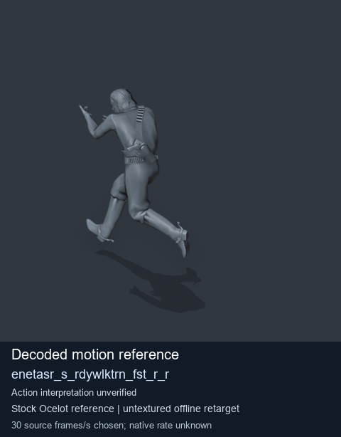
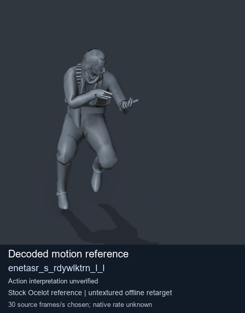
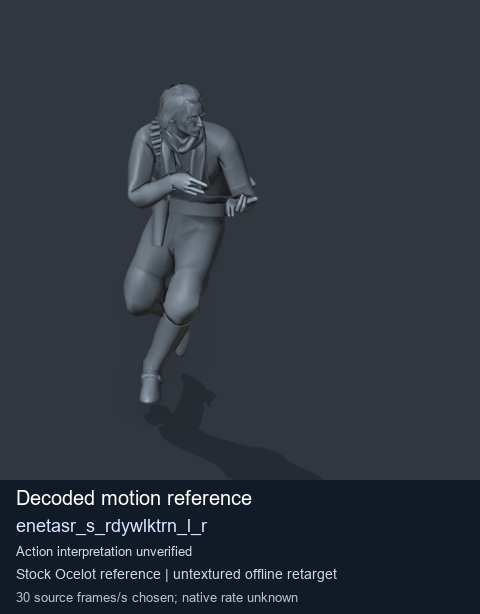
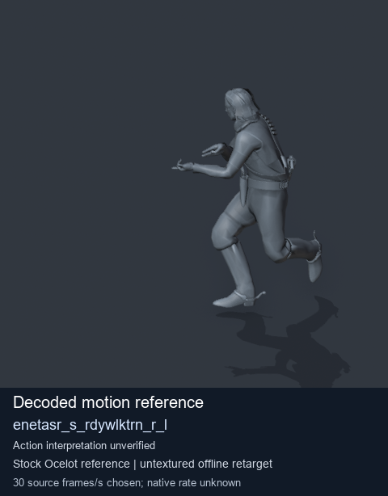

# Stock Soldier_common motion references / /Assets/tpp/motion/SI_game/fani/bodies/enet/enetasr - page 190

[Library](../README.md) · [Grouped directory](../browse/README.md) · [This source family](../browse/stock-soldier-enetasr-dd428991.md) · [Switch mode](browse-stock-soldier-enetasr-dd428991-190.md)

**Still images: no GIFs loaded** · 4 clips · 0.31 MiB downloaded.

Images reuse existing files. A small display width does not reduce download size. Open one clip for its larger titled GIF and original technical data.

Source-family grouping uses only recorded virtual directories; it does not establish an action, weapon, actor, rig or native compatibility. Existing descriptions and tags below are unchanged. Per-clip visual review may be pending; chosen preview speed is separate from unmeasured native timing.

| Preview | Animation | Category | Tags | Virtual GANI directory / file | MTAR / container location | Description | Frames / data |
| --- | --- | --- | --- | --- | --- | --- | --- |
|  | [Stock reference: enetasr_s_rdywlktrn_fst_r_r](../clips/mgsv-tpp-soldier_common-payloadsha256-d0d0b9e998702cb5169827c1c2747d26ce11314b779a1c85c70b622fcf0ad2d8.md) <code>enetasr_s_rdywlktrn_fst_r_r</code> | Stock Soldier_common motion references | <code>stock animation reference</code> <code>Soldier_common</code> <code>source-derived label</code> <code>Ocelot reference mesh</code> | <code>/Assets/tpp/motion/SI_game/fani/bodies/enet/enetasr</code> <code>enetasr_s_rdywlktrn_fst_r_r.gani</code> | Retained MTAR: <code>Soldier_common.mtar</code> DAT / FPK membership unverified | Decoded stock reference enetasr_s_rdywlktrn_fst_r_r; action interpretation unverified. | 41 raw 1.37 s chosen; native rate unknown [Full data](../clips/mgsv-tpp-soldier_common-payloadsha256-d0d0b9e998702cb5169827c1c2747d26ce11314b779a1c85c70b622fcf0ad2d8.md#technical-data) |
|  | [Stock reference: enetasr_s_rdywlktrn_l_l](../clips/mgsv-tpp-soldier_common-payloadsha256-e0ac1fc5245ab1f3ded24a3b94ad925f2f1bd2b8ec0449ef25a2d916cc0abd2e.md) <code>enetasr_s_rdywlktrn_l_l</code> | Stock Soldier_common motion references | <code>stock animation reference</code> <code>Soldier_common</code> <code>source-derived label</code> <code>Ocelot reference mesh</code> | <code>/Assets/tpp/motion/SI_game/fani/bodies/enet/enetasr</code> <code>enetasr_s_rdywlktrn_l_l.gani</code> | Retained MTAR: <code>Soldier_common.mtar</code> DAT / FPK membership unverified | Decoded stock reference enetasr_s_rdywlktrn_l_l; action interpretation unverified. | 83 raw 2.77 s chosen; native rate unknown [Full data](../clips/mgsv-tpp-soldier_common-payloadsha256-e0ac1fc5245ab1f3ded24a3b94ad925f2f1bd2b8ec0449ef25a2d916cc0abd2e.md#technical-data) |
|  | [Stock reference: enetasr_s_rdywlktrn_l_r](../clips/mgsv-tpp-soldier_common-payloadsha256-2d6d5def175f25d4a346402275a3765b26a44a2810bc9de9cad76af9ea3677b7.md) <code>enetasr_s_rdywlktrn_l_r</code> | Stock Soldier_common motion references | <code>stock animation reference</code> <code>Soldier_common</code> <code>source-derived label</code> <code>Ocelot reference mesh</code> | <code>/Assets/tpp/motion/SI_game/fani/bodies/enet/enetasr</code> <code>enetasr_s_rdywlktrn_l_r.gani</code> | Retained MTAR: <code>Soldier_common.mtar</code> DAT / FPK membership unverified | Decoded stock reference enetasr_s_rdywlktrn_l_r; action interpretation unverified. | 90 raw 3.0 s chosen; native rate unknown [Full data](../clips/mgsv-tpp-soldier_common-payloadsha256-2d6d5def175f25d4a346402275a3765b26a44a2810bc9de9cad76af9ea3677b7.md#technical-data) |
|  | [Stock motion reference: enetasr_s_rdywlktrn_r_l](../clips/mgsv-tpp-soldier_common-payloadsha256-0748d746d4013d36239ce97e46d2bf425ddb112d3318fbc7c19bcdd4335b46d1.md) <code>enetasr_s_rdywlktrn_r_l</code> | Stock Soldier_common motion references | <code>stock body motion</code> <code>Soldier_common</code> <code>source-derived label</code> <code>Ocelot reference mesh</code> | <code>/Assets/tpp/motion/SI_game/fani/bodies/enet/enetasr</code> <code>enetasr_s_rdywlktrn_r_l.gani</code> | Retained MTAR: <code>Soldier_common.mtar</code> DAT / FPK membership unverified | Decoded stock body-motion reference enetasr_s_rdywlktrn_r_l; action interpretation unverified. | 87 raw 2.9 s chosen; native rate unknown [Full data](../clips/mgsv-tpp-soldier_common-payloadsha256-0748d746d4013d36239ce97e46d2bf425ddb112d3318fbc7c19bcdd4335b46d1.md#technical-data) |

[Source descriptions, confidence and credits](../description-sources.md) · [Complete JSON](../catalogue.json) · [CSV](../catalogue.csv)
