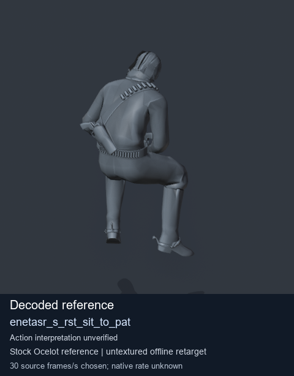
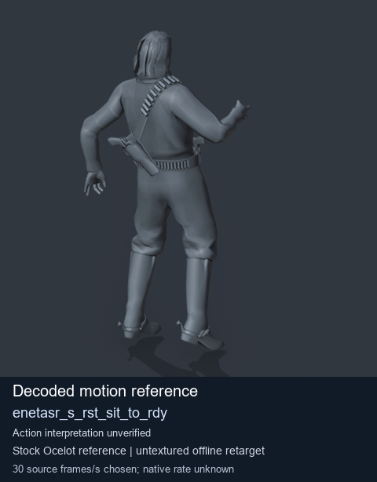
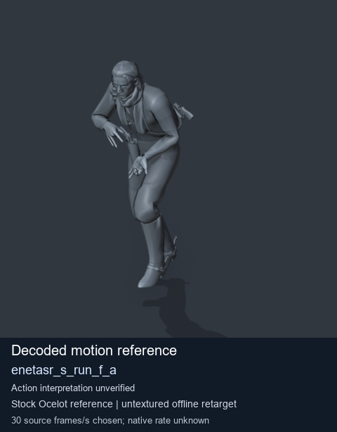

# Stock Soldier_common motion references / /Assets/tpp/motion/SI_game/fani/bodies/enet/enetasr - page 194

[Library](../README.md) · [Grouped directory](../browse/README.md) · [This source family](../browse/stock-soldier-enetasr-dd428991.md) · [Switch mode](browse-stock-soldier-enetasr-dd428991-194.md)

**Still images: no GIFs loaded** · 3 clips · 0.26 MiB downloaded.

Images reuse existing files. A small display width does not reduce download size. Open one clip for its larger titled GIF and original technical data.

Source-family grouping uses only recorded virtual directories; it does not establish an action, weapon, actor, rig or native compatibility. Existing descriptions and tags below are unchanged. Per-clip visual review may be pending; chosen preview speed is separate from unmeasured native timing.

| Preview | Animation | Category | Tags | Virtual GANI directory / file | MTAR / container location | Description | Frames / data |
| --- | --- | --- | --- | --- | --- | --- | --- |
|  | [Stock reference: enetasr_s_rst_sit_to_pat](../clips/mgsv-tpp-soldier_common-payloadsha256-a83502c829902725c9035295aa877804fc66b07aca20ef354acf6d2bb3f36167.md) <code>enetasr_s_rst_sit_to_pat</code> | Stock Soldier_common motion references | <code>stock animation reference</code> <code>Soldier_common</code> <code>source-derived label</code> <code>Ocelot reference mesh</code> | <code>/Assets/tpp/motion/SI_game/fani/bodies/enet/enetasr</code> <code>enetasr_s_rst_sit_to_pat.gani</code> | Retained MTAR: <code>Soldier_common.mtar</code> DAT / FPK membership unverified | Decoded stock reference enetasr_s_rst_sit_to_pat; action interpretation unverified. | 310 raw 10.33 s chosen; native rate unknown [Full data](../clips/mgsv-tpp-soldier_common-payloadsha256-a83502c829902725c9035295aa877804fc66b07aca20ef354acf6d2bb3f36167.md#technical-data) |
|  | [Stock motion reference: enetasr_s_rst_sit_to_rdy](../clips/mgsv-tpp-soldier_common-payloadsha256-346e9b537328bdbec1fb2790dee78f1f28dc4e3df64180de75a6f05f6ef8f5ef.md) <code>enetasr_s_rst_sit_to_rdy</code> | Stock Soldier_common motion references | <code>stock body motion</code> <code>Soldier_common</code> <code>source-derived label</code> <code>Ocelot reference mesh</code> | <code>/Assets/tpp/motion/SI_game/fani/bodies/enet/enetasr</code> <code>enetasr_s_rst_sit_to_rdy.gani</code> | Retained MTAR: <code>Soldier_common.mtar</code> DAT / FPK membership unverified | Decoded stock body-motion reference enetasr_s_rst_sit_to_rdy; action interpretation unverified. | 80 raw 2.67 s chosen; native rate unknown [Full data](../clips/mgsv-tpp-soldier_common-payloadsha256-346e9b537328bdbec1fb2790dee78f1f28dc4e3df64180de75a6f05f6ef8f5ef.md#technical-data) |
|  | [Stock motion reference: enetasr_s_run_f_a](../clips/mgsv-tpp-soldier_common-payloadsha256-68fad6d2a777149fedb8102bce6b5174afbc64969d0032257bf577cd37df4846.md) <code>enetasr_s_run_f_a</code> | Stock Soldier_common motion references | <code>stock body motion</code> <code>Soldier_common</code> <code>source-derived label</code> <code>Ocelot reference mesh</code> | <code>/Assets/tpp/motion/SI_game/fani/bodies/enet/enetasr</code> <code>enetasr_s_run_f_a.gani</code> | Retained MTAR: <code>Soldier_common.mtar</code> DAT / FPK membership unverified | Decoded stock body-motion reference enetasr_s_run_f_a; action interpretation unverified. | 48 raw 1.6 s chosen; native rate unknown [Full data](../clips/mgsv-tpp-soldier_common-payloadsha256-68fad6d2a777149fedb8102bce6b5174afbc64969d0032257bf577cd37df4846.md#technical-data) |

[Source descriptions, confidence and credits](../description-sources.md) · [Complete JSON](../catalogue.json) · [CSV](../catalogue.csv)
