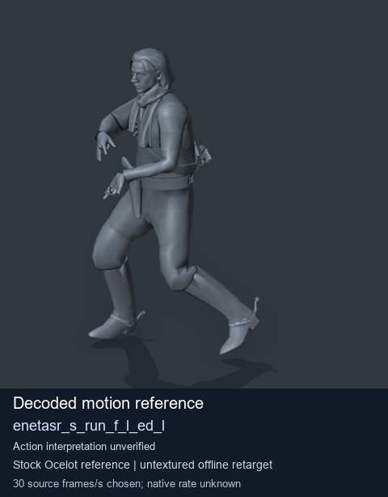
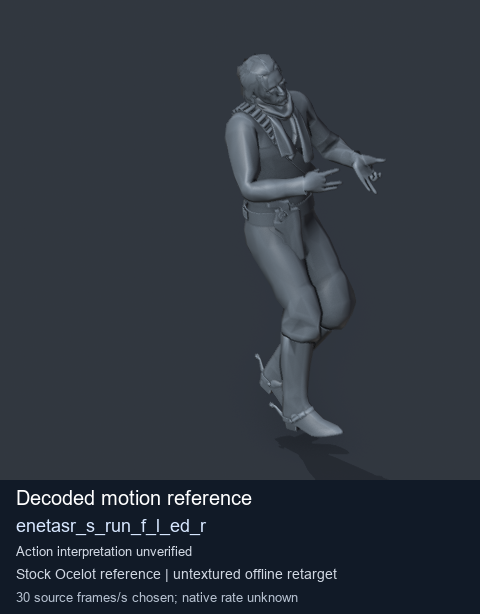
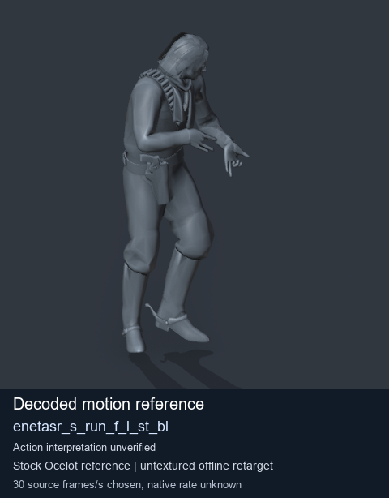
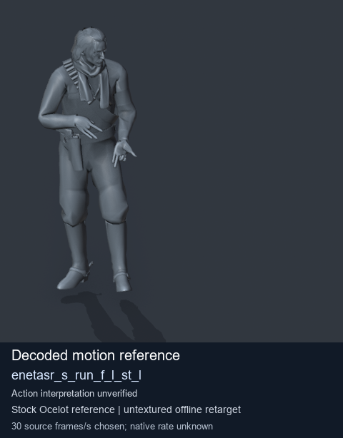

# Stock Soldier_common motion references / /Assets/tpp/motion/SI_game/fani/bodies/enet/enetasr - page 196

[Library](../README.md) · [Grouped directory](../browse/README.md) · [This source family](../browse/stock-soldier-enetasr-dd428991.md) · [Switch mode](browse-stock-soldier-enetasr-dd428991-196.md)

**Still images: no GIFs loaded** · 4 clips · 0.36 MiB downloaded.

Images reuse existing files. A small display width does not reduce download size. Open one clip for its larger titled GIF and original technical data.

Source-family grouping uses only recorded virtual directories; it does not establish an action, weapon, actor, rig or native compatibility. Existing descriptions and tags below are unchanged. Per-clip visual review may be pending; chosen preview speed is separate from unmeasured native timing.

| Preview | Animation | Category | Tags | Virtual GANI directory / file | MTAR / container location | Description | Frames / data |
| --- | --- | --- | --- | --- | --- | --- | --- |
|  | [Stock reference: enetasr_s_run_f_l_ed_l](../clips/mgsv-tpp-soldier_common-payloadsha256-61c52141efb812153350f97fe06433019a91a4d9c64274f29b8dabe1b8ab2e0b.md) <code>enetasr_s_run_f_l_ed_l</code> | Stock Soldier_common motion references | <code>stock animation reference</code> <code>Soldier_common</code> <code>source-derived label</code> <code>Ocelot reference mesh</code> | <code>/Assets/tpp/motion/SI_game/fani/bodies/enet/enetasr</code> <code>enetasr_s_run_f_l_ed_l.gani</code> | Retained MTAR: <code>Soldier_common.mtar</code> DAT / FPK membership unverified | Decoded stock reference enetasr_s_run_f_l_ed_l; action interpretation unverified. | 85 raw 2.83 s chosen; native rate unknown [Full data](../clips/mgsv-tpp-soldier_common-payloadsha256-61c52141efb812153350f97fe06433019a91a4d9c64274f29b8dabe1b8ab2e0b.md#technical-data) |
|  | [Stock reference: enetasr_s_run_f_l_ed_r](../clips/mgsv-tpp-soldier_common-payloadsha256-2b3946606ab43cf3e13c530c8681c963147abd018fe469d0454031a3fb1d9e28.md) <code>enetasr_s_run_f_l_ed_r</code> | Stock Soldier_common motion references | <code>stock animation reference</code> <code>Soldier_common</code> <code>source-derived label</code> <code>Ocelot reference mesh</code> | <code>/Assets/tpp/motion/SI_game/fani/bodies/enet/enetasr</code> <code>enetasr_s_run_f_l_ed_r.gani</code> | Retained MTAR: <code>Soldier_common.mtar</code> DAT / FPK membership unverified | Decoded stock reference enetasr_s_run_f_l_ed_r; action interpretation unverified. | 120 raw 4.0 s chosen; native rate unknown [Full data](../clips/mgsv-tpp-soldier_common-payloadsha256-2b3946606ab43cf3e13c530c8681c963147abd018fe469d0454031a3fb1d9e28.md#technical-data) |
|  | [Stock motion reference: enetasr_s_run_f_l_st_bl](../clips/mgsv-tpp-soldier_common-payloadsha256-63202e628dcbe392436effa036165f589354782052addbf43e0f2d1d67e7089b.md) <code>enetasr_s_run_f_l_st_bl</code> | Stock Soldier_common motion references | <code>stock body motion</code> <code>Soldier_common</code> <code>source-derived label</code> <code>Ocelot reference mesh</code> | <code>/Assets/tpp/motion/SI_game/fani/bodies/enet/enetasr</code> <code>enetasr_s_run_f_l_st_bl.gani</code> | Retained MTAR: <code>Soldier_common.mtar</code> DAT / FPK membership unverified | Decoded stock body-motion reference enetasr_s_run_f_l_st_bl; action interpretation unverified. | 75 raw 2.5 s chosen; native rate unknown [Full data](../clips/mgsv-tpp-soldier_common-payloadsha256-63202e628dcbe392436effa036165f589354782052addbf43e0f2d1d67e7089b.md#technical-data) |
|  | [Stock motion reference: enetasr_s_run_f_l_st_l](../clips/mgsv-tpp-soldier_common-payloadsha256-862ff39d0b10f6c91f419bd2ffd45d4dcbcd9ec421b59fa31e1c0de03971ace3.md) <code>enetasr_s_run_f_l_st_l</code> | Stock Soldier_common motion references | <code>stock body motion</code> <code>Soldier_common</code> <code>source-derived label</code> <code>Ocelot reference mesh</code> | <code>/Assets/tpp/motion/SI_game/fani/bodies/enet/enetasr</code> <code>enetasr_s_run_f_l_st_l.gani</code> | Retained MTAR: <code>Soldier_common.mtar</code> DAT / FPK membership unverified | Decoded stock body-motion reference enetasr_s_run_f_l_st_l; action interpretation unverified. | 115 raw 3.83 s chosen; native rate unknown [Full data](../clips/mgsv-tpp-soldier_common-payloadsha256-862ff39d0b10f6c91f419bd2ffd45d4dcbcd9ec421b59fa31e1c0de03971ace3.md#technical-data) |

[Source descriptions, confidence and credits](../description-sources.md) · [Complete JSON](../catalogue.json) · [CSV](../catalogue.csv)
