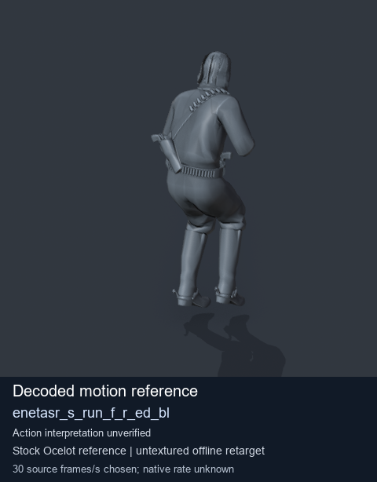
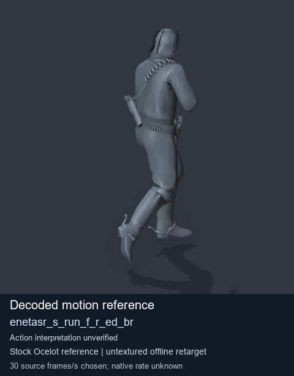
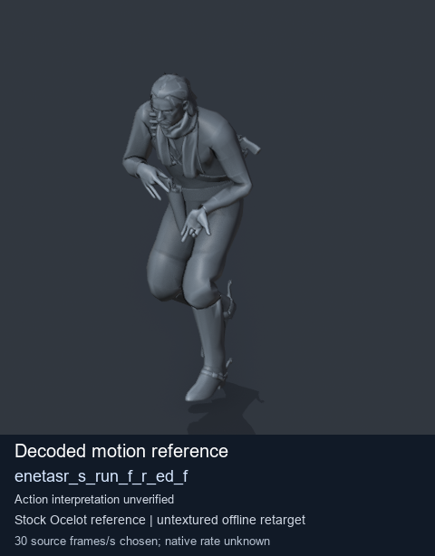

# Stock Soldier_common motion references / /Assets/tpp/motion/SI_game/fani/bodies/enet/enetasr - page 197

[Library](../README.md) · [Grouped directory](../browse/README.md) · [This source family](../browse/stock-soldier-enetasr-dd428991.md) · [Switch mode](browse-stock-soldier-enetasr-dd428991-197.md)

**Still images: no GIFs loaded** · 3 clips · 0.24 MiB downloaded.

Images reuse existing files. A small display width does not reduce download size. Open one clip for its larger titled GIF and original technical data.

Source-family grouping uses only recorded virtual directories; it does not establish an action, weapon, actor, rig or native compatibility. Existing descriptions and tags below are unchanged. Per-clip visual review may be pending; chosen preview speed is separate from unmeasured native timing.

| Preview | Animation | Category | Tags | Virtual GANI directory / file | MTAR / container location | Description | Frames / data |
| --- | --- | --- | --- | --- | --- | --- | --- |
|  | [Stock reference: enetasr_s_run_f_r_ed_bl](../clips/mgsv-tpp-soldier_common-payloadsha256-6c6eaa1b4fb5fdc91c228827fc69c8310ed94237eeb69be54f8d585a4bb42c89.md) <code>enetasr_s_run_f_r_ed_bl</code> | Stock Soldier_common motion references | <code>stock animation reference</code> <code>Soldier_common</code> <code>source-derived label</code> <code>Ocelot reference mesh</code> | <code>/Assets/tpp/motion/SI_game/fani/bodies/enet/enetasr</code> <code>enetasr_s_run_f_r_ed_bl.gani</code> | Retained MTAR: <code>Soldier_common.mtar</code> DAT / FPK membership unverified | Decoded stock reference enetasr_s_run_f_r_ed_bl; action interpretation unverified. | 201 raw 6.7 s chosen; native rate unknown [Full data](../clips/mgsv-tpp-soldier_common-payloadsha256-6c6eaa1b4fb5fdc91c228827fc69c8310ed94237eeb69be54f8d585a4bb42c89.md#technical-data) |
|  | [Stock reference: enetasr_s_run_f_r_ed_br](../clips/mgsv-tpp-soldier_common-payloadsha256-620d9fb7e78113801dd1419dfca982015ada64d7d9caca0bae72cabe1eae636e.md) <code>enetasr_s_run_f_r_ed_br</code> | Stock Soldier_common motion references | <code>stock animation reference</code> <code>Soldier_common</code> <code>source-derived label</code> <code>Ocelot reference mesh</code> | <code>/Assets/tpp/motion/SI_game/fani/bodies/enet/enetasr</code> <code>enetasr_s_run_f_r_ed_br.gani</code> | Retained MTAR: <code>Soldier_common.mtar</code> DAT / FPK membership unverified | Decoded stock reference enetasr_s_run_f_r_ed_br; action interpretation unverified. | 167 raw 5.57 s chosen; native rate unknown [Full data](../clips/mgsv-tpp-soldier_common-payloadsha256-620d9fb7e78113801dd1419dfca982015ada64d7d9caca0bae72cabe1eae636e.md#technical-data) |
|  | [Stock reference: enetasr_s_run_f_r_ed_f](../clips/mgsv-tpp-soldier_common-payloadsha256-35faa2d6445ab223c5c982824cafc1a0f7f27bb8b7375cdfd5de2af2eaed807d.md) <code>enetasr_s_run_f_r_ed_f</code> | Stock Soldier_common motion references | <code>stock animation reference</code> <code>Soldier_common</code> <code>source-derived label</code> <code>Ocelot reference mesh</code> | <code>/Assets/tpp/motion/SI_game/fani/bodies/enet/enetasr</code> <code>enetasr_s_run_f_r_ed_f.gani</code> | Retained MTAR: <code>Soldier_common.mtar</code> DAT / FPK membership unverified | Decoded stock reference enetasr_s_run_f_r_ed_f; action interpretation unverified. | 120 raw 4.0 s chosen; native rate unknown [Full data](../clips/mgsv-tpp-soldier_common-payloadsha256-35faa2d6445ab223c5c982824cafc1a0f7f27bb8b7375cdfd5de2af2eaed807d.md#technical-data) |

[Source descriptions, confidence and credits](../description-sources.md) · [Complete JSON](../catalogue.json) · [CSV](../catalogue.csv)
