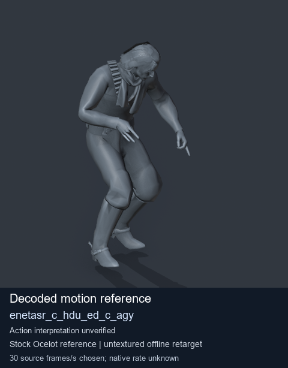
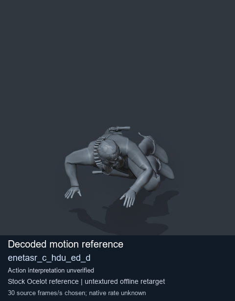

# Stock Soldier_common motion references / /Assets/tpp/motion/SI_game/fani/bodies/enet/enetasr - page 2

[Library](../README.md) · [Grouped directory](../browse/README.md) · [This source family](../browse/stock-soldier-enetasr-dd428991.md) · [Switch mode](browse-stock-soldier-enetasr-dd428991-2.md)

**Still images: no GIFs loaded** · 2 clips · 0.17 MiB downloaded.

Images reuse existing files. A small display width does not reduce download size. Open one clip for its larger titled GIF and original technical data.

Source-family grouping uses only recorded virtual directories; it does not establish an action, weapon, actor, rig or native compatibility. Existing descriptions and tags below are unchanged. Per-clip visual review may be pending; chosen preview speed is separate from unmeasured native timing.

| Preview | Animation | Category | Tags | Virtual GANI directory / file | MTAR / container location | Description | Frames / data |
| --- | --- | --- | --- | --- | --- | --- | --- |
|  | [Stock reference: enetasr_c_hdu_ed_c_agy](../clips/mgsv-tpp-soldier_common-payloadsha256-3072f66d2bcbb349a42fc858b33dd42146615be4771b35b4ce945a0cddc93331.md) <code>enetasr_c_hdu_ed_c_agy</code> | Stock Soldier_common motion references | <code>stock animation reference</code> <code>Soldier_common</code> <code>source-derived label</code> <code>Ocelot reference mesh</code> | <code>/Assets/tpp/motion/SI_game/fani/bodies/enet/enetasr</code> <code>enetasr_c_hdu_ed_c_agy.gani</code> | Retained MTAR: <code>Soldier_common.mtar</code> DAT / FPK membership unverified | Decoded stock reference enetasr_c_hdu_ed_c_agy; action interpretation unverified. | 192 raw 6.4 s chosen; native rate unknown [Full data](../clips/mgsv-tpp-soldier_common-payloadsha256-3072f66d2bcbb349a42fc858b33dd42146615be4771b35b4ce945a0cddc93331.md#technical-data) |
|  | [Stock reference: enetasr_c_hdu_ed_d](../clips/mgsv-tpp-soldier_common-payloadsha256-62ee41ede6c557906ced8ebd0b011a747a33b9f3e83a98ee01af85ba85c165a3.md) <code>enetasr_c_hdu_ed_d</code> | Stock Soldier_common motion references | <code>stock animation reference</code> <code>Soldier_common</code> <code>source-derived label</code> <code>Ocelot reference mesh</code> | <code>/Assets/tpp/motion/SI_game/fani/bodies/enet/enetasr</code> <code>enetasr_c_hdu_ed_d.gani</code> | Retained MTAR: <code>Soldier_common.mtar</code> DAT / FPK membership unverified | Decoded stock reference enetasr_c_hdu_ed_d; action interpretation unverified. | 250 raw 8.33 s chosen; native rate unknown [Full data](../clips/mgsv-tpp-soldier_common-payloadsha256-62ee41ede6c557906ced8ebd0b011a747a33b9f3e83a98ee01af85ba85c165a3.md#technical-data) |

[Source descriptions, confidence and credits](../description-sources.md) · [Complete JSON](../catalogue.json) · [CSV](../catalogue.csv)
