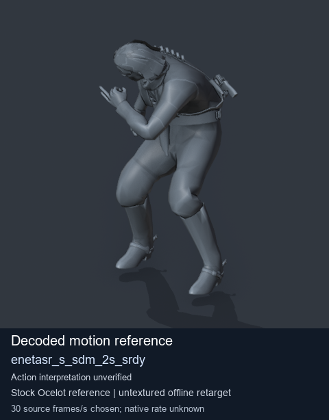
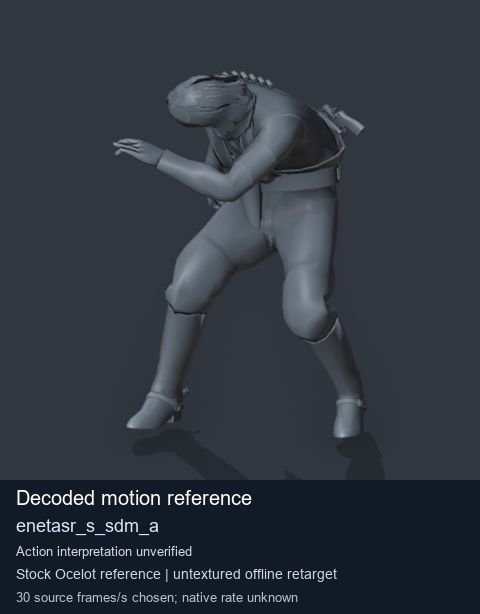
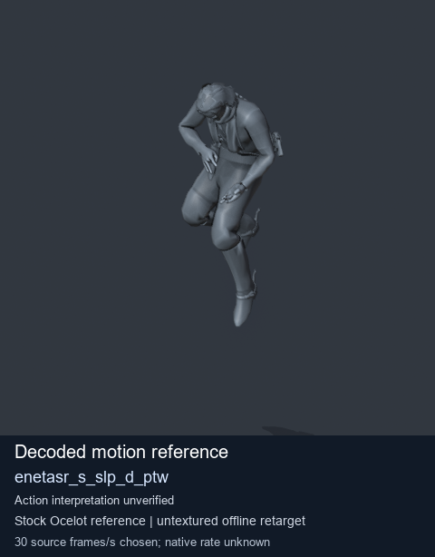

# Stock Soldier_common motion references / /Assets/tpp/motion/SI_game/fani/bodies/enet/enetasr - page 201

[Library](../README.md) · [Grouped directory](../browse/README.md) · [This source family](../browse/stock-soldier-enetasr-dd428991.md) · [Switch mode](browse-stock-soldier-enetasr-dd428991-201.md)

**Still images: no GIFs loaded** · 3 clips · 0.27 MiB downloaded.

Images reuse existing files. A small display width does not reduce download size. Open one clip for its larger titled GIF and original technical data.

Source-family grouping uses only recorded virtual directories; it does not establish an action, weapon, actor, rig or native compatibility. Existing descriptions and tags below are unchanged. Per-clip visual review may be pending; chosen preview speed is separate from unmeasured native timing.

| Preview | Animation | Category | Tags | Virtual GANI directory / file | MTAR / container location | Description | Frames / data |
| --- | --- | --- | --- | --- | --- | --- | --- |
|  | [Stock motion reference: enetasr_s_sdm_2s_srdy](../clips/mgsv-tpp-soldier_common-payloadsha256-8817f8a79981b1227f4e6d6df85c038411dc43c7108b5d5df90fd5e50536af83.md) <code>enetasr_s_sdm_2s_srdy</code> | Stock Soldier_common motion references | <code>stock body motion</code> <code>Soldier_common</code> <code>source-derived label</code> <code>Ocelot reference mesh</code> | <code>/Assets/tpp/motion/SI_game/fani/bodies/enet/enetasr</code> <code>enetasr_s_sdm_2s_srdy.gani</code> | Retained MTAR: <code>Soldier_common.mtar</code> DAT / FPK membership unverified | Decoded stock body-motion reference enetasr_s_sdm_2s_srdy; action interpretation unverified. | 117 raw 3.9 s chosen; native rate unknown [Full data](../clips/mgsv-tpp-soldier_common-payloadsha256-8817f8a79981b1227f4e6d6df85c038411dc43c7108b5d5df90fd5e50536af83.md#technical-data) |
|  | [Stock reference: enetasr_s_sdm_a](../clips/mgsv-tpp-soldier_common-payloadsha256-8ec68d87b0c02c48ec45d0ea4fe49717e93a17d43be4dccabe6c10d639b06c34.md) <code>enetasr_s_sdm_a</code> | Stock Soldier_common motion references | <code>stock animation reference</code> <code>Soldier_common</code> <code>source-derived label</code> <code>Ocelot reference mesh</code> | <code>/Assets/tpp/motion/SI_game/fani/bodies/enet/enetasr</code> <code>enetasr_s_sdm_a.gani</code> | Retained MTAR: <code>Soldier_common.mtar</code> DAT / FPK membership unverified | Decoded stock reference enetasr_s_sdm_a; action interpretation unverified. | 270 raw 9.0 s chosen; native rate unknown [Full data](../clips/mgsv-tpp-soldier_common-payloadsha256-8ec68d87b0c02c48ec45d0ea4fe49717e93a17d43be4dccabe6c10d639b06c34.md#technical-data) |
|  | [Stock reference: enetasr_s_slp_d_ptw](../clips/mgsv-tpp-soldier_common-payloadsha256-0dc3cd2bf9cb00bbb5b4468001845672f2ce47c2be9942f562b1472ee8e1478e.md) <code>enetasr_s_slp_d_ptw</code> | Stock Soldier_common motion references | <code>stock animation reference</code> <code>Soldier_common</code> <code>source-derived label</code> <code>Ocelot reference mesh</code> | <code>/Assets/tpp/motion/SI_game/fani/bodies/enet/enetasr</code> <code>enetasr_s_slp_d_ptw.gani</code> | Retained MTAR: <code>Soldier_common.mtar</code> DAT / FPK membership unverified | Decoded stock reference enetasr_s_slp_d_ptw; action interpretation unverified. | 90 raw 3.0 s chosen; native rate unknown [Full data](../clips/mgsv-tpp-soldier_common-payloadsha256-0dc3cd2bf9cb00bbb5b4468001845672f2ce47c2be9942f562b1472ee8e1478e.md#technical-data) |

[Source descriptions, confidence and credits](../description-sources.md) · [Complete JSON](../catalogue.json) · [CSV](../catalogue.csv)
