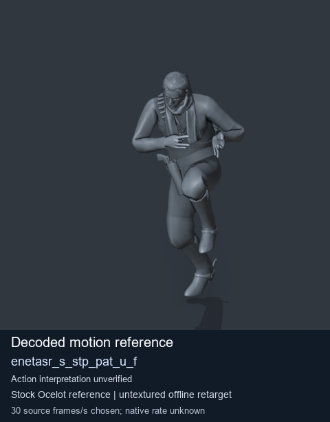
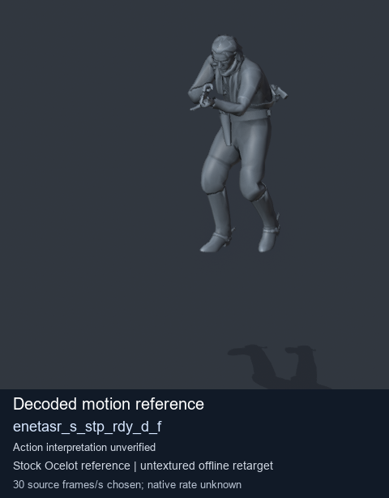
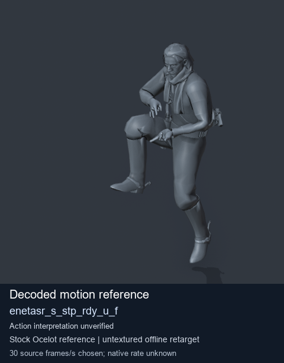
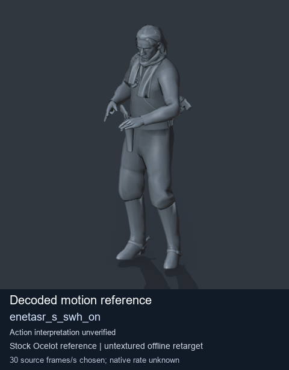

# Stock Soldier_common motion references / /Assets/tpp/motion/SI_game/fani/bodies/enet/enetasr - page 208

[Library](../README.md) · [Grouped directory](../browse/README.md) · [This source family](../browse/stock-soldier-enetasr-dd428991.md) · [Switch mode](browse-stock-soldier-enetasr-dd428991-208.md)

**Still images: no GIFs loaded** · 4 clips · 0.32 MiB downloaded.

Images reuse existing files. A small display width does not reduce download size. Open one clip for its larger titled GIF and original technical data.

Source-family grouping uses only recorded virtual directories; it does not establish an action, weapon, actor, rig or native compatibility. Existing descriptions and tags below are unchanged. Per-clip visual review may be pending; chosen preview speed is separate from unmeasured native timing.

| Preview | Animation | Category | Tags | Virtual GANI directory / file | MTAR / container location | Description | Frames / data |
| --- | --- | --- | --- | --- | --- | --- | --- |
|  | [Stock motion reference: enetasr_s_stp_pat_u_f](../clips/mgsv-tpp-soldier_common-payloadsha256-719159ae2edd343525b052939bdaf7d3539745c261fc56dc44538fcce3572b36.md) <code>enetasr_s_stp_pat_u_f</code> | Stock Soldier_common motion references | <code>stock body motion</code> <code>Soldier_common</code> <code>source-derived label</code> <code>Ocelot reference mesh</code> | <code>/Assets/tpp/motion/SI_game/fani/bodies/enet/enetasr</code> <code>enetasr_s_stp_pat_u_f.gani</code> | Retained MTAR: <code>Soldier_common.mtar</code> DAT / FPK membership unverified | Decoded stock body-motion reference enetasr_s_stp_pat_u_f; action interpretation unverified. | 136 raw 4.53 s chosen; native rate unknown [Full data](../clips/mgsv-tpp-soldier_common-payloadsha256-719159ae2edd343525b052939bdaf7d3539745c261fc56dc44538fcce3572b36.md#technical-data) |
|  | [Stock motion reference: enetasr_s_stp_rdy_d_f](../clips/mgsv-tpp-soldier_common-payloadsha256-340665b58c503104b437caba73b2717f6be04f3f0a4a78667719d942ba515271.md) <code>enetasr_s_stp_rdy_d_f</code> | Stock Soldier_common motion references | <code>stock body motion</code> <code>Soldier_common</code> <code>source-derived label</code> <code>Ocelot reference mesh</code> | <code>/Assets/tpp/motion/SI_game/fani/bodies/enet/enetasr</code> <code>enetasr_s_stp_rdy_d_f.gani</code> | Retained MTAR: <code>Soldier_common.mtar</code> DAT / FPK membership unverified | Decoded stock body-motion reference enetasr_s_stp_rdy_d_f; action interpretation unverified. | 110 raw 3.67 s chosen; native rate unknown [Full data](../clips/mgsv-tpp-soldier_common-payloadsha256-340665b58c503104b437caba73b2717f6be04f3f0a4a78667719d942ba515271.md#technical-data) |
|  | [Stock motion reference: enetasr_s_stp_rdy_u_f](../clips/mgsv-tpp-soldier_common-payloadsha256-a5865b829bdea755b6d6711b6daafdb7a32d229c9ee21e983166eef50e0ffdaa.md) <code>enetasr_s_stp_rdy_u_f</code> | Stock Soldier_common motion references | <code>stock body motion</code> <code>Soldier_common</code> <code>source-derived label</code> <code>Ocelot reference mesh</code> | <code>/Assets/tpp/motion/SI_game/fani/bodies/enet/enetasr</code> <code>enetasr_s_stp_rdy_u_f.gani</code> | Retained MTAR: <code>Soldier_common.mtar</code> DAT / FPK membership unverified | Decoded stock body-motion reference enetasr_s_stp_rdy_u_f; action interpretation unverified. | 101 raw 3.37 s chosen; native rate unknown [Full data](../clips/mgsv-tpp-soldier_common-payloadsha256-a5865b829bdea755b6d6711b6daafdb7a32d229c9ee21e983166eef50e0ffdaa.md#technical-data) |
|  | [Stock motion reference: enetasr_s_swh_on](../clips/mgsv-tpp-soldier_common-payloadsha256-91899d01938b446a92144ff7e1c97846119affcdb87762d98943c1f7fc7ca3c3.md) <code>enetasr_s_swh_on</code> | Stock Soldier_common motion references | <code>stock body motion</code> <code>Soldier_common</code> <code>source-derived label</code> <code>Ocelot reference mesh</code> | <code>/Assets/tpp/motion/SI_game/fani/bodies/enet/enetasr</code> <code>enetasr_s_swh_on.gani</code> | Retained MTAR: <code>Soldier_common.mtar</code> DAT / FPK membership unverified | Decoded stock body-motion reference enetasr_s_swh_on; action interpretation unverified. | 130 raw 4.33 s chosen; native rate unknown [Full data](../clips/mgsv-tpp-soldier_common-payloadsha256-91899d01938b446a92144ff7e1c97846119affcdb87762d98943c1f7fc7ca3c3.md#technical-data) |

[Source descriptions, confidence and credits](../description-sources.md) · [Complete JSON](../catalogue.json) · [CSV](../catalogue.csv)
