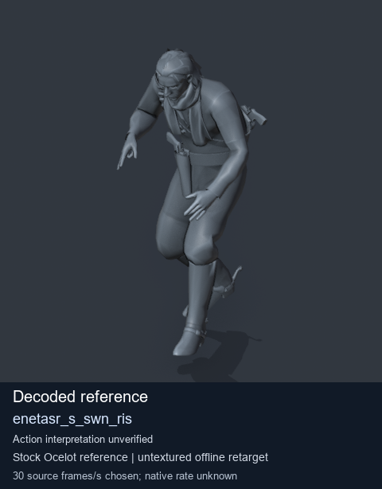
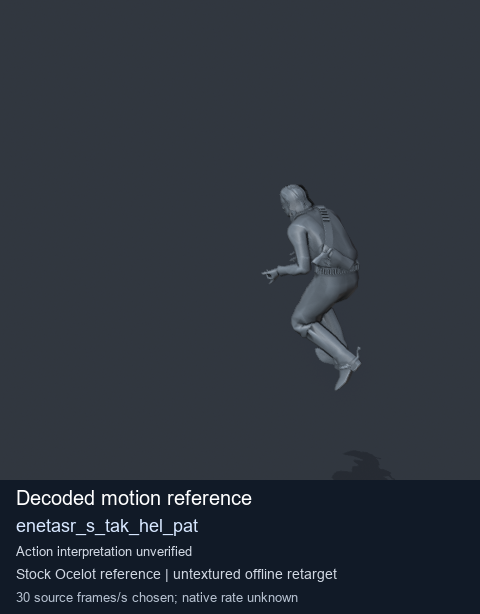

# Stock Soldier_common motion references / /Assets/tpp/motion/SI_game/fani/bodies/enet/enetasr - page 210

[Library](../README.md) · [Grouped directory](../browse/README.md) · [This source family](../browse/stock-soldier-enetasr-dd428991.md) · [Switch mode](browse-stock-soldier-enetasr-dd428991-210.md)

**Still images: no GIFs loaded** · 2 clips · 0.15 MiB downloaded.

Images reuse existing files. A small display width does not reduce download size. Open one clip for its larger titled GIF and original technical data.

Source-family grouping uses only recorded virtual directories; it does not establish an action, weapon, actor, rig or native compatibility. Existing descriptions and tags below are unchanged. Per-clip visual review may be pending; chosen preview speed is separate from unmeasured native timing.

| Preview | Animation | Category | Tags | Virtual GANI directory / file | MTAR / container location | Description | Frames / data |
| --- | --- | --- | --- | --- | --- | --- | --- |
|  | [Stock reference: enetasr_s_swn_ris](../clips/mgsv-tpp-soldier_common-payloadsha256-b4f2701852d726bbd03add78a9cb4b48a68dda103deac32091410ebb26588592.md) <code>enetasr_s_swn_ris</code> | Stock Soldier_common motion references | <code>stock animation reference</code> <code>Soldier_common</code> <code>source-derived label</code> <code>Ocelot reference mesh</code> | <code>/Assets/tpp/motion/SI_game/fani/bodies/enet/enetasr</code> <code>enetasr_s_swn_ris.gani</code> | Retained MTAR: <code>Soldier_common.mtar</code> DAT / FPK membership unverified | Decoded stock reference enetasr_s_swn_ris; action interpretation unverified. | 380 raw 12.67 s chosen; native rate unknown [Full data](../clips/mgsv-tpp-soldier_common-payloadsha256-b4f2701852d726bbd03add78a9cb4b48a68dda103deac32091410ebb26588592.md#technical-data) |
|  | [Stock reference: enetasr_s_tak_hel_pat](../clips/mgsv-tpp-soldier_common-payloadsha256-d062aa7ab2dfb03ec16c1eb4ae756f1aaac46e6adf8cd4b213543b8eb7a38fc2.md) <code>enetasr_s_tak_hel_pat</code> | Stock Soldier_common motion references | <code>stock animation reference</code> <code>Soldier_common</code> <code>source-derived label</code> <code>Ocelot reference mesh</code> | <code>/Assets/tpp/motion/SI_game/fani/bodies/enet/enetasr</code> <code>enetasr_s_tak_hel_pat.gani</code> | Retained MTAR: <code>Soldier_common.mtar</code> DAT / FPK membership unverified | Decoded stock reference enetasr_s_tak_hel_pat; action interpretation unverified. | 150 raw 5.0 s chosen; native rate unknown [Full data](../clips/mgsv-tpp-soldier_common-payloadsha256-d062aa7ab2dfb03ec16c1eb4ae756f1aaac46e6adf8cd4b213543b8eb7a38fc2.md#technical-data) |

[Source descriptions, confidence and credits](../description-sources.md) · [Complete JSON](../catalogue.json) · [CSV](../catalogue.csv)
