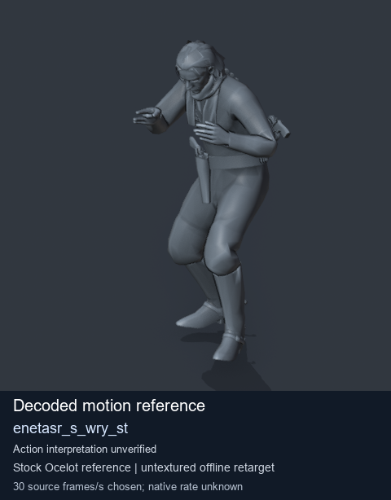
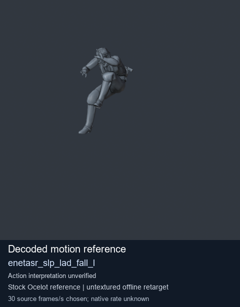
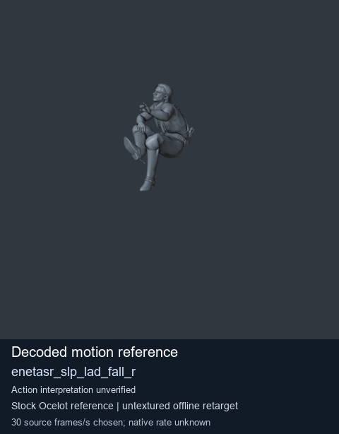
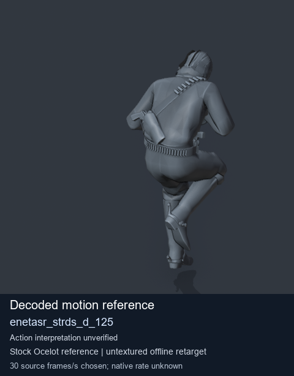

# Stock Soldier_common motion references / /Assets/tpp/motion/SI_game/fani/bodies/enet/enetasr - page 221

[Library](../README.md) · [Grouped directory](../browse/README.md) · [This source family](../browse/stock-soldier-enetasr-dd428991.md) · [Switch mode](browse-stock-soldier-enetasr-dd428991-221.md)

**Still images: no GIFs loaded** · 4 clips · 0.28 MiB downloaded.

Images reuse existing files. A small display width does not reduce download size. Open one clip for its larger titled GIF and original technical data.

Source-family grouping uses only recorded virtual directories; it does not establish an action, weapon, actor, rig or native compatibility. Existing descriptions and tags below are unchanged. Per-clip visual review may be pending; chosen preview speed is separate from unmeasured native timing.

| Preview | Animation | Category | Tags | Virtual GANI directory / file | MTAR / container location | Description | Frames / data |
| --- | --- | --- | --- | --- | --- | --- | --- |
|  | [Stock reference: enetasr_s_wry_st](../clips/mgsv-tpp-soldier_common-payloadsha256-f5eeb2daef752509fb227e16bcd91fc8f9d54dadeeb3839ffbc9e342059b0c0c.md) <code>enetasr_s_wry_st</code> | Stock Soldier_common motion references | <code>stock animation reference</code> <code>Soldier_common</code> <code>source-derived label</code> <code>Ocelot reference mesh</code> | <code>/Assets/tpp/motion/SI_game/fani/bodies/enet/enetasr</code> <code>enetasr_s_wry_st.gani</code> | Retained MTAR: <code>Soldier_common.mtar</code> DAT / FPK membership unverified | Decoded stock reference enetasr_s_wry_st; action interpretation unverified. | 142 raw 4.73 s chosen; native rate unknown [Full data](../clips/mgsv-tpp-soldier_common-payloadsha256-f5eeb2daef752509fb227e16bcd91fc8f9d54dadeeb3839ffbc9e342059b0c0c.md#technical-data) |
|  | [Stock reference: enetasr_slp_lad_fall_l](../clips/mgsv-tpp-soldier_common-payloadsha256-19ab6bede2090930623eafdd2036be30fee1882871dd75e395a8adae20fefd68.md) <code>enetasr_slp_lad_fall_l</code> | Stock Soldier_common motion references | <code>stock animation reference</code> <code>Soldier_common</code> <code>source-derived label</code> <code>Ocelot reference mesh</code> | <code>/Assets/tpp/motion/SI_game/fani/bodies/enet/enetasr</code> <code>enetasr_slp_lad_fall_l.gani</code> | Retained MTAR: <code>Soldier_common.mtar</code> DAT / FPK membership unverified | Decoded stock reference enetasr_slp_lad_fall_l; action interpretation unverified. | 67 raw 2.23 s chosen; native rate unknown [Full data](../clips/mgsv-tpp-soldier_common-payloadsha256-19ab6bede2090930623eafdd2036be30fee1882871dd75e395a8adae20fefd68.md#technical-data) |
|  | [Stock motion reference: enetasr_slp_lad_fall_r](../clips/mgsv-tpp-soldier_common-payloadsha256-d485a759ce227b52918f7afe6dfcb5b7189cf26b909e91dc08e21c0919e2d7ab.md) <code>enetasr_slp_lad_fall_r</code> | Stock Soldier_common motion references | <code>stock body motion</code> <code>Soldier_common</code> <code>source-derived label</code> <code>Ocelot reference mesh</code> | <code>/Assets/tpp/motion/SI_game/fani/bodies/enet/enetasr</code> <code>enetasr_slp_lad_fall_r.gani</code> | Retained MTAR: <code>Soldier_common.mtar</code> DAT / FPK membership unverified | Decoded stock body-motion reference enetasr_slp_lad_fall_r; action interpretation unverified. | 61 raw 2.03 s chosen; native rate unknown [Full data](../clips/mgsv-tpp-soldier_common-payloadsha256-d485a759ce227b52918f7afe6dfcb5b7189cf26b909e91dc08e21c0919e2d7ab.md#technical-data) |
|  | [Stock reference: enetasr_strds_d_125](../clips/mgsv-tpp-soldier_common-payloadsha256-924616d83e69038d46b5116734437ffb77b59993822b3259ab426b51eefd612b.md) <code>enetasr_strds_d_125</code> | Stock Soldier_common motion references | <code>stock animation reference</code> <code>Soldier_common</code> <code>source-derived label</code> <code>Ocelot reference mesh</code> | <code>/Assets/tpp/motion/SI_game/fani/bodies/enet/enetasr</code> <code>enetasr_strds_d_125.gani</code> | Retained MTAR: <code>Soldier_common.mtar</code> DAT / FPK membership unverified | Decoded stock reference enetasr_strds_d_125; action interpretation unverified. | 27 raw 0.9 s chosen; native rate unknown [Full data](../clips/mgsv-tpp-soldier_common-payloadsha256-924616d83e69038d46b5116734437ffb77b59993822b3259ab426b51eefd612b.md#technical-data) |

[Source descriptions, confidence and credits](../description-sources.md) · [Complete JSON](../catalogue.json) · [CSV](../catalogue.csv)
