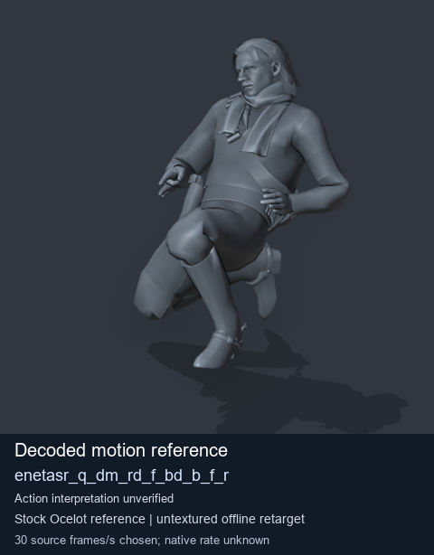
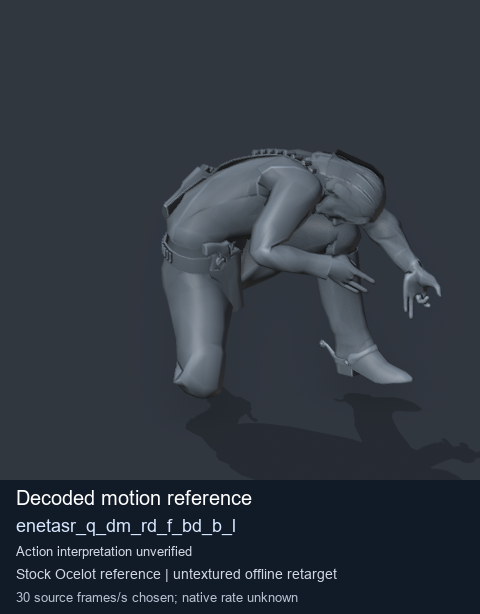
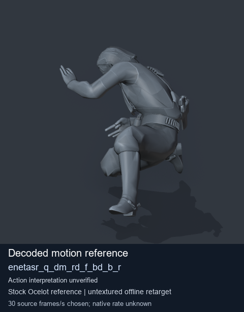

# Stock Soldier_common motion references / /Assets/tpp/motion/SI_game/fani/bodies/enet/enetasr - page 25

[Library](../README.md) · [Grouped directory](../browse/README.md) · [This source family](../browse/stock-soldier-enetasr-dd428991.md) · [Switch mode](browse-stock-soldier-enetasr-dd428991-25.md)

**Still images: no GIFs loaded** · 3 clips · 0.32 MiB downloaded.

Images reuse existing files. A small display width does not reduce download size. Open one clip for its larger titled GIF and original technical data.

Source-family grouping uses only recorded virtual directories; it does not establish an action, weapon, actor, rig or native compatibility. Existing descriptions and tags below are unchanged. Per-clip visual review may be pending; chosen preview speed is separate from unmeasured native timing.

| Preview | Animation | Category | Tags | Virtual GANI directory / file | MTAR / container location | Description | Frames / data |
| --- | --- | --- | --- | --- | --- | --- | --- |
|  | [Stock motion reference: enetasr_q_dm_rd_f_bd_b_f_r](../clips/mgsv-tpp-soldier_common-payloadsha256-e4bec25cc5cc952fb0569bc6348de52a503d953b7f514c834047034a036f242d.md) <code>enetasr_q_dm_rd_f_bd_b_f_r</code> | Stock Soldier_common motion references | <code>stock body motion</code> <code>Soldier_common</code> <code>source-derived label</code> <code>Ocelot reference mesh</code> | <code>/Assets/tpp/motion/SI_game/fani/bodies/enet/enetasr</code> <code>enetasr_q_dm_rd_f_bd_b_f_r.gani</code> | Retained MTAR: <code>Soldier_common.mtar</code> DAT / FPK membership unverified | Decoded stock body-motion reference enetasr_q_dm_rd_f_bd_b_f_r; action interpretation unverified. | 125 raw 4.17 s chosen; native rate unknown [Full data](../clips/mgsv-tpp-soldier_common-payloadsha256-e4bec25cc5cc952fb0569bc6348de52a503d953b7f514c834047034a036f242d.md#technical-data) |
|  | [Stock reference: enetasr_q_dm_rd_f_bd_b_l](../clips/mgsv-tpp-soldier_common-payloadsha256-399c52758a7c89b47a32b9ce3c8bb952fea62aebd7fbe1a5eb3d752dc944ece6.md) <code>enetasr_q_dm_rd_f_bd_b_l</code> | Stock Soldier_common motion references | <code>stock animation reference</code> <code>Soldier_common</code> <code>source-derived label</code> <code>Ocelot reference mesh</code> | <code>/Assets/tpp/motion/SI_game/fani/bodies/enet/enetasr</code> <code>enetasr_q_dm_rd_f_bd_b_l.gani</code> | Retained MTAR: <code>Soldier_common.mtar</code> DAT / FPK membership unverified | Decoded stock reference enetasr_q_dm_rd_f_bd_b_l; action interpretation unverified. | 135 raw 4.5 s chosen; native rate unknown [Full data](../clips/mgsv-tpp-soldier_common-payloadsha256-399c52758a7c89b47a32b9ce3c8bb952fea62aebd7fbe1a5eb3d752dc944ece6.md#technical-data) |
|  | [Stock motion reference: enetasr_q_dm_rd_f_bd_b_r](../clips/mgsv-tpp-soldier_common-payloadsha256-3f5fd2a70a0e9c547f266cae7dc2d829611e1dc12d54841c27f0367fe9b84796.md) <code>enetasr_q_dm_rd_f_bd_b_r</code> | Stock Soldier_common motion references | <code>stock body motion</code> <code>Soldier_common</code> <code>source-derived label</code> <code>Ocelot reference mesh</code> | <code>/Assets/tpp/motion/SI_game/fani/bodies/enet/enetasr</code> <code>enetasr_q_dm_rd_f_bd_b_r.gani</code> | Retained MTAR: <code>Soldier_common.mtar</code> DAT / FPK membership unverified | Decoded stock body-motion reference enetasr_q_dm_rd_f_bd_b_r; action interpretation unverified. | 135 raw 4.5 s chosen; native rate unknown [Full data](../clips/mgsv-tpp-soldier_common-payloadsha256-3f5fd2a70a0e9c547f266cae7dc2d829611e1dc12d54841c27f0367fe9b84796.md#technical-data) |

[Source descriptions, confidence and credits](../description-sources.md) · [Complete JSON](../catalogue.json) · [CSV](../catalogue.csv)
