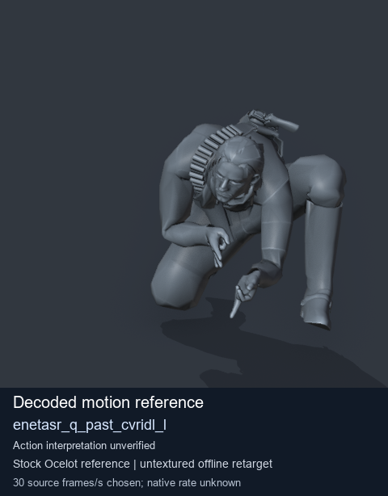
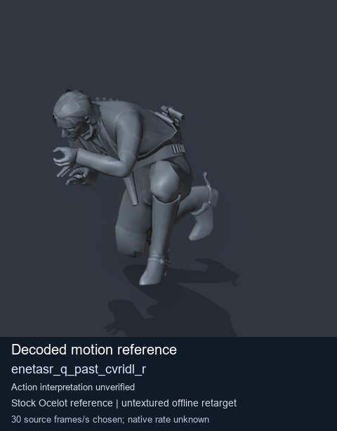
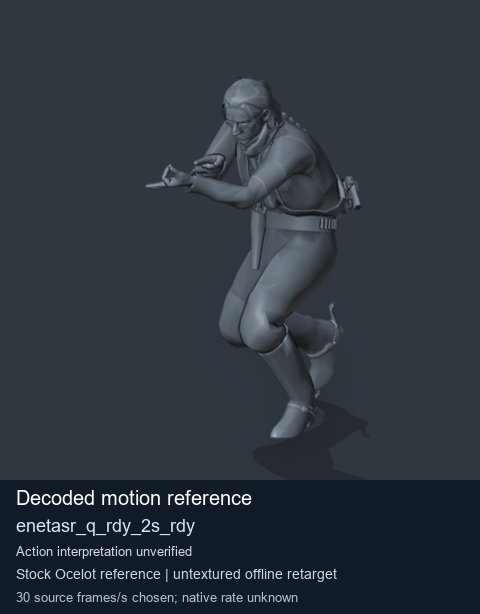
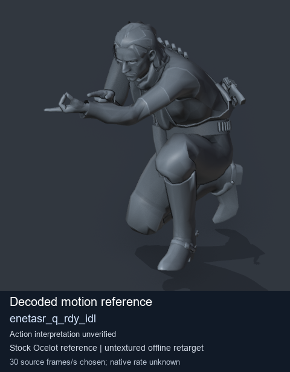

# Stock Soldier_common motion references / /Assets/tpp/motion/SI_game/fani/bodies/enet/enetasr - page 31

[Library](../README.md) · [Grouped directory](../browse/README.md) · [This source family](../browse/stock-soldier-enetasr-dd428991.md) · [Switch mode](browse-stock-soldier-enetasr-dd428991-31.md)

**Still images: no GIFs loaded** · 4 clips · 0.42 MiB downloaded.

Images reuse existing files. A small display width does not reduce download size. Open one clip for its larger titled GIF and original technical data.

Source-family grouping uses only recorded virtual directories; it does not establish an action, weapon, actor, rig or native compatibility. Existing descriptions and tags below are unchanged. Per-clip visual review may be pending; chosen preview speed is separate from unmeasured native timing.

| Preview | Animation | Category | Tags | Virtual GANI directory / file | MTAR / container location | Description | Frames / data |
| --- | --- | --- | --- | --- | --- | --- | --- |
|  | [Stock motion reference: enetasr_q_past_cvridl_l](../clips/mgsv-tpp-soldier_common-payloadsha256-58a87b2cf88b1be6681336ae6c2a10a4fb916d08844c08daf455b669ada96209.md) <code>enetasr_q_past_cvridl_l</code> | Stock Soldier_common motion references | <code>stock body motion</code> <code>Soldier_common</code> <code>source-derived label</code> <code>Ocelot reference mesh</code> | <code>/Assets/tpp/motion/SI_game/fani/bodies/enet/enetasr</code> <code>enetasr_q_past_cvridl_l.gani</code> | Retained MTAR: <code>Soldier_common.mtar</code> DAT / FPK membership unverified | Decoded stock body-motion reference enetasr_q_past_cvridl_l; action interpretation unverified. | 96 raw 3.2 s chosen; native rate unknown [Full data](../clips/mgsv-tpp-soldier_common-payloadsha256-58a87b2cf88b1be6681336ae6c2a10a4fb916d08844c08daf455b669ada96209.md#technical-data) |
|  | [Stock reference: enetasr_q_past_cvridl_r](../clips/mgsv-tpp-soldier_common-payloadsha256-26bcf38243f4e8d1726083b8eb5b4523cb34e94d27089cf1d5f692359b67923c.md) <code>enetasr_q_past_cvridl_r</code> | Stock Soldier_common motion references | <code>stock animation reference</code> <code>Soldier_common</code> <code>source-derived label</code> <code>Ocelot reference mesh</code> | <code>/Assets/tpp/motion/SI_game/fani/bodies/enet/enetasr</code> <code>enetasr_q_past_cvridl_r.gani</code> | Retained MTAR: <code>Soldier_common.mtar</code> DAT / FPK membership unverified | Decoded stock reference enetasr_q_past_cvridl_r; action interpretation unverified. | 104 raw 3.47 s chosen; native rate unknown [Full data](../clips/mgsv-tpp-soldier_common-payloadsha256-26bcf38243f4e8d1726083b8eb5b4523cb34e94d27089cf1d5f692359b67923c.md#technical-data) |
|  | [Stock motion reference: enetasr_q_rdy_2s_rdy](../clips/mgsv-tpp-soldier_common-payloadsha256-b58f8f974e10835924d224e352ef047b8a32ce5400e05e4b7f70fac1b78cbc86.md) <code>enetasr_q_rdy_2s_rdy</code> | Stock Soldier_common motion references | <code>stock body motion</code> <code>Soldier_common</code> <code>source-derived label</code> <code>Ocelot reference mesh</code> | <code>/Assets/tpp/motion/SI_game/fani/bodies/enet/enetasr</code> <code>enetasr_q_rdy_2s_rdy.gani</code> | Retained MTAR: <code>Soldier_common.mtar</code> DAT / FPK membership unverified | Decoded stock body-motion reference enetasr_q_rdy_2s_rdy; action interpretation unverified. | 52 raw 1.73 s chosen; native rate unknown [Full data](../clips/mgsv-tpp-soldier_common-payloadsha256-b58f8f974e10835924d224e352ef047b8a32ce5400e05e4b7f70fac1b78cbc86.md#technical-data) |
|  | [Stock motion reference: enetasr_q_rdy_idl](../clips/mgsv-tpp-soldier_common-payloadsha256-582eef3600d039529e692783526d1986c4571811038f1764290e2ac611a1179b.md) <code>enetasr_q_rdy_idl</code> | Stock Soldier_common motion references | <code>stock body motion</code> <code>Soldier_common</code> <code>source-derived label</code> <code>Ocelot reference mesh</code> | <code>/Assets/tpp/motion/SI_game/fani/bodies/enet/enetasr</code> <code>enetasr_q_rdy_idl.gani</code> | Retained MTAR: <code>Soldier_common.mtar</code> DAT / FPK membership unverified | Decoded stock body-motion reference enetasr_q_rdy_idl; action interpretation unverified. | 128 raw 4.27 s chosen; native rate unknown [Full data](../clips/mgsv-tpp-soldier_common-payloadsha256-582eef3600d039529e692783526d1986c4571811038f1764290e2ac611a1179b.md#technical-data) |

[Source descriptions, confidence and credits](../description-sources.md) · [Complete JSON](../catalogue.json) · [CSV](../catalogue.csv)
