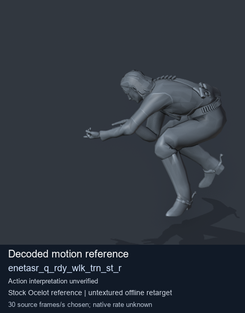
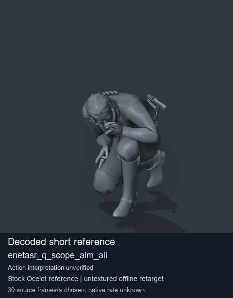
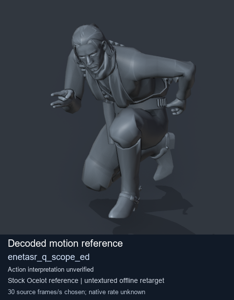
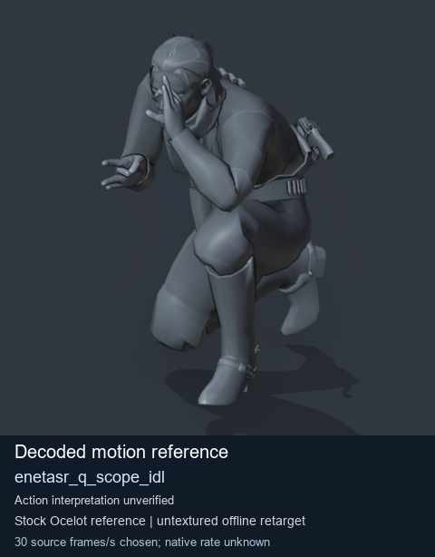

# Stock Soldier_common motion references / /Assets/tpp/motion/SI_game/fani/bodies/enet/enetasr - page 37

[Library](../README.md) · [Grouped directory](../browse/README.md) · [This source family](../browse/stock-soldier-enetasr-dd428991.md) · [Switch mode](browse-stock-soldier-enetasr-dd428991-37.md)

**Still images: no GIFs loaded** · 4 clips · 0.42 MiB downloaded.

Images reuse existing files. A small display width does not reduce download size. Open one clip for its larger titled GIF and original technical data.

Source-family grouping uses only recorded virtual directories; it does not establish an action, weapon, actor, rig or native compatibility. Existing descriptions and tags below are unchanged. Per-clip visual review may be pending; chosen preview speed is separate from unmeasured native timing.

| Preview | Animation | Category | Tags | Virtual GANI directory / file | MTAR / container location | Description | Frames / data |
| --- | --- | --- | --- | --- | --- | --- | --- |
|  | [Stock motion reference: enetasr_q_rdy_wlk_trn_st_r](../clips/mgsv-tpp-soldier_common-payloadsha256-53703fcdd13b7b7f455e99eb90b5261cc6dfd9398f1dcfee332029c7be8f4b4c.md) <code>enetasr_q_rdy_wlk_trn_st_r</code> | Stock Soldier_common motion references | <code>stock body motion</code> <code>Soldier_common</code> <code>source-derived label</code> <code>Ocelot reference mesh</code> | <code>/Assets/tpp/motion/SI_game/fani/bodies/enet/enetasr</code> <code>enetasr_q_rdy_wlk_trn_st_r.gani</code> | Retained MTAR: <code>Soldier_common.mtar</code> DAT / FPK membership unverified | Decoded stock body-motion reference enetasr_q_rdy_wlk_trn_st_r; action interpretation unverified. | 74 raw 2.47 s chosen; native rate unknown [Full data](../clips/mgsv-tpp-soldier_common-payloadsha256-53703fcdd13b7b7f455e99eb90b5261cc6dfd9398f1dcfee332029c7be8f4b4c.md#technical-data) |
|  | [Stock reference: enetasr_q_scope_aim_all](../clips/mgsv-tpp-soldier_common-payloadsha256-983c9810d1095fdfd5f3f3cc758b536ada08ca20f46c7698ed905596a8f29dcc.md) <code>enetasr_q_scope_aim_all</code> | Stock Soldier_common motion references | <code>stock animation reference</code> <code>Soldier_common</code> <code>source-derived label</code> <code>Ocelot reference mesh</code> | <code>/Assets/tpp/motion/SI_game/fani/bodies/enet/enetasr</code> <code>enetasr_q_scope_aim_all.gani</code> | Retained MTAR: <code>Soldier_common.mtar</code> DAT / FPK membership unverified | Decoded stock reference enetasr_q_scope_aim_all; action interpretation unverified. | 8 raw 0.27 s chosen; native rate unknown [Full data](../clips/mgsv-tpp-soldier_common-payloadsha256-983c9810d1095fdfd5f3f3cc758b536ada08ca20f46c7698ed905596a8f29dcc.md#technical-data) |
|  | [Stock reference: enetasr_q_scope_ed](../clips/mgsv-tpp-soldier_common-payloadsha256-c8765fc80301efd4b4ccaf4c6b33372521d45c9b07bc1f9eac0dd6b0497489be.md) <code>enetasr_q_scope_ed</code> | Stock Soldier_common motion references | <code>stock animation reference</code> <code>Soldier_common</code> <code>source-derived label</code> <code>Ocelot reference mesh</code> | <code>/Assets/tpp/motion/SI_game/fani/bodies/enet/enetasr</code> <code>enetasr_q_scope_ed.gani</code> | Retained MTAR: <code>Soldier_common.mtar</code> DAT / FPK membership unverified | Decoded stock reference enetasr_q_scope_ed; action interpretation unverified. | 70 raw 2.33 s chosen; native rate unknown [Full data](../clips/mgsv-tpp-soldier_common-payloadsha256-c8765fc80301efd4b4ccaf4c6b33372521d45c9b07bc1f9eac0dd6b0497489be.md#technical-data) |
|  | [Stock motion reference: enetasr_q_scope_idl](../clips/mgsv-tpp-soldier_common-payloadsha256-796af9ab663d8d260beb00fc98df879fc46d58ed3641ab60eb7337cce133a96d.md) <code>enetasr_q_scope_idl</code> | Stock Soldier_common motion references | <code>stock body motion</code> <code>Soldier_common</code> <code>source-derived label</code> <code>Ocelot reference mesh</code> | <code>/Assets/tpp/motion/SI_game/fani/bodies/enet/enetasr</code> <code>enetasr_q_scope_idl.gani</code> | Retained MTAR: <code>Soldier_common.mtar</code> DAT / FPK membership unverified | Decoded stock body-motion reference enetasr_q_scope_idl; action interpretation unverified. | 120 raw 4.0 s chosen; native rate unknown [Full data](../clips/mgsv-tpp-soldier_common-payloadsha256-796af9ab663d8d260beb00fc98df879fc46d58ed3641ab60eb7337cce133a96d.md#technical-data) |

[Source descriptions, confidence and credits](../description-sources.md) · [Complete JSON](../catalogue.json) · [CSV](../catalogue.csv)
