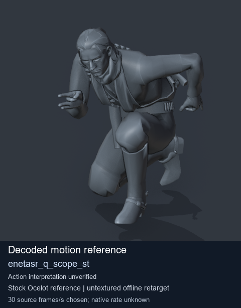
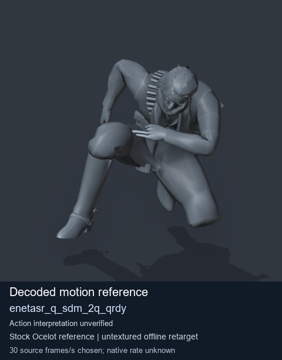

# Stock Soldier_common motion references / /Assets/tpp/motion/SI_game/fani/bodies/enet/enetasr - page 38

[Library](../README.md) · [Grouped directory](../browse/README.md) · [This source family](../browse/stock-soldier-enetasr-dd428991.md) · [Switch mode](browse-stock-soldier-enetasr-dd428991-38.md)

**Still images: no GIFs loaded** · 2 clips · 0.23 MiB downloaded.

Images reuse existing files. A small display width does not reduce download size. Open one clip for its larger titled GIF and original technical data.

Source-family grouping uses only recorded virtual directories; it does not establish an action, weapon, actor, rig or native compatibility. Existing descriptions and tags below are unchanged. Per-clip visual review may be pending; chosen preview speed is separate from unmeasured native timing.

| Preview | Animation | Category | Tags | Virtual GANI directory / file | MTAR / container location | Description | Frames / data |
| --- | --- | --- | --- | --- | --- | --- | --- |
|  | [Stock reference: enetasr_q_scope_st](../clips/mgsv-tpp-soldier_common-payloadsha256-c5f0aa2bcd6b25df53e13bbbe88cd5987a8539cfbee1b4f6b953c0a8916537a0.md) <code>enetasr_q_scope_st</code> | Stock Soldier_common motion references | <code>stock animation reference</code> <code>Soldier_common</code> <code>source-derived label</code> <code>Ocelot reference mesh</code> | <code>/Assets/tpp/motion/SI_game/fani/bodies/enet/enetasr</code> <code>enetasr_q_scope_st.gani</code> | Retained MTAR: <code>Soldier_common.mtar</code> DAT / FPK membership unverified | Decoded stock reference enetasr_q_scope_st; action interpretation unverified. | 73 raw 2.43 s chosen; native rate unknown [Full data](../clips/mgsv-tpp-soldier_common-payloadsha256-c5f0aa2bcd6b25df53e13bbbe88cd5987a8539cfbee1b4f6b953c0a8916537a0.md#technical-data) |
|  | [Stock reference: enetasr_q_sdm_2q_qrdy](../clips/mgsv-tpp-soldier_common-payloadsha256-3d68e86e742714f9510514cff19cce7e56ed0357ba1ed564dc0d508370a56669.md) <code>enetasr_q_sdm_2q_qrdy</code> | Stock Soldier_common motion references | <code>stock animation reference</code> <code>Soldier_common</code> <code>source-derived label</code> <code>Ocelot reference mesh</code> | <code>/Assets/tpp/motion/SI_game/fani/bodies/enet/enetasr</code> <code>enetasr_q_sdm_2q_qrdy.gani</code> | Retained MTAR: <code>Soldier_common.mtar</code> DAT / FPK membership unverified | Decoded stock reference enetasr_q_sdm_2q_qrdy; action interpretation unverified. | 274 raw 9.13 s chosen; native rate unknown [Full data](../clips/mgsv-tpp-soldier_common-payloadsha256-3d68e86e742714f9510514cff19cce7e56ed0357ba1ed564dc0d508370a56669.md#technical-data) |

[Source descriptions, confidence and credits](../description-sources.md) · [Complete JSON](../catalogue.json) · [CSV](../catalogue.csv)
