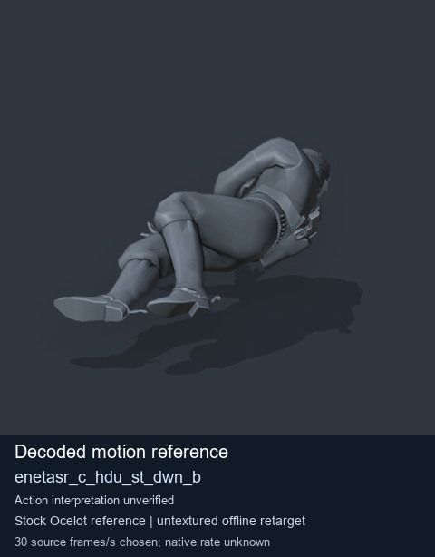
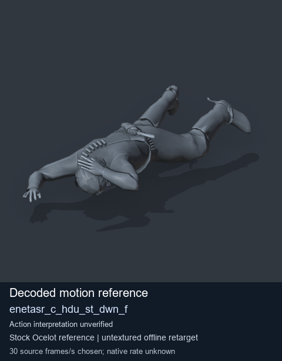
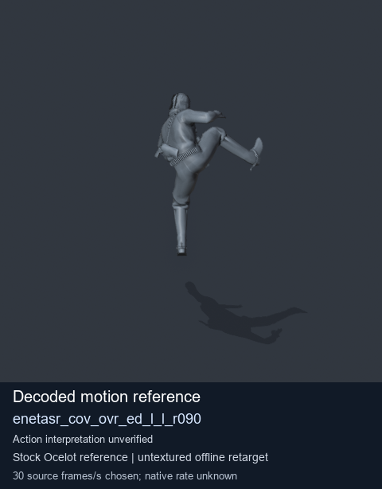
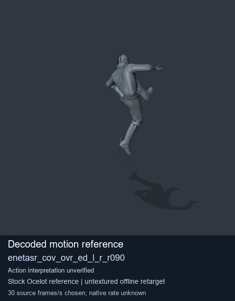

# Stock Soldier_common motion references / /Assets/tpp/motion/SI_game/fani/bodies/enet/enetasr - page 4

[Library](../README.md) · [Grouped directory](../browse/README.md) · [This source family](../browse/stock-soldier-enetasr-dd428991.md) · [Switch mode](browse-stock-soldier-enetasr-dd428991-4.md)

**Still images: no GIFs loaded** · 4 clips · 0.31 MiB downloaded.

Images reuse existing files. A small display width does not reduce download size. Open one clip for its larger titled GIF and original technical data.

Source-family grouping uses only recorded virtual directories; it does not establish an action, weapon, actor, rig or native compatibility. Existing descriptions and tags below are unchanged. Per-clip visual review may be pending; chosen preview speed is separate from unmeasured native timing.

| Preview | Animation | Category | Tags | Virtual GANI directory / file | MTAR / container location | Description | Frames / data |
| --- | --- | --- | --- | --- | --- | --- | --- |
|  | [Stock reference: enetasr_c_hdu_st_dwn_b](../clips/mgsv-tpp-soldier_common-payloadsha256-ad8b5e6a9f432580d74a65e16c69a4a71d71a412b097a53d1bd603844fb726b8.md) <code>enetasr_c_hdu_st_dwn_b</code> | Stock Soldier_common motion references | <code>stock animation reference</code> <code>Soldier_common</code> <code>source-derived label</code> <code>Ocelot reference mesh</code> | <code>/Assets/tpp/motion/SI_game/fani/bodies/enet/enetasr</code> <code>enetasr_c_hdu_st_dwn_b.gani</code> | Retained MTAR: <code>Soldier_common.mtar</code> DAT / FPK membership unverified | Decoded stock reference enetasr_c_hdu_st_dwn_b; action interpretation unverified. | 146 raw 4.87 s chosen; native rate unknown [Full data](../clips/mgsv-tpp-soldier_common-payloadsha256-ad8b5e6a9f432580d74a65e16c69a4a71d71a412b097a53d1bd603844fb726b8.md#technical-data) |
|  | [Stock reference: enetasr_c_hdu_st_dwn_f](../clips/mgsv-tpp-soldier_common-payloadsha256-1f904bcaf0156ad3a3e54602dd835df8addfd3fddf060078806c86756d4ba3eb.md) <code>enetasr_c_hdu_st_dwn_f</code> | Stock Soldier_common motion references | <code>stock animation reference</code> <code>Soldier_common</code> <code>source-derived label</code> <code>Ocelot reference mesh</code> | <code>/Assets/tpp/motion/SI_game/fani/bodies/enet/enetasr</code> <code>enetasr_c_hdu_st_dwn_f.gani</code> | Retained MTAR: <code>Soldier_common.mtar</code> DAT / FPK membership unverified | Decoded stock reference enetasr_c_hdu_st_dwn_f; action interpretation unverified. | 64 raw 2.13 s chosen; native rate unknown [Full data](../clips/mgsv-tpp-soldier_common-payloadsha256-1f904bcaf0156ad3a3e54602dd835df8addfd3fddf060078806c86756d4ba3eb.md#technical-data) |
|  | [Stock motion reference: enetasr_cov_ovr_ed_l_l_r090](../clips/mgsv-tpp-soldier_common-payloadsha256-a450718d1d7b40b03104c0974180c9588365d7ac92d00f9dff6f2c1330227243.md) <code>enetasr_cov_ovr_ed_l_l_r090</code> | Stock Soldier_common motion references | <code>stock body motion</code> <code>Soldier_common</code> <code>source-derived label</code> <code>Ocelot reference mesh</code> | <code>/Assets/tpp/motion/SI_game/fani/bodies/enet/enetasr</code> <code>enetasr_cov_ovr_ed_l_l_r090.gani</code> | Retained MTAR: <code>Soldier_common.mtar</code> DAT / FPK membership unverified | Decoded stock body-motion reference enetasr_cov_ovr_ed_l_l_r090; action interpretation unverified. | 120 raw 4.0 s chosen; native rate unknown [Full data](../clips/mgsv-tpp-soldier_common-payloadsha256-a450718d1d7b40b03104c0974180c9588365d7ac92d00f9dff6f2c1330227243.md#technical-data) |
|  | [Stock motion reference: enetasr_cov_ovr_ed_l_r_r090](../clips/mgsv-tpp-soldier_common-payloadsha256-0f7456690760c93ffcfd75c1ae6c952d83fed73f77cdd8ec2ef2d2bc96685f98.md) <code>enetasr_cov_ovr_ed_l_r_r090</code> | Stock Soldier_common motion references | <code>stock body motion</code> <code>Soldier_common</code> <code>source-derived label</code> <code>Ocelot reference mesh</code> | <code>/Assets/tpp/motion/SI_game/fani/bodies/enet/enetasr</code> <code>enetasr_cov_ovr_ed_l_r_r090.gani</code> | Retained MTAR: <code>Soldier_common.mtar</code> DAT / FPK membership unverified | Decoded stock body-motion reference enetasr_cov_ovr_ed_l_r_r090; action interpretation unverified. | 118 raw 3.93 s chosen; native rate unknown [Full data](../clips/mgsv-tpp-soldier_common-payloadsha256-0f7456690760c93ffcfd75c1ae6c952d83fed73f77cdd8ec2ef2d2bc96685f98.md#technical-data) |

[Source descriptions, confidence and credits](../description-sources.md) · [Complete JSON](../catalogue.json) · [CSV](../catalogue.csv)
