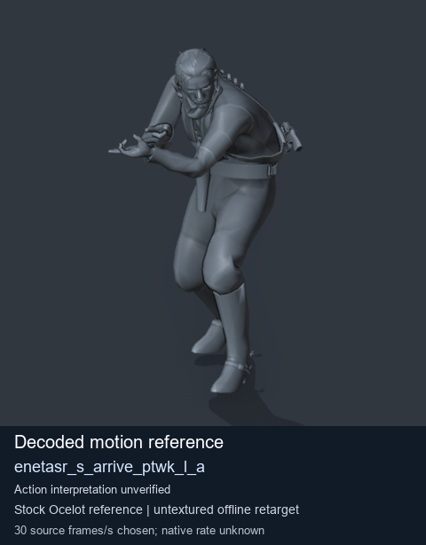
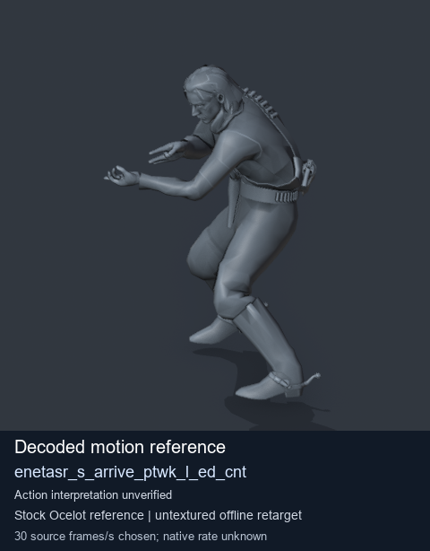
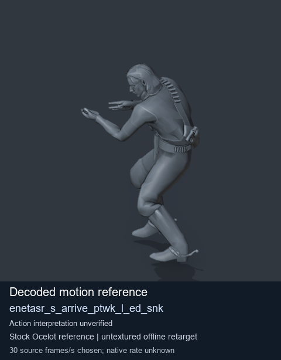
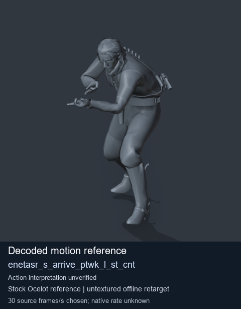

# Stock Soldier_common motion references / /Assets/tpp/motion/SI_game/fani/bodies/enet/enetasr - page 41

[Library](../README.md) · [Grouped directory](../browse/README.md) · [This source family](../browse/stock-soldier-enetasr-dd428991.md) · [Switch mode](browse-stock-soldier-enetasr-dd428991-41.md)

**Still images: no GIFs loaded** · 4 clips · 0.36 MiB downloaded.

Images reuse existing files. A small display width does not reduce download size. Open one clip for its larger titled GIF and original technical data.

Source-family grouping uses only recorded virtual directories; it does not establish an action, weapon, actor, rig or native compatibility. Existing descriptions and tags below are unchanged. Per-clip visual review may be pending; chosen preview speed is separate from unmeasured native timing.

| Preview | Animation | Category | Tags | Virtual GANI directory / file | MTAR / container location | Description | Frames / data |
| --- | --- | --- | --- | --- | --- | --- | --- |
|  | [Stock reference: enetasr_s_arrive_ptwk_l_a](../clips/mgsv-tpp-soldier_common-payloadsha256-fe000744da90737e4d75fcd5be345b883d30bd96f053084f84d1af2559e1e25d.md) <code>enetasr_s_arrive_ptwk_l_a</code> | Stock Soldier_common motion references | <code>stock animation reference</code> <code>Soldier_common</code> <code>source-derived label</code> <code>Ocelot reference mesh</code> | <code>/Assets/tpp/motion/SI_game/fani/bodies/enet/enetasr</code> <code>enetasr_s_arrive_ptwk_l_a.gani</code> | Retained MTAR: <code>Soldier_common.mtar</code> DAT / FPK membership unverified | Decoded stock reference enetasr_s_arrive_ptwk_l_a; action interpretation unverified. | 182 raw 6.07 s chosen; native rate unknown [Full data](../clips/mgsv-tpp-soldier_common-payloadsha256-fe000744da90737e4d75fcd5be345b883d30bd96f053084f84d1af2559e1e25d.md#technical-data) |
|  | [Stock motion reference: enetasr_s_arrive_ptwk_l_ed_cnt](../clips/mgsv-tpp-soldier_common-payloadsha256-3d06acfb63d8150b85efa331bd10592d115319d62dcc60d75b19086fb6720706.md) <code>enetasr_s_arrive_ptwk_l_ed_cnt</code> | Stock Soldier_common motion references | <code>stock body motion</code> <code>Soldier_common</code> <code>source-derived label</code> <code>Ocelot reference mesh</code> | <code>/Assets/tpp/motion/SI_game/fani/bodies/enet/enetasr</code> <code>enetasr_s_arrive_ptwk_l_ed_cnt.gani</code> | Retained MTAR: <code>Soldier_common.mtar</code> DAT / FPK membership unverified | Decoded stock body-motion reference enetasr_s_arrive_ptwk_l_ed_cnt; action interpretation unverified. | 92 raw 3.07 s chosen; native rate unknown [Full data](../clips/mgsv-tpp-soldier_common-payloadsha256-3d06acfb63d8150b85efa331bd10592d115319d62dcc60d75b19086fb6720706.md#technical-data) |
|  | [Stock reference: enetasr_s_arrive_ptwk_l_ed_snk](../clips/mgsv-tpp-soldier_common-payloadsha256-3b4485d2244792c837645720d4e81a770de469c1dd2a3e82e8c9afa871b76d2d.md) <code>enetasr_s_arrive_ptwk_l_ed_snk</code> | Stock Soldier_common motion references | <code>stock animation reference</code> <code>Soldier_common</code> <code>source-derived label</code> <code>Ocelot reference mesh</code> | <code>/Assets/tpp/motion/SI_game/fani/bodies/enet/enetasr</code> <code>enetasr_s_arrive_ptwk_l_ed_snk.gani</code> | Retained MTAR: <code>Soldier_common.mtar</code> DAT / FPK membership unverified | Decoded stock reference enetasr_s_arrive_ptwk_l_ed_snk; action interpretation unverified. | 137 raw 4.57 s chosen; native rate unknown [Full data](../clips/mgsv-tpp-soldier_common-payloadsha256-3b4485d2244792c837645720d4e81a770de469c1dd2a3e82e8c9afa871b76d2d.md#technical-data) |
|  | [Stock reference: enetasr_s_arrive_ptwk_l_st_cnt](../clips/mgsv-tpp-soldier_common-payloadsha256-5083921018291348131d1da0162f342f3fd262f2e63103308cde462339c7d993.md) <code>enetasr_s_arrive_ptwk_l_st_cnt</code> | Stock Soldier_common motion references | <code>stock animation reference</code> <code>Soldier_common</code> <code>source-derived label</code> <code>Ocelot reference mesh</code> | <code>/Assets/tpp/motion/SI_game/fani/bodies/enet/enetasr</code> <code>enetasr_s_arrive_ptwk_l_st_cnt.gani</code> | Retained MTAR: <code>Soldier_common.mtar</code> DAT / FPK membership unverified | Decoded stock reference enetasr_s_arrive_ptwk_l_st_cnt; action interpretation unverified. | 58 raw 1.93 s chosen; native rate unknown [Full data](../clips/mgsv-tpp-soldier_common-payloadsha256-5083921018291348131d1da0162f342f3fd262f2e63103308cde462339c7d993.md#technical-data) |

[Source descriptions, confidence and credits](../description-sources.md) · [Complete JSON](../catalogue.json) · [CSV](../catalogue.csv)
