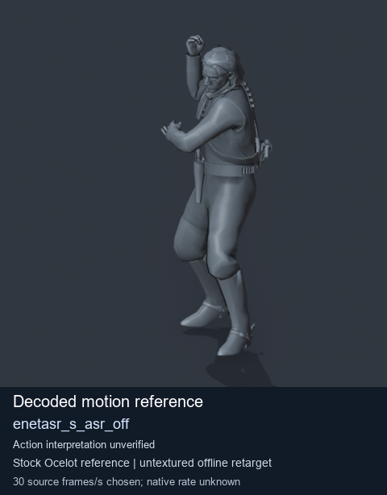
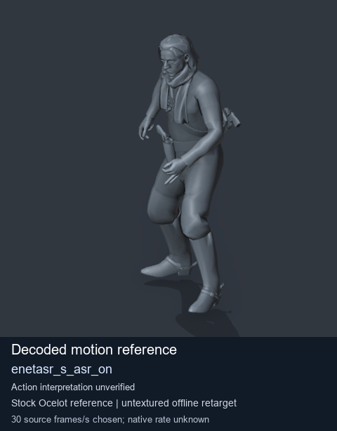
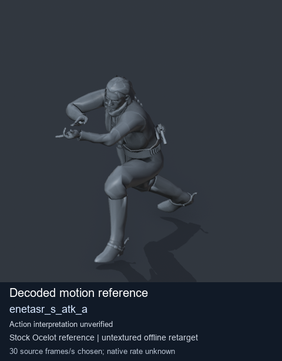
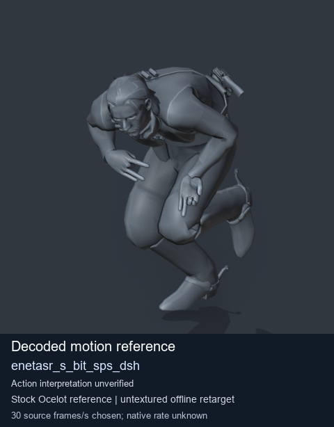

# Stock Soldier_common motion references / /Assets/tpp/motion/SI_game/fani/bodies/enet/enetasr - page 46

[Library](../README.md) · [Grouped directory](../browse/README.md) · [This source family](../browse/stock-soldier-enetasr-dd428991.md) · [Switch mode](browse-stock-soldier-enetasr-dd428991-46.md)

**Still images: no GIFs loaded** · 4 clips · 0.37 MiB downloaded.

Images reuse existing files. A small display width does not reduce download size. Open one clip for its larger titled GIF and original technical data.

Source-family grouping uses only recorded virtual directories; it does not establish an action, weapon, actor, rig or native compatibility. Existing descriptions and tags below are unchanged. Per-clip visual review may be pending; chosen preview speed is separate from unmeasured native timing.

| Preview | Animation | Category | Tags | Virtual GANI directory / file | MTAR / container location | Description | Frames / data |
| --- | --- | --- | --- | --- | --- | --- | --- |
|  | [Stock motion reference: enetasr_s_asr_off](../clips/mgsv-tpp-soldier_common-payloadsha256-da3f7465e394138722b0771f9537e40ddd93ab3a4ded4af993e4c72b25819b9d.md) <code>enetasr_s_asr_off</code> | Stock Soldier_common motion references | <code>stock body motion</code> <code>Soldier_common</code> <code>source-derived label</code> <code>Ocelot reference mesh</code> | <code>/Assets/tpp/motion/SI_game/fani/bodies/enet/enetasr</code> <code>enetasr_s_asr_off.gani</code> | Retained MTAR: <code>Soldier_common.mtar</code> DAT / FPK membership unverified | Decoded stock body-motion reference enetasr_s_asr_off; action interpretation unverified. | 65 raw 2.17 s chosen; native rate unknown [Full data](../clips/mgsv-tpp-soldier_common-payloadsha256-da3f7465e394138722b0771f9537e40ddd93ab3a4ded4af993e4c72b25819b9d.md#technical-data) |
|  | [Stock reference: enetasr_s_asr_on](../clips/mgsv-tpp-soldier_common-payloadsha256-a4fc64c42c9a8746d6b4cd1dc5bc888787e27813d74fcc217c4a7230d2c8e8fe.md) <code>enetasr_s_asr_on</code> | Stock Soldier_common motion references | <code>stock animation reference</code> <code>Soldier_common</code> <code>source-derived label</code> <code>Ocelot reference mesh</code> | <code>/Assets/tpp/motion/SI_game/fani/bodies/enet/enetasr</code> <code>enetasr_s_asr_on.gani</code> | Retained MTAR: <code>Soldier_common.mtar</code> DAT / FPK membership unverified | Decoded stock reference enetasr_s_asr_on; action interpretation unverified. | 86 raw 2.87 s chosen; native rate unknown [Full data](../clips/mgsv-tpp-soldier_common-payloadsha256-a4fc64c42c9a8746d6b4cd1dc5bc888787e27813d74fcc217c4a7230d2c8e8fe.md#technical-data) |
|  | [Stock motion reference: enetasr_s_atk_a](../clips/mgsv-tpp-soldier_common-payloadsha256-ef208a0972fbd83ecf31bc62b9fa461b93f67533f03e775887c77bbf7bc55a3e.md) <code>enetasr_s_atk_a</code> | Stock Soldier_common motion references | <code>stock body motion</code> <code>Soldier_common</code> <code>source-derived label</code> <code>Ocelot reference mesh</code> | <code>/Assets/tpp/motion/SI_game/fani/bodies/enet/enetasr</code> <code>enetasr_s_atk_a.gani</code> | Retained MTAR: <code>Soldier_common.mtar</code> DAT / FPK membership unverified | Decoded stock body-motion reference enetasr_s_atk_a; action interpretation unverified. | 121 raw 4.03 s chosen; native rate unknown [Full data](../clips/mgsv-tpp-soldier_common-payloadsha256-ef208a0972fbd83ecf31bc62b9fa461b93f67533f03e775887c77bbf7bc55a3e.md#technical-data) |
|  | [Stock motion reference: enetasr_s_bit_sps_dsh](../clips/mgsv-tpp-soldier_common-payloadsha256-a38dd1dc4afd7d96b471bcda90e7b95edf1e484c8f22d3e5c7179aaf457348b1.md) <code>enetasr_s_bit_sps_dsh</code> | Stock Soldier_common motion references | <code>stock body motion</code> <code>Soldier_common</code> <code>source-derived label</code> <code>Ocelot reference mesh</code> | <code>/Assets/tpp/motion/SI_game/fani/bodies/enet/enetasr</code> <code>enetasr_s_bit_sps_dsh.gani</code> | Retained MTAR: <code>Soldier_common.mtar</code> DAT / FPK membership unverified | Decoded stock body-motion reference enetasr_s_bit_sps_dsh; action interpretation unverified. | 80 raw 2.67 s chosen; native rate unknown [Full data](../clips/mgsv-tpp-soldier_common-payloadsha256-a38dd1dc4afd7d96b471bcda90e7b95edf1e484c8f22d3e5c7179aaf457348b1.md#technical-data) |

[Source descriptions, confidence and credits](../description-sources.md) · [Complete JSON](../catalogue.json) · [CSV](../catalogue.csv)
