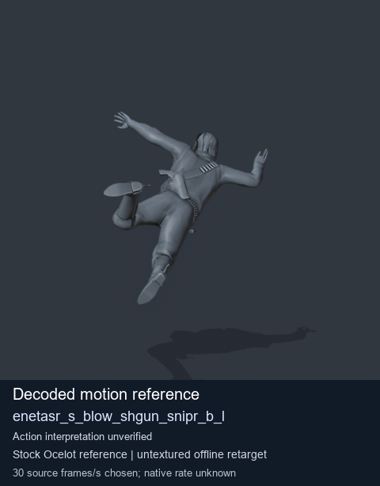
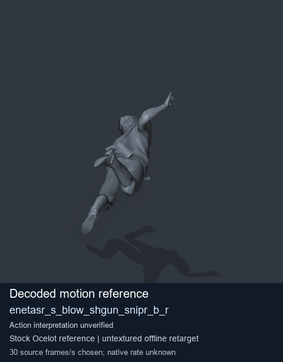
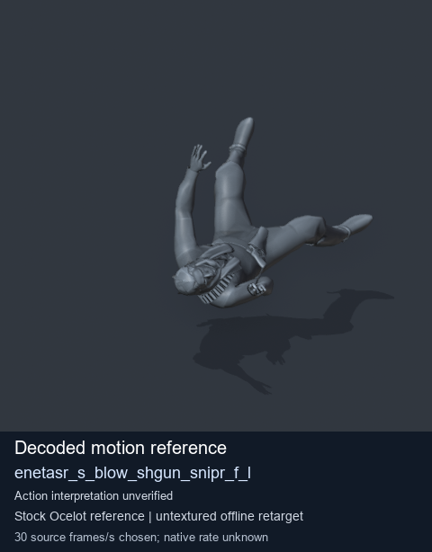
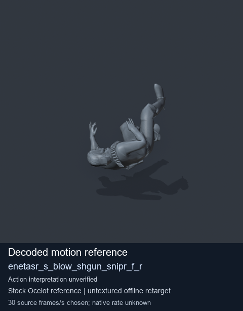

# Stock Soldier_common motion references / /Assets/tpp/motion/SI_game/fani/bodies/enet/enetasr - page 48

[Library](../README.md) · [Grouped directory](../browse/README.md) · [This source family](../browse/stock-soldier-enetasr-dd428991.md) · [Switch mode](browse-stock-soldier-enetasr-dd428991-48.md)

**Still images: no GIFs loaded** · 4 clips · 0.28 MiB downloaded.

Images reuse existing files. A small display width does not reduce download size. Open one clip for its larger titled GIF and original technical data.

Source-family grouping uses only recorded virtual directories; it does not establish an action, weapon, actor, rig or native compatibility. Existing descriptions and tags below are unchanged. Per-clip visual review may be pending; chosen preview speed is separate from unmeasured native timing.

| Preview | Animation | Category | Tags | Virtual GANI directory / file | MTAR / container location | Description | Frames / data |
| --- | --- | --- | --- | --- | --- | --- | --- |
|  | [Stock motion reference: enetasr_s_blow_shgun_snipr_b_l](../clips/mgsv-tpp-soldier_common-payloadsha256-ab53a5e46ed0d2f824a4f90f24afd1af4e548bcc957f67b29d16acd5db0b0c3a.md) <code>enetasr_s_blow_shgun_snipr_b_l</code> | Stock Soldier_common motion references | <code>stock body motion</code> <code>Soldier_common</code> <code>source-derived label</code> <code>Ocelot reference mesh</code> | <code>/Assets/tpp/motion/SI_game/fani/bodies/enet/enetasr</code> <code>enetasr_s_blow_shgun_snipr_b_l.gani</code> | Retained MTAR: <code>Soldier_common.mtar</code> DAT / FPK membership unverified | Decoded stock body-motion reference enetasr_s_blow_shgun_snipr_b_l; action interpretation unverified. | 75 raw 2.5 s chosen; native rate unknown [Full data](../clips/mgsv-tpp-soldier_common-payloadsha256-ab53a5e46ed0d2f824a4f90f24afd1af4e548bcc957f67b29d16acd5db0b0c3a.md#technical-data) |
|  | [Stock motion reference: enetasr_s_blow_shgun_snipr_b_r](../clips/mgsv-tpp-soldier_common-payloadsha256-613bafe57cdb4f4600d66e465ab6785530e57f58b12f95bfd1a3826c66ea3bd7.md) <code>enetasr_s_blow_shgun_snipr_b_r</code> | Stock Soldier_common motion references | <code>stock body motion</code> <code>Soldier_common</code> <code>source-derived label</code> <code>Ocelot reference mesh</code> | <code>/Assets/tpp/motion/SI_game/fani/bodies/enet/enetasr</code> <code>enetasr_s_blow_shgun_snipr_b_r.gani</code> | Retained MTAR: <code>Soldier_common.mtar</code> DAT / FPK membership unverified | Decoded stock body-motion reference enetasr_s_blow_shgun_snipr_b_r; action interpretation unverified. | 75 raw 2.5 s chosen; native rate unknown [Full data](../clips/mgsv-tpp-soldier_common-payloadsha256-613bafe57cdb4f4600d66e465ab6785530e57f58b12f95bfd1a3826c66ea3bd7.md#technical-data) |
|  | [Stock reference: enetasr_s_blow_shgun_snipr_f_l](../clips/mgsv-tpp-soldier_common-payloadsha256-f048dc4839365d023cd15ff337d9e25a994b5cbda13dbc193a87441774001c18.md) <code>enetasr_s_blow_shgun_snipr_f_l</code> | Stock Soldier_common motion references | <code>stock animation reference</code> <code>Soldier_common</code> <code>source-derived label</code> <code>Ocelot reference mesh</code> | <code>/Assets/tpp/motion/SI_game/fani/bodies/enet/enetasr</code> <code>enetasr_s_blow_shgun_snipr_f_l.gani</code> | Retained MTAR: <code>Soldier_common.mtar</code> DAT / FPK membership unverified | Decoded stock reference enetasr_s_blow_shgun_snipr_f_l; action interpretation unverified. | 100 raw 3.33 s chosen; native rate unknown [Full data](../clips/mgsv-tpp-soldier_common-payloadsha256-f048dc4839365d023cd15ff337d9e25a994b5cbda13dbc193a87441774001c18.md#technical-data) |
|  | [Stock reference: enetasr_s_blow_shgun_snipr_f_r](../clips/mgsv-tpp-soldier_common-payloadsha256-513bdd07e8f497c34fdaeab1c879a3ad130094f171a944de05d65081a5c2d382.md) <code>enetasr_s_blow_shgun_snipr_f_r</code> | Stock Soldier_common motion references | <code>stock animation reference</code> <code>Soldier_common</code> <code>source-derived label</code> <code>Ocelot reference mesh</code> | <code>/Assets/tpp/motion/SI_game/fani/bodies/enet/enetasr</code> <code>enetasr_s_blow_shgun_snipr_f_r.gani</code> | Retained MTAR: <code>Soldier_common.mtar</code> DAT / FPK membership unverified | Decoded stock reference enetasr_s_blow_shgun_snipr_f_r; action interpretation unverified. | 95 raw 3.17 s chosen; native rate unknown [Full data](../clips/mgsv-tpp-soldier_common-payloadsha256-513bdd07e8f497c34fdaeab1c879a3ad130094f171a944de05d65081a5c2d382.md#technical-data) |

[Source descriptions, confidence and credits](../description-sources.md) · [Complete JSON](../catalogue.json) · [CSV](../catalogue.csv)
