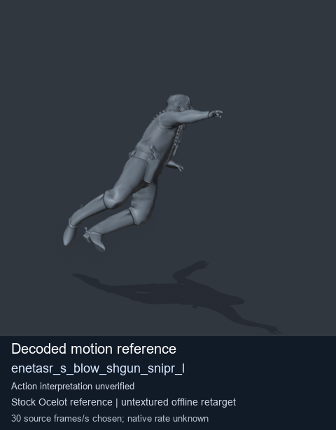
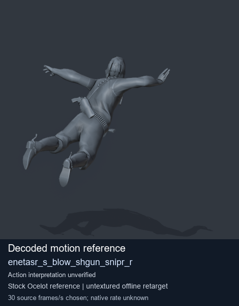
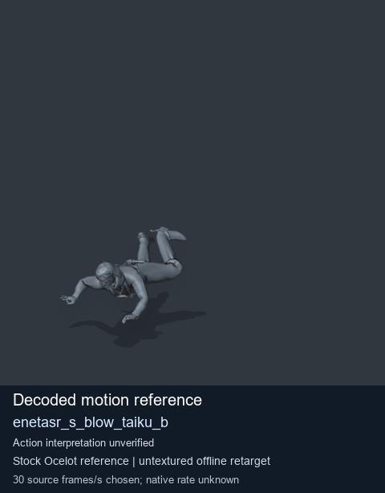
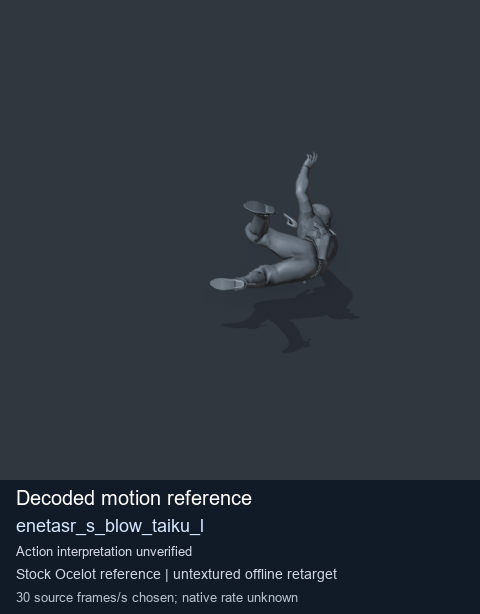

# Stock Soldier_common motion references / /Assets/tpp/motion/SI_game/fani/bodies/enet/enetasr - page 49

[Library](../README.md) · [Grouped directory](../browse/README.md) · [This source family](../browse/stock-soldier-enetasr-dd428991.md) · [Switch mode](browse-stock-soldier-enetasr-dd428991-49.md)

**Still images: no GIFs loaded** · 4 clips · 0.27 MiB downloaded.

Images reuse existing files. A small display width does not reduce download size. Open one clip for its larger titled GIF and original technical data.

Source-family grouping uses only recorded virtual directories; it does not establish an action, weapon, actor, rig or native compatibility. Existing descriptions and tags below are unchanged. Per-clip visual review may be pending; chosen preview speed is separate from unmeasured native timing.

| Preview | Animation | Category | Tags | Virtual GANI directory / file | MTAR / container location | Description | Frames / data |
| --- | --- | --- | --- | --- | --- | --- | --- |
|  | [Stock reference: enetasr_s_blow_shgun_snipr_l](../clips/mgsv-tpp-soldier_common-payloadsha256-ddd9930dceef6e71e82a438a5d515cc5c62f4f10c625d0a56ed02c5b02f73d91.md) <code>enetasr_s_blow_shgun_snipr_l</code> | Stock Soldier_common motion references | <code>stock animation reference</code> <code>Soldier_common</code> <code>source-derived label</code> <code>Ocelot reference mesh</code> | <code>/Assets/tpp/motion/SI_game/fani/bodies/enet/enetasr</code> <code>enetasr_s_blow_shgun_snipr_l.gani</code> | Retained MTAR: <code>Soldier_common.mtar</code> DAT / FPK membership unverified | Decoded stock reference enetasr_s_blow_shgun_snipr_l; action interpretation unverified. | 95 raw 3.17 s chosen; native rate unknown [Full data](../clips/mgsv-tpp-soldier_common-payloadsha256-ddd9930dceef6e71e82a438a5d515cc5c62f4f10c625d0a56ed02c5b02f73d91.md#technical-data) |
|  | [Stock motion reference: enetasr_s_blow_shgun_snipr_r](../clips/mgsv-tpp-soldier_common-payloadsha256-745440f88b66b81af473c503dd7819475ff3412791caad2a7e02bd69de0cf567.md) <code>enetasr_s_blow_shgun_snipr_r</code> | Stock Soldier_common motion references | <code>stock body motion</code> <code>Soldier_common</code> <code>source-derived label</code> <code>Ocelot reference mesh</code> | <code>/Assets/tpp/motion/SI_game/fani/bodies/enet/enetasr</code> <code>enetasr_s_blow_shgun_snipr_r.gani</code> | Retained MTAR: <code>Soldier_common.mtar</code> DAT / FPK membership unverified | Decoded stock body-motion reference enetasr_s_blow_shgun_snipr_r; action interpretation unverified. | 96 raw 3.2 s chosen; native rate unknown [Full data](../clips/mgsv-tpp-soldier_common-payloadsha256-745440f88b66b81af473c503dd7819475ff3412791caad2a7e02bd69de0cf567.md#technical-data) |
|  | [Stock reference: enetasr_s_blow_taiku_b](../clips/mgsv-tpp-soldier_common-payloadsha256-5229273afb607ceac97c9397058216a3bb9e666795ff251cb39b8ba481021ade.md) <code>enetasr_s_blow_taiku_b</code> | Stock Soldier_common motion references | <code>stock animation reference</code> <code>Soldier_common</code> <code>source-derived label</code> <code>Ocelot reference mesh</code> | <code>/Assets/tpp/motion/SI_game/fani/bodies/enet/enetasr</code> <code>enetasr_s_blow_taiku_b.gani</code> | Retained MTAR: <code>Soldier_common.mtar</code> DAT / FPK membership unverified | Decoded stock reference enetasr_s_blow_taiku_b; action interpretation unverified. | 75 raw 2.5 s chosen; native rate unknown [Full data](../clips/mgsv-tpp-soldier_common-payloadsha256-5229273afb607ceac97c9397058216a3bb9e666795ff251cb39b8ba481021ade.md#technical-data) |
|  | [Stock reference: enetasr_s_blow_taiku_l](../clips/mgsv-tpp-soldier_common-payloadsha256-c00bc5df67f3cf75762c607960e43002556acfa1e10d3b2654a920ddbda685e5.md) <code>enetasr_s_blow_taiku_l</code> | Stock Soldier_common motion references | <code>stock animation reference</code> <code>Soldier_common</code> <code>source-derived label</code> <code>Ocelot reference mesh</code> | <code>/Assets/tpp/motion/SI_game/fani/bodies/enet/enetasr</code> <code>enetasr_s_blow_taiku_l.gani</code> | Retained MTAR: <code>Soldier_common.mtar</code> DAT / FPK membership unverified | Decoded stock reference enetasr_s_blow_taiku_l; action interpretation unverified. | 110 raw 3.67 s chosen; native rate unknown [Full data](../clips/mgsv-tpp-soldier_common-payloadsha256-c00bc5df67f3cf75762c607960e43002556acfa1e10d3b2654a920ddbda685e5.md#technical-data) |

[Source descriptions, confidence and credits](../description-sources.md) · [Complete JSON](../catalogue.json) · [CSV](../catalogue.csv)
