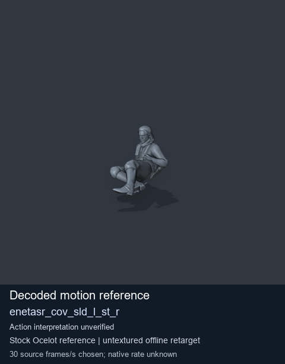
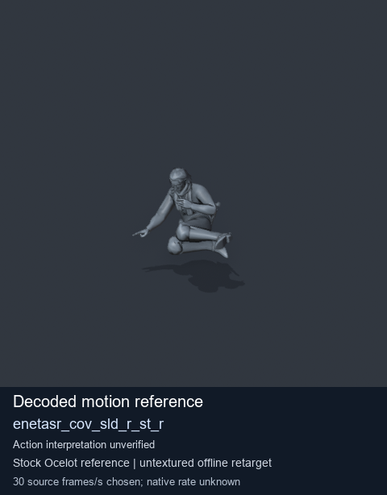
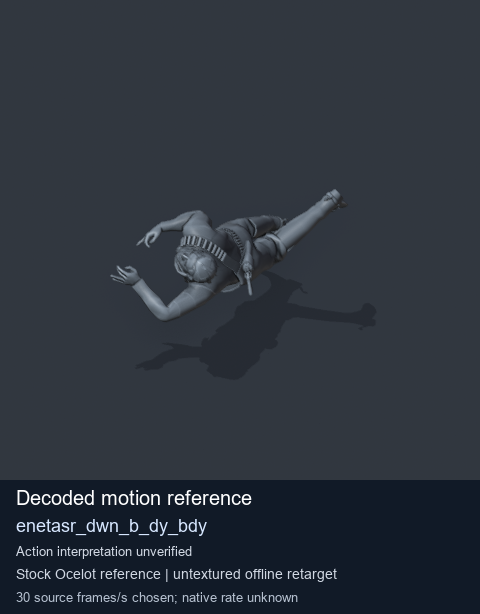
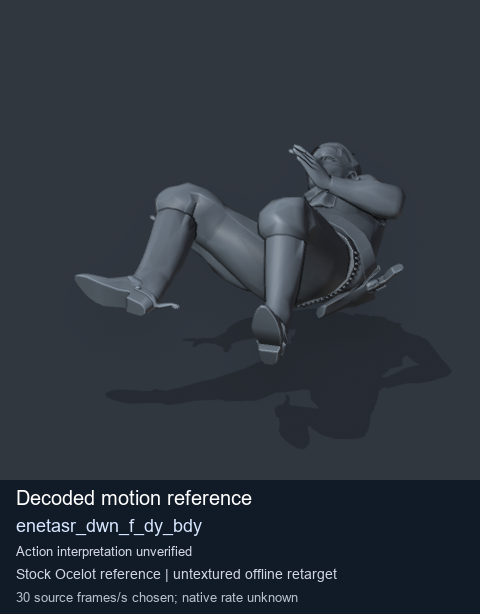

# Stock Soldier_common motion references / /Assets/tpp/motion/SI_game/fani/bodies/enet/enetasr - page 6

[Library](../README.md) · [Grouped directory](../browse/README.md) · [This source family](../browse/stock-soldier-enetasr-dd428991.md) · [Switch mode](browse-stock-soldier-enetasr-dd428991-6.md)

**Still images: no GIFs loaded** · 4 clips · 0.28 MiB downloaded.

Images reuse existing files. A small display width does not reduce download size. Open one clip for its larger titled GIF and original technical data.

Source-family grouping uses only recorded virtual directories; it does not establish an action, weapon, actor, rig or native compatibility. Existing descriptions and tags below are unchanged. Per-clip visual review may be pending; chosen preview speed is separate from unmeasured native timing.

| Preview | Animation | Category | Tags | Virtual GANI directory / file | MTAR / container location | Description | Frames / data |
| --- | --- | --- | --- | --- | --- | --- | --- |
|  | [Stock reference: enetasr_cov_sld_l_st_r](../clips/mgsv-tpp-soldier_common-payloadsha256-093f2901f1f15b7b49a572cb74e4d0652ab660e4470d86c95b9f61d5ae1a2c21.md) <code>enetasr_cov_sld_l_st_r</code> | Stock Soldier_common motion references | <code>stock animation reference</code> <code>Soldier_common</code> <code>source-derived label</code> <code>Ocelot reference mesh</code> | <code>/Assets/tpp/motion/SI_game/fani/bodies/enet/enetasr</code> <code>enetasr_cov_sld_l_st_r.gani</code> | Retained MTAR: <code>Soldier_common.mtar</code> DAT / FPK membership unverified | Decoded stock reference enetasr_cov_sld_l_st_r; action interpretation unverified. | 72 raw 2.4 s chosen; native rate unknown [Full data](../clips/mgsv-tpp-soldier_common-payloadsha256-093f2901f1f15b7b49a572cb74e4d0652ab660e4470d86c95b9f61d5ae1a2c21.md#technical-data) |
|  | [Stock motion reference: enetasr_cov_sld_r_st_r](../clips/mgsv-tpp-soldier_common-payloadsha256-c812be2adfbfe95780179aa74d903e2c784d042c80d0d9297ae67ef15df365a9.md) <code>enetasr_cov_sld_r_st_r</code> | Stock Soldier_common motion references | <code>stock body motion</code> <code>Soldier_common</code> <code>source-derived label</code> <code>Ocelot reference mesh</code> | <code>/Assets/tpp/motion/SI_game/fani/bodies/enet/enetasr</code> <code>enetasr_cov_sld_r_st_r.gani</code> | Retained MTAR: <code>Soldier_common.mtar</code> DAT / FPK membership unverified | Decoded stock body-motion reference enetasr_cov_sld_r_st_r; action interpretation unverified. | 72 raw 2.4 s chosen; native rate unknown [Full data](../clips/mgsv-tpp-soldier_common-payloadsha256-c812be2adfbfe95780179aa74d903e2c784d042c80d0d9297ae67ef15df365a9.md#technical-data) |
|  | [Stock reference: enetasr_dwn_b_dy_bdy](../clips/mgsv-tpp-soldier_common-payloadsha256-67096d9a9e41ad0ddbd25ce1d0eb754337c983fbf7959fd5a1bbb493da630777.md) <code>enetasr_dwn_b_dy_bdy</code> | Stock Soldier_common motion references | <code>stock animation reference</code> <code>Soldier_common</code> <code>source-derived label</code> <code>Ocelot reference mesh</code> | <code>/Assets/tpp/motion/SI_game/fani/bodies/enet/enetasr</code> <code>enetasr_dwn_b_dy_bdy.gani</code> | Retained MTAR: <code>Soldier_common.mtar</code> DAT / FPK membership unverified | Decoded stock reference enetasr_dwn_b_dy_bdy; action interpretation unverified. | 127 raw 4.23 s chosen; native rate unknown [Full data](../clips/mgsv-tpp-soldier_common-payloadsha256-67096d9a9e41ad0ddbd25ce1d0eb754337c983fbf7959fd5a1bbb493da630777.md#technical-data) |
|  | [Stock reference: enetasr_dwn_f_dy_bdy](../clips/mgsv-tpp-soldier_common-payloadsha256-a2125dc0906064ddda46a1f00f60c9ecb99547c209b6ab58cff712a59d42c1fa.md) <code>enetasr_dwn_f_dy_bdy</code> | Stock Soldier_common motion references | <code>stock animation reference</code> <code>Soldier_common</code> <code>source-derived label</code> <code>Ocelot reference mesh</code> | <code>/Assets/tpp/motion/SI_game/fani/bodies/enet/enetasr</code> <code>enetasr_dwn_f_dy_bdy.gani</code> | Retained MTAR: <code>Soldier_common.mtar</code> DAT / FPK membership unverified | Decoded stock reference enetasr_dwn_f_dy_bdy; action interpretation unverified. | 53 raw 1.77 s chosen; native rate unknown [Full data](../clips/mgsv-tpp-soldier_common-payloadsha256-a2125dc0906064ddda46a1f00f60c9ecb99547c209b6ab58cff712a59d42c1fa.md#technical-data) |

[Source descriptions, confidence and credits](../description-sources.md) · [Complete JSON](../catalogue.json) · [CSV](../catalogue.csv)
