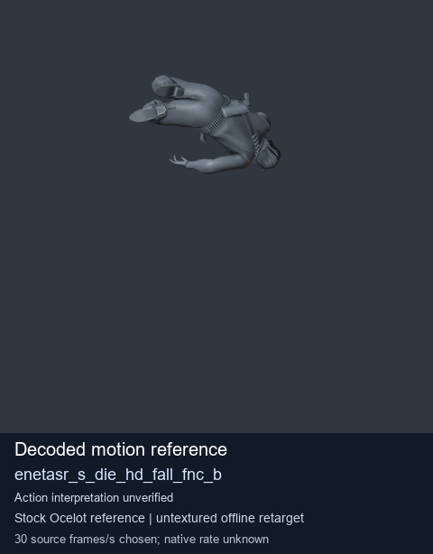
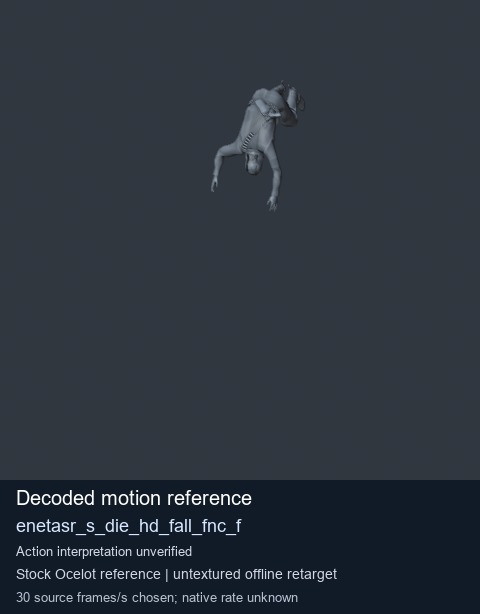
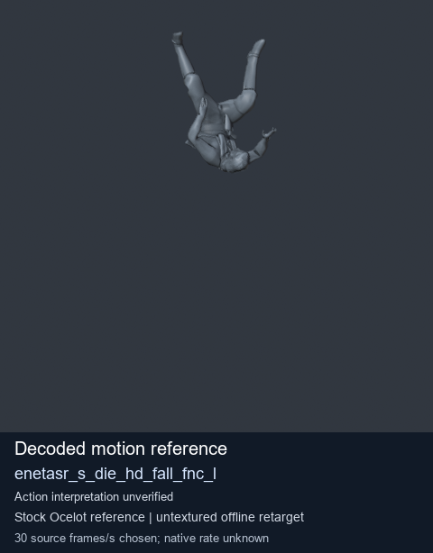
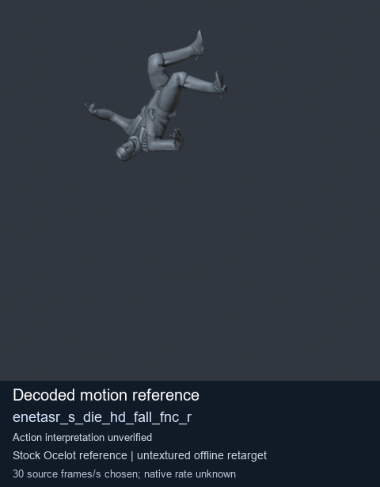

# Stock Soldier_common motion references / /Assets/tpp/motion/SI_game/fani/bodies/enet/enetasr - page 64

[Library](../README.md) · [Grouped directory](../browse/README.md) · [This source family](../browse/stock-soldier-enetasr-dd428991.md) · [Switch mode](browse-stock-soldier-enetasr-dd428991-64.md)

**Still images: no GIFs loaded** · 4 clips · 0.22 MiB downloaded.

Images reuse existing files. A small display width does not reduce download size. Open one clip for its larger titled GIF and original technical data.

Source-family grouping uses only recorded virtual directories; it does not establish an action, weapon, actor, rig or native compatibility. Existing descriptions and tags below are unchanged. Per-clip visual review may be pending; chosen preview speed is separate from unmeasured native timing.

| Preview | Animation | Category | Tags | Virtual GANI directory / file | MTAR / container location | Description | Frames / data |
| --- | --- | --- | --- | --- | --- | --- | --- |
|  | [Stock reference: enetasr_s_die_hd_fall_fnc_b](../clips/mgsv-tpp-soldier_common-payloadsha256-8c5a2c14eb452fe73457c757185013ba15283eed3fe7727a9e54fa52b707a604.md) <code>enetasr_s_die_hd_fall_fnc_b</code> | Stock Soldier_common motion references | <code>stock animation reference</code> <code>Soldier_common</code> <code>source-derived label</code> <code>Ocelot reference mesh</code> | <code>/Assets/tpp/motion/SI_game/fani/bodies/enet/enetasr</code> <code>enetasr_s_die_hd_fall_fnc_b.gani</code> | Retained MTAR: <code>Soldier_common.mtar</code> DAT / FPK membership unverified | Decoded stock reference enetasr_s_die_hd_fall_fnc_b; action interpretation unverified. | 61 raw 2.03 s chosen; native rate unknown [Full data](../clips/mgsv-tpp-soldier_common-payloadsha256-8c5a2c14eb452fe73457c757185013ba15283eed3fe7727a9e54fa52b707a604.md#technical-data) |
|  | [Stock reference: enetasr_s_die_hd_fall_fnc_f](../clips/mgsv-tpp-soldier_common-payloadsha256-2ee97bb5c6cd742df6d64457cf435a562e9113541fd1aefb573a798277126536.md) <code>enetasr_s_die_hd_fall_fnc_f</code> | Stock Soldier_common motion references | <code>stock animation reference</code> <code>Soldier_common</code> <code>source-derived label</code> <code>Ocelot reference mesh</code> | <code>/Assets/tpp/motion/SI_game/fani/bodies/enet/enetasr</code> <code>enetasr_s_die_hd_fall_fnc_f.gani</code> | Retained MTAR: <code>Soldier_common.mtar</code> DAT / FPK membership unverified | Decoded stock reference enetasr_s_die_hd_fall_fnc_f; action interpretation unverified. | 67 raw 2.23 s chosen; native rate unknown [Full data](../clips/mgsv-tpp-soldier_common-payloadsha256-2ee97bb5c6cd742df6d64457cf435a562e9113541fd1aefb573a798277126536.md#technical-data) |
|  | [Stock motion reference: enetasr_s_die_hd_fall_fnc_l](../clips/mgsv-tpp-soldier_common-payloadsha256-df92579d7a4f28c48731d82369f84c9f5572eb93067e4838aef9fc4e97210ea9.md) <code>enetasr_s_die_hd_fall_fnc_l</code> | Stock Soldier_common motion references | <code>stock body motion</code> <code>Soldier_common</code> <code>source-derived label</code> <code>Ocelot reference mesh</code> | <code>/Assets/tpp/motion/SI_game/fani/bodies/enet/enetasr</code> <code>enetasr_s_die_hd_fall_fnc_l.gani</code> | Retained MTAR: <code>Soldier_common.mtar</code> DAT / FPK membership unverified | Decoded stock body-motion reference enetasr_s_die_hd_fall_fnc_l; action interpretation unverified. | 55 raw 1.83 s chosen; native rate unknown [Full data](../clips/mgsv-tpp-soldier_common-payloadsha256-df92579d7a4f28c48731d82369f84c9f5572eb93067e4838aef9fc4e97210ea9.md#technical-data) |
|  | [Stock motion reference: enetasr_s_die_hd_fall_fnc_r](../clips/mgsv-tpp-soldier_common-payloadsha256-e27caba5adebef047b7621dbb8b82aa5c6fc68bcb808f5ad983d69a320dc6175.md) <code>enetasr_s_die_hd_fall_fnc_r</code> | Stock Soldier_common motion references | <code>stock body motion</code> <code>Soldier_common</code> <code>source-derived label</code> <code>Ocelot reference mesh</code> | <code>/Assets/tpp/motion/SI_game/fani/bodies/enet/enetasr</code> <code>enetasr_s_die_hd_fall_fnc_r.gani</code> | Retained MTAR: <code>Soldier_common.mtar</code> DAT / FPK membership unverified | Decoded stock body-motion reference enetasr_s_die_hd_fall_fnc_r; action interpretation unverified. | 55 raw 1.83 s chosen; native rate unknown [Full data](../clips/mgsv-tpp-soldier_common-payloadsha256-e27caba5adebef047b7621dbb8b82aa5c6fc68bcb808f5ad983d69a320dc6175.md#technical-data) |

[Source descriptions, confidence and credits](../description-sources.md) · [Complete JSON](../catalogue.json) · [CSV](../catalogue.csv)
