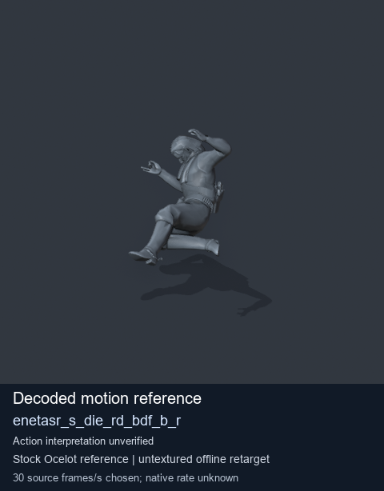
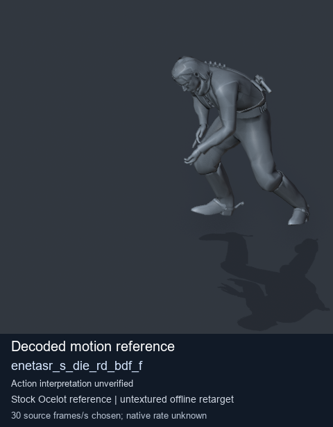
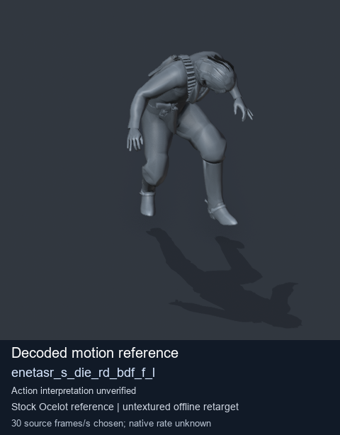
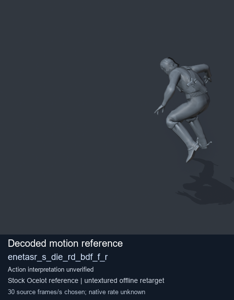

# Stock Soldier_common motion references / /Assets/tpp/motion/SI_game/fani/bodies/enet/enetasr - page 67

[Library](../README.md) · [Grouped directory](../browse/README.md) · [This source family](../browse/stock-soldier-enetasr-dd428991.md) · [Switch mode](browse-stock-soldier-enetasr-dd428991-67.md)

**Still images: no GIFs loaded** · 4 clips · 0.30 MiB downloaded.

Images reuse existing files. A small display width does not reduce download size. Open one clip for its larger titled GIF and original technical data.

Source-family grouping uses only recorded virtual directories; it does not establish an action, weapon, actor, rig or native compatibility. Existing descriptions and tags below are unchanged. Per-clip visual review may be pending; chosen preview speed is separate from unmeasured native timing.

| Preview | Animation | Category | Tags | Virtual GANI directory / file | MTAR / container location | Description | Frames / data |
| --- | --- | --- | --- | --- | --- | --- | --- |
|  | [Stock reference: enetasr_s_die_rd_bdf_b_r](../clips/mgsv-tpp-soldier_common-payloadsha256-f97507abae0563176bb40f2db77d8c064c49755499cf85eafd5361720f1e25ff.md) <code>enetasr_s_die_rd_bdf_b_r</code> | Stock Soldier_common motion references | <code>stock animation reference</code> <code>Soldier_common</code> <code>source-derived label</code> <code>Ocelot reference mesh</code> | <code>/Assets/tpp/motion/SI_game/fani/bodies/enet/enetasr</code> <code>enetasr_s_die_rd_bdf_b_r.gani</code> | Retained MTAR: <code>Soldier_common.mtar</code> DAT / FPK membership unverified | Decoded stock reference enetasr_s_die_rd_bdf_b_r; action interpretation unverified. | 100 raw 3.33 s chosen; native rate unknown [Full data](../clips/mgsv-tpp-soldier_common-payloadsha256-f97507abae0563176bb40f2db77d8c064c49755499cf85eafd5361720f1e25ff.md#technical-data) |
|  | [Stock reference: enetasr_s_die_rd_bdf_f](../clips/mgsv-tpp-soldier_common-payloadsha256-44c7bb0f38ff810df2229cefc101be54440f9c7289ceaab298d53854c84fece6.md) <code>enetasr_s_die_rd_bdf_f</code> | Stock Soldier_common motion references | <code>stock animation reference</code> <code>Soldier_common</code> <code>source-derived label</code> <code>Ocelot reference mesh</code> | <code>/Assets/tpp/motion/SI_game/fani/bodies/enet/enetasr</code> <code>enetasr_s_die_rd_bdf_f.gani</code> | Retained MTAR: <code>Soldier_common.mtar</code> DAT / FPK membership unverified | Decoded stock reference enetasr_s_die_rd_bdf_f; action interpretation unverified. | 105 raw 3.5 s chosen; native rate unknown [Full data](../clips/mgsv-tpp-soldier_common-payloadsha256-44c7bb0f38ff810df2229cefc101be54440f9c7289ceaab298d53854c84fece6.md#technical-data) |
|  | [Stock reference: enetasr_s_die_rd_bdf_f_l](../clips/mgsv-tpp-soldier_common-payloadsha256-d289cded5bffa0ff4d4cc15c39b8e657d754a1bbd08d225a68d6ef98f830d413.md) <code>enetasr_s_die_rd_bdf_f_l</code> | Stock Soldier_common motion references | <code>stock animation reference</code> <code>Soldier_common</code> <code>source-derived label</code> <code>Ocelot reference mesh</code> | <code>/Assets/tpp/motion/SI_game/fani/bodies/enet/enetasr</code> <code>enetasr_s_die_rd_bdf_f_l.gani</code> | Retained MTAR: <code>Soldier_common.mtar</code> DAT / FPK membership unverified | Decoded stock reference enetasr_s_die_rd_bdf_f_l; action interpretation unverified. | 130 raw 4.33 s chosen; native rate unknown [Full data](../clips/mgsv-tpp-soldier_common-payloadsha256-d289cded5bffa0ff4d4cc15c39b8e657d754a1bbd08d225a68d6ef98f830d413.md#technical-data) |
|  | [Stock motion reference: enetasr_s_die_rd_bdf_f_r](../clips/mgsv-tpp-soldier_common-payloadsha256-a096e1f85af6d1e0981a4d0a2a428821e3fdbfa20633700cf8ca8af90e8f7973.md) <code>enetasr_s_die_rd_bdf_f_r</code> | Stock Soldier_common motion references | <code>stock body motion</code> <code>Soldier_common</code> <code>source-derived label</code> <code>Ocelot reference mesh</code> | <code>/Assets/tpp/motion/SI_game/fani/bodies/enet/enetasr</code> <code>enetasr_s_die_rd_bdf_f_r.gani</code> | Retained MTAR: <code>Soldier_common.mtar</code> DAT / FPK membership unverified | Decoded stock body-motion reference enetasr_s_die_rd_bdf_f_r; action interpretation unverified. | 120 raw 4.0 s chosen; native rate unknown [Full data](../clips/mgsv-tpp-soldier_common-payloadsha256-a096e1f85af6d1e0981a4d0a2a428821e3fdbfa20633700cf8ca8af90e8f7973.md#technical-data) |

[Source descriptions, confidence and credits](../description-sources.md) · [Complete JSON](../catalogue.json) · [CSV](../catalogue.csv)
