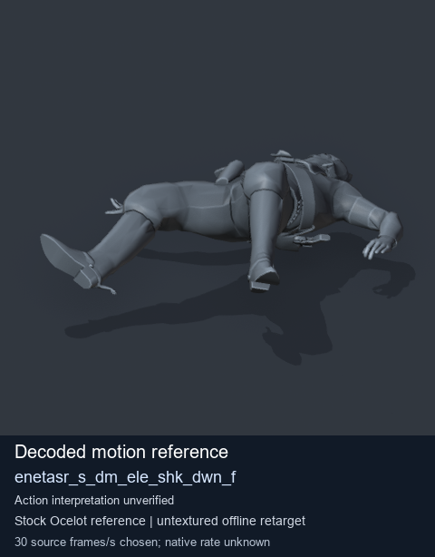
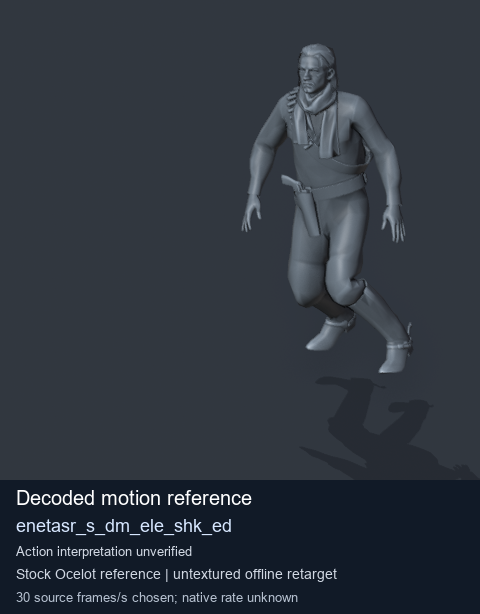
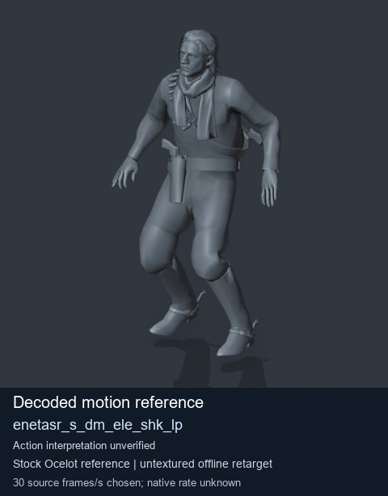
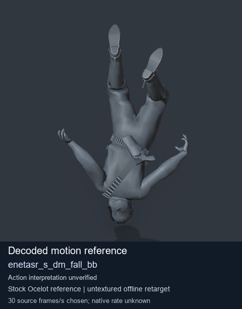

# Stock Soldier_common motion references / /Assets/tpp/motion/SI_game/fani/bodies/enet/enetasr - page 69

[Library](../README.md) · [Grouped directory](../browse/README.md) · [This source family](../browse/stock-soldier-enetasr-dd428991.md) · [Switch mode](browse-stock-soldier-enetasr-dd428991-69.md)

**Still images: no GIFs loaded** · 4 clips · 0.37 MiB downloaded.

Images reuse existing files. A small display width does not reduce download size. Open one clip for its larger titled GIF and original technical data.

Source-family grouping uses only recorded virtual directories; it does not establish an action, weapon, actor, rig or native compatibility. Existing descriptions and tags below are unchanged. Per-clip visual review may be pending; chosen preview speed is separate from unmeasured native timing.

| Preview | Animation | Category | Tags | Virtual GANI directory / file | MTAR / container location | Description | Frames / data |
| --- | --- | --- | --- | --- | --- | --- | --- |
|  | [Stock reference: enetasr_s_dm_ele_shk_dwn_f](../clips/mgsv-tpp-soldier_common-payloadsha256-812c2482ee77afe52d88db0db1255a72efe8ae279cfadd375897726490ce754b.md) <code>enetasr_s_dm_ele_shk_dwn_f</code> | Stock Soldier_common motion references | <code>stock animation reference</code> <code>Soldier_common</code> <code>source-derived label</code> <code>Ocelot reference mesh</code> | <code>/Assets/tpp/motion/SI_game/fani/bodies/enet/enetasr</code> <code>enetasr_s_dm_ele_shk_dwn_f.gani</code> | Retained MTAR: <code>Soldier_common.mtar</code> DAT / FPK membership unverified | Decoded stock reference enetasr_s_dm_ele_shk_dwn_f; action interpretation unverified. | 25 raw 0.83 s chosen; native rate unknown [Full data](../clips/mgsv-tpp-soldier_common-payloadsha256-812c2482ee77afe52d88db0db1255a72efe8ae279cfadd375897726490ce754b.md#technical-data) |
|  | [Stock reference: enetasr_s_dm_ele_shk_ed](../clips/mgsv-tpp-soldier_common-payloadsha256-af48a7ec370a5d1984d4a46873c56b29a11b536d815a239e03bab0a676627a64.md) <code>enetasr_s_dm_ele_shk_ed</code> | Stock Soldier_common motion references | <code>stock animation reference</code> <code>Soldier_common</code> <code>source-derived label</code> <code>Ocelot reference mesh</code> | <code>/Assets/tpp/motion/SI_game/fani/bodies/enet/enetasr</code> <code>enetasr_s_dm_ele_shk_ed.gani</code> | Retained MTAR: <code>Soldier_common.mtar</code> DAT / FPK membership unverified | Decoded stock reference enetasr_s_dm_ele_shk_ed; action interpretation unverified. | 148 raw 4.93 s chosen; native rate unknown [Full data](../clips/mgsv-tpp-soldier_common-payloadsha256-af48a7ec370a5d1984d4a46873c56b29a11b536d815a239e03bab0a676627a64.md#technical-data) |
|  | [Stock reference: enetasr_s_dm_ele_shk_lp](../clips/mgsv-tpp-soldier_common-payloadsha256-48ff8a8958aeb612d1bf30666ccf96e3028ff4889488e958ff0d85b68efe4e93.md) <code>enetasr_s_dm_ele_shk_lp</code> | Stock Soldier_common motion references | <code>stock animation reference</code> <code>Soldier_common</code> <code>source-derived label</code> <code>Ocelot reference mesh</code> | <code>/Assets/tpp/motion/SI_game/fani/bodies/enet/enetasr</code> <code>enetasr_s_dm_ele_shk_lp.gani</code> | Retained MTAR: <code>Soldier_common.mtar</code> DAT / FPK membership unverified | Decoded stock reference enetasr_s_dm_ele_shk_lp; action interpretation unverified. | 26 raw 0.87 s chosen; native rate unknown [Full data](../clips/mgsv-tpp-soldier_common-payloadsha256-48ff8a8958aeb612d1bf30666ccf96e3028ff4889488e958ff0d85b68efe4e93.md#technical-data) |
|  | [Stock motion reference: enetasr_s_dm_fall_bb](../clips/mgsv-tpp-soldier_common-payloadsha256-80cb855a4827853b8f15f2084d9a38ba5481967318561cc5e4eaf92c91e8d2fd.md) <code>enetasr_s_dm_fall_bb</code> | Stock Soldier_common motion references | <code>stock body motion</code> <code>Soldier_common</code> <code>source-derived label</code> <code>Ocelot reference mesh</code> | <code>/Assets/tpp/motion/SI_game/fani/bodies/enet/enetasr</code> <code>enetasr_s_dm_fall_bb.gani</code> | Retained MTAR: <code>Soldier_common.mtar</code> DAT / FPK membership unverified | Decoded stock body-motion reference enetasr_s_dm_fall_bb; action interpretation unverified. | 60 raw 2.0 s chosen; native rate unknown [Full data](../clips/mgsv-tpp-soldier_common-payloadsha256-80cb855a4827853b8f15f2084d9a38ba5481967318561cc5e4eaf92c91e8d2fd.md#technical-data) |

[Source descriptions, confidence and credits](../description-sources.md) · [Complete JSON](../catalogue.json) · [CSV](../catalogue.csv)
