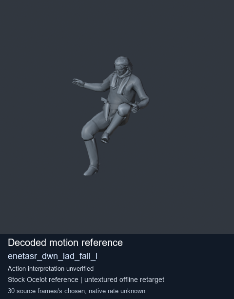
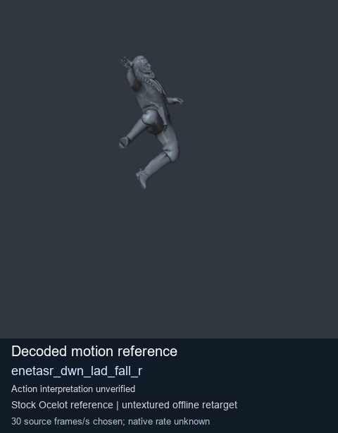
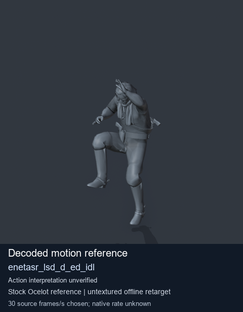
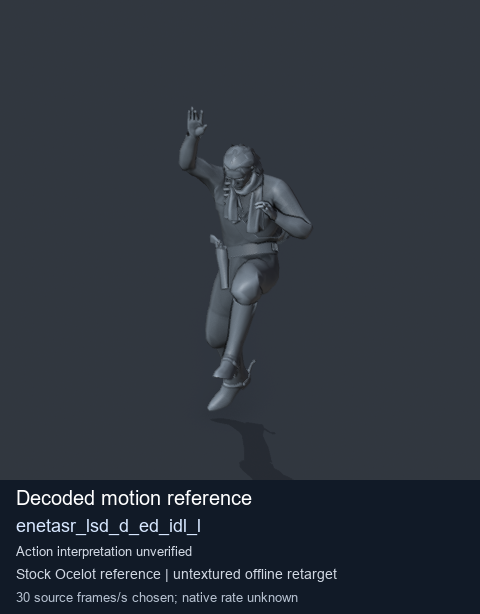

# Stock Soldier_common motion references / /Assets/tpp/motion/SI_game/fani/bodies/enet/enetasr - page 7

[Library](../README.md) · [Grouped directory](../browse/README.md) · [This source family](../browse/stock-soldier-enetasr-dd428991.md) · [Switch mode](browse-stock-soldier-enetasr-dd428991-7.md)

**Still images: no GIFs loaded** · 4 clips · 0.25 MiB downloaded.

Images reuse existing files. A small display width does not reduce download size. Open one clip for its larger titled GIF and original technical data.

Source-family grouping uses only recorded virtual directories; it does not establish an action, weapon, actor, rig or native compatibility. Existing descriptions and tags below are unchanged. Per-clip visual review may be pending; chosen preview speed is separate from unmeasured native timing.

| Preview | Animation | Category | Tags | Virtual GANI directory / file | MTAR / container location | Description | Frames / data |
| --- | --- | --- | --- | --- | --- | --- | --- |
|  | [Stock motion reference: enetasr_dwn_lad_fall_l](../clips/mgsv-tpp-soldier_common-payloadsha256-56d24de627f4a9ccbb628b097a248df9d24b1cf933610d94813b2bc5b64a269e.md) <code>enetasr_dwn_lad_fall_l</code> | Stock Soldier_common motion references | <code>stock body motion</code> <code>Soldier_common</code> <code>source-derived label</code> <code>Ocelot reference mesh</code> | <code>/Assets/tpp/motion/SI_game/fani/bodies/enet/enetasr</code> <code>enetasr_dwn_lad_fall_l.gani</code> | Retained MTAR: <code>Soldier_common.mtar</code> DAT / FPK membership unverified | Decoded stock body-motion reference enetasr_dwn_lad_fall_l; action interpretation unverified. | 53 raw 1.77 s chosen; native rate unknown [Full data](../clips/mgsv-tpp-soldier_common-payloadsha256-56d24de627f4a9ccbb628b097a248df9d24b1cf933610d94813b2bc5b64a269e.md#technical-data) |
|  | [Stock motion reference: enetasr_dwn_lad_fall_r](../clips/mgsv-tpp-soldier_common-payloadsha256-a309e0543cabae2fd608def0e70cd904a91d246d4473cc7e48a040ead81652dd.md) <code>enetasr_dwn_lad_fall_r</code> | Stock Soldier_common motion references | <code>stock body motion</code> <code>Soldier_common</code> <code>source-derived label</code> <code>Ocelot reference mesh</code> | <code>/Assets/tpp/motion/SI_game/fani/bodies/enet/enetasr</code> <code>enetasr_dwn_lad_fall_r.gani</code> | Retained MTAR: <code>Soldier_common.mtar</code> DAT / FPK membership unverified | Decoded stock body-motion reference enetasr_dwn_lad_fall_r; action interpretation unverified. | 63 raw 2.1 s chosen; native rate unknown [Full data](../clips/mgsv-tpp-soldier_common-payloadsha256-a309e0543cabae2fd608def0e70cd904a91d246d4473cc7e48a040ead81652dd.md#technical-data) |
|  | [Stock reference: enetasr_lsd_d_ed_idl](../clips/mgsv-tpp-soldier_common-payloadsha256-0e86a45b31373db4bd601751eb1bbc269912778a8c168a1bc0eaa6716ae1f861.md) <code>enetasr_lsd_d_ed_idl</code> | Stock Soldier_common motion references | <code>stock animation reference</code> <code>Soldier_common</code> <code>source-derived label</code> <code>Ocelot reference mesh</code> | <code>/Assets/tpp/motion/SI_game/fani/bodies/enet/enetasr</code> <code>enetasr_lsd_d_ed_idl.gani</code> | Retained MTAR: <code>Soldier_common.mtar</code> DAT / FPK membership unverified | Decoded stock reference enetasr_lsd_d_ed_idl; action interpretation unverified. | 60 raw 2.0 s chosen; native rate unknown [Full data](../clips/mgsv-tpp-soldier_common-payloadsha256-0e86a45b31373db4bd601751eb1bbc269912778a8c168a1bc0eaa6716ae1f861.md#technical-data) |
|  | [Stock motion reference: enetasr_lsd_d_ed_idl_l](../clips/mgsv-tpp-soldier_common-payloadsha256-e18ef6a0638bb79cd8d541a3f077ab883761379a6164812d974689bdba30c283.md) <code>enetasr_lsd_d_ed_idl_l</code> | Stock Soldier_common motion references | <code>stock body motion</code> <code>Soldier_common</code> <code>source-derived label</code> <code>Ocelot reference mesh</code> | <code>/Assets/tpp/motion/SI_game/fani/bodies/enet/enetasr</code> <code>enetasr_lsd_d_ed_idl_l.gani</code> | Retained MTAR: <code>Soldier_common.mtar</code> DAT / FPK membership unverified | Decoded stock body-motion reference enetasr_lsd_d_ed_idl_l; action interpretation unverified. | 65 raw 2.17 s chosen; native rate unknown [Full data](../clips/mgsv-tpp-soldier_common-payloadsha256-e18ef6a0638bb79cd8d541a3f077ab883761379a6164812d974689bdba30c283.md#technical-data) |

[Source descriptions, confidence and credits](../description-sources.md) · [Complete JSON](../catalogue.json) · [CSV](../catalogue.csv)
