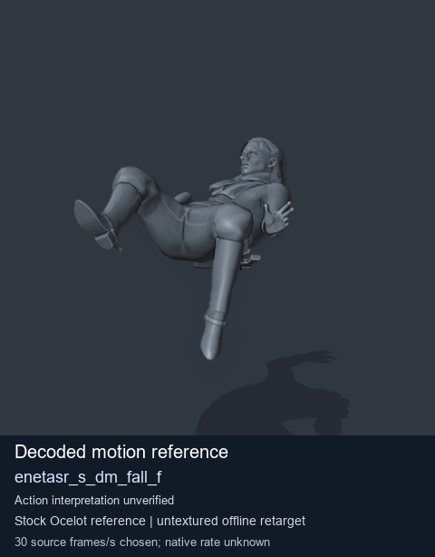
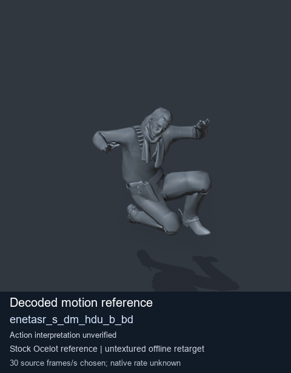
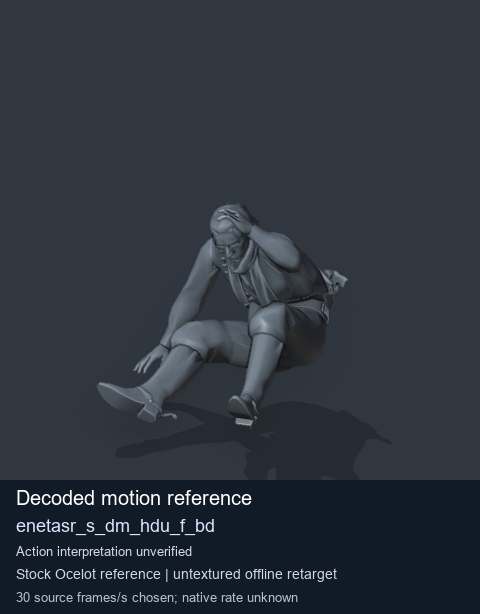
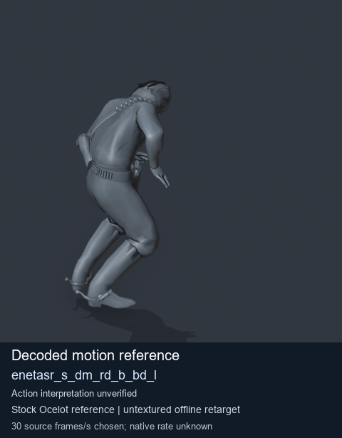

# Stock Soldier_common motion references / /Assets/tpp/motion/SI_game/fani/bodies/enet/enetasr - page 70

[Library](../README.md) · [Grouped directory](../browse/README.md) · [This source family](../browse/stock-soldier-enetasr-dd428991.md) · [Switch mode](browse-stock-soldier-enetasr-dd428991-70.md)

**Still images: no GIFs loaded** · 4 clips · 0.32 MiB downloaded.

Images reuse existing files. A small display width does not reduce download size. Open one clip for its larger titled GIF and original technical data.

Source-family grouping uses only recorded virtual directories; it does not establish an action, weapon, actor, rig or native compatibility. Existing descriptions and tags below are unchanged. Per-clip visual review may be pending; chosen preview speed is separate from unmeasured native timing.

| Preview | Animation | Category | Tags | Virtual GANI directory / file | MTAR / container location | Description | Frames / data |
| --- | --- | --- | --- | --- | --- | --- | --- |
|  | [Stock reference: enetasr_s_dm_fall_f](../clips/mgsv-tpp-soldier_common-payloadsha256-a2a73073625befc635c86b1f335dc4f95b9eff5008ae4b9a4ceb835f1df74021.md) <code>enetasr_s_dm_fall_f</code> | Stock Soldier_common motion references | <code>stock animation reference</code> <code>Soldier_common</code> <code>source-derived label</code> <code>Ocelot reference mesh</code> | <code>/Assets/tpp/motion/SI_game/fani/bodies/enet/enetasr</code> <code>enetasr_s_dm_fall_f.gani</code> | Retained MTAR: <code>Soldier_common.mtar</code> DAT / FPK membership unverified | Decoded stock reference enetasr_s_dm_fall_f; action interpretation unverified. | 43 raw 1.43 s chosen; native rate unknown [Full data](../clips/mgsv-tpp-soldier_common-payloadsha256-a2a73073625befc635c86b1f335dc4f95b9eff5008ae4b9a4ceb835f1df74021.md#technical-data) |
|  | [Stock reference: enetasr_s_dm_hdu_b_bd](../clips/mgsv-tpp-soldier_common-payloadsha256-95b7339bfc91a0568a4cb2209e0a1e24aed1e17aa1c222681b44d87765c1db08.md) <code>enetasr_s_dm_hdu_b_bd</code> | Stock Soldier_common motion references | <code>stock animation reference</code> <code>Soldier_common</code> <code>source-derived label</code> <code>Ocelot reference mesh</code> | <code>/Assets/tpp/motion/SI_game/fani/bodies/enet/enetasr</code> <code>enetasr_s_dm_hdu_b_bd.gani</code> | Retained MTAR: <code>Soldier_common.mtar</code> DAT / FPK membership unverified | Decoded stock reference enetasr_s_dm_hdu_b_bd; action interpretation unverified. | 91 raw 3.03 s chosen; native rate unknown [Full data](../clips/mgsv-tpp-soldier_common-payloadsha256-95b7339bfc91a0568a4cb2209e0a1e24aed1e17aa1c222681b44d87765c1db08.md#technical-data) |
|  | [Stock motion reference: enetasr_s_dm_hdu_f_bd](../clips/mgsv-tpp-soldier_common-payloadsha256-58e1cd4a52d317d9f7af35459c80cb4704855f782f7a72613ac9953c4b9da48a.md) <code>enetasr_s_dm_hdu_f_bd</code> | Stock Soldier_common motion references | <code>stock body motion</code> <code>Soldier_common</code> <code>source-derived label</code> <code>Ocelot reference mesh</code> | <code>/Assets/tpp/motion/SI_game/fani/bodies/enet/enetasr</code> <code>enetasr_s_dm_hdu_f_bd.gani</code> | Retained MTAR: <code>Soldier_common.mtar</code> DAT / FPK membership unverified | Decoded stock body-motion reference enetasr_s_dm_hdu_f_bd; action interpretation unverified. | 78 raw 2.6 s chosen; native rate unknown [Full data](../clips/mgsv-tpp-soldier_common-payloadsha256-58e1cd4a52d317d9f7af35459c80cb4704855f782f7a72613ac9953c4b9da48a.md#technical-data) |
|  | [Stock reference: enetasr_s_dm_rd_b_bd_l](../clips/mgsv-tpp-soldier_common-payloadsha256-d9ae7b7141ed47a2f02fc8d723647bbfb4d4935c18213cd8ba97ced95789410f.md) <code>enetasr_s_dm_rd_b_bd_l</code> | Stock Soldier_common motion references | <code>stock animation reference</code> <code>Soldier_common</code> <code>source-derived label</code> <code>Ocelot reference mesh</code> | <code>/Assets/tpp/motion/SI_game/fani/bodies/enet/enetasr</code> <code>enetasr_s_dm_rd_b_bd_l.gani</code> | Retained MTAR: <code>Soldier_common.mtar</code> DAT / FPK membership unverified | Decoded stock reference enetasr_s_dm_rd_b_bd_l; action interpretation unverified. | 45 raw 1.5 s chosen; native rate unknown [Full data](../clips/mgsv-tpp-soldier_common-payloadsha256-d9ae7b7141ed47a2f02fc8d723647bbfb4d4935c18213cd8ba97ced95789410f.md#technical-data) |

[Source descriptions, confidence and credits](../description-sources.md) · [Complete JSON](../catalogue.json) · [CSV](../catalogue.csv)
