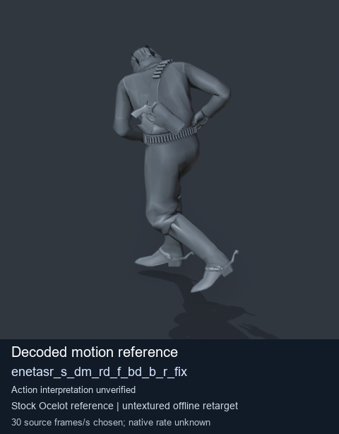
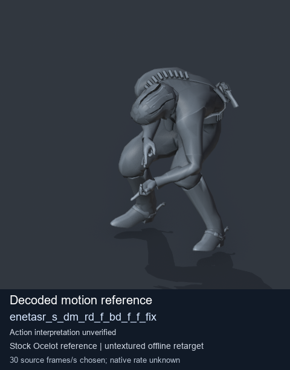
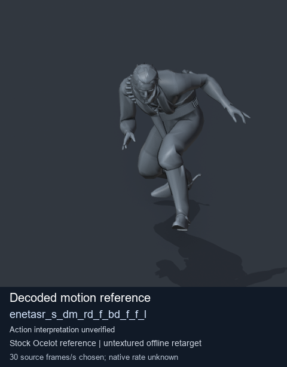
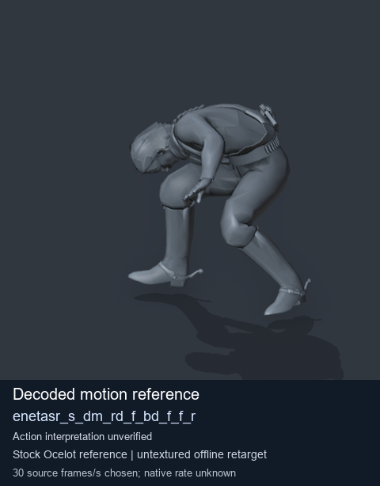

# Stock Soldier_common motion references / /Assets/tpp/motion/SI_game/fani/bodies/enet/enetasr - page 73

[Library](../README.md) · [Grouped directory](../browse/README.md) · [This source family](../browse/stock-soldier-enetasr-dd428991.md) · [Switch mode](browse-stock-soldier-enetasr-dd428991-73.md)

**Still images: no GIFs loaded** · 4 clips · 0.37 MiB downloaded.

Images reuse existing files. A small display width does not reduce download size. Open one clip for its larger titled GIF and original technical data.

Source-family grouping uses only recorded virtual directories; it does not establish an action, weapon, actor, rig or native compatibility. Existing descriptions and tags below are unchanged. Per-clip visual review may be pending; chosen preview speed is separate from unmeasured native timing.

| Preview | Animation | Category | Tags | Virtual GANI directory / file | MTAR / container location | Description | Frames / data |
| --- | --- | --- | --- | --- | --- | --- | --- |
|  | [Stock reference: enetasr_s_dm_rd_f_bd_b_r_fix](../clips/mgsv-tpp-soldier_common-payloadsha256-e0b10d3c383bbda2f4ec8dd11c3f9fe86ad1648bc69019e0caa93a2710aa2494.md) <code>enetasr_s_dm_rd_f_bd_b_r_fix</code> | Stock Soldier_common motion references | <code>stock animation reference</code> <code>Soldier_common</code> <code>source-derived label</code> <code>Ocelot reference mesh</code> | <code>/Assets/tpp/motion/SI_game/fani/bodies/enet/enetasr</code> <code>enetasr_s_dm_rd_f_bd_b_r_fix.gani</code> | Retained MTAR: <code>Soldier_common.mtar</code> DAT / FPK membership unverified | Decoded stock reference enetasr_s_dm_rd_f_bd_b_r_fix; action interpretation unverified. | 110 raw 3.67 s chosen; native rate unknown [Full data](../clips/mgsv-tpp-soldier_common-payloadsha256-e0b10d3c383bbda2f4ec8dd11c3f9fe86ad1648bc69019e0caa93a2710aa2494.md#technical-data) |
|  | [Stock reference: enetasr_s_dm_rd_f_bd_f_f_fix](../clips/mgsv-tpp-soldier_common-payloadsha256-0e46f3b766faddfbd1b7389e070095eae26d5ef145f63d2592579d8c4a693249.md) <code>enetasr_s_dm_rd_f_bd_f_f_fix</code> | Stock Soldier_common motion references | <code>stock animation reference</code> <code>Soldier_common</code> <code>source-derived label</code> <code>Ocelot reference mesh</code> | <code>/Assets/tpp/motion/SI_game/fani/bodies/enet/enetasr</code> <code>enetasr_s_dm_rd_f_bd_f_f_fix.gani</code> | Retained MTAR: <code>Soldier_common.mtar</code> DAT / FPK membership unverified | Decoded stock reference enetasr_s_dm_rd_f_bd_f_f_fix; action interpretation unverified. | 130 raw 4.33 s chosen; native rate unknown [Full data](../clips/mgsv-tpp-soldier_common-payloadsha256-0e46f3b766faddfbd1b7389e070095eae26d5ef145f63d2592579d8c4a693249.md#technical-data) |
|  | [Stock motion reference: enetasr_s_dm_rd_f_bd_f_f_l](../clips/mgsv-tpp-soldier_common-payloadsha256-4fe5406d0fe0a6b1dfa10bf0826211d227608e6ff7ceed8a6cffaa8e96680c68.md) <code>enetasr_s_dm_rd_f_bd_f_f_l</code> | Stock Soldier_common motion references | <code>stock body motion</code> <code>Soldier_common</code> <code>source-derived label</code> <code>Ocelot reference mesh</code> | <code>/Assets/tpp/motion/SI_game/fani/bodies/enet/enetasr</code> <code>enetasr_s_dm_rd_f_bd_f_f_l.gani</code> | Retained MTAR: <code>Soldier_common.mtar</code> DAT / FPK membership unverified | Decoded stock body-motion reference enetasr_s_dm_rd_f_bd_f_f_l; action interpretation unverified. | 80 raw 2.67 s chosen; native rate unknown [Full data](../clips/mgsv-tpp-soldier_common-payloadsha256-4fe5406d0fe0a6b1dfa10bf0826211d227608e6ff7ceed8a6cffaa8e96680c68.md#technical-data) |
|  | [Stock reference: enetasr_s_dm_rd_f_bd_f_f_r](../clips/mgsv-tpp-soldier_common-payloadsha256-557635221675b28c385602a8c0ebebe7c6aca11e981d18fe5de87fa241a7d441.md) <code>enetasr_s_dm_rd_f_bd_f_f_r</code> | Stock Soldier_common motion references | <code>stock animation reference</code> <code>Soldier_common</code> <code>source-derived label</code> <code>Ocelot reference mesh</code> | <code>/Assets/tpp/motion/SI_game/fani/bodies/enet/enetasr</code> <code>enetasr_s_dm_rd_f_bd_f_f_r.gani</code> | Retained MTAR: <code>Soldier_common.mtar</code> DAT / FPK membership unverified | Decoded stock reference enetasr_s_dm_rd_f_bd_f_f_r; action interpretation unverified. | 140 raw 4.67 s chosen; native rate unknown [Full data](../clips/mgsv-tpp-soldier_common-payloadsha256-557635221675b28c385602a8c0ebebe7c6aca11e981d18fe5de87fa241a7d441.md#technical-data) |

[Source descriptions, confidence and credits](../description-sources.md) · [Complete JSON](../catalogue.json) · [CSV](../catalogue.csv)
