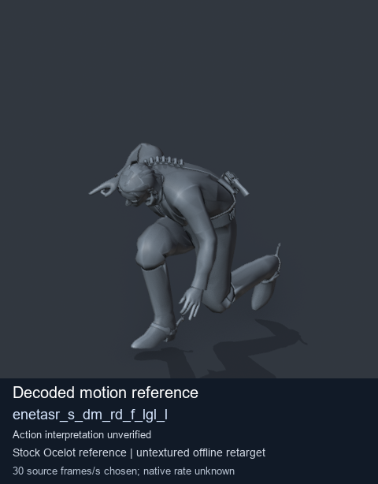
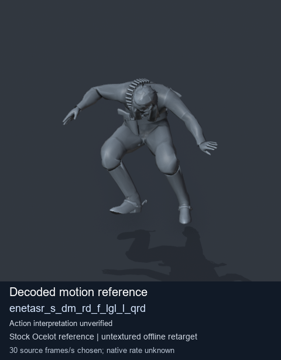
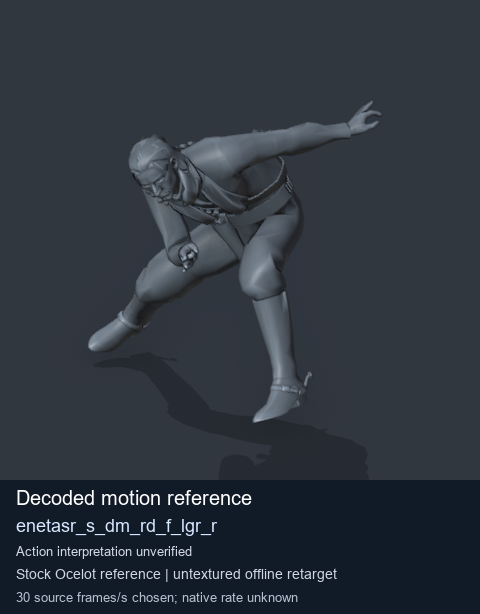
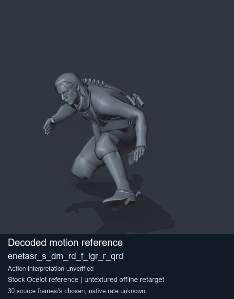

# Stock Soldier_common motion references / /Assets/tpp/motion/SI_game/fani/bodies/enet/enetasr - page 74

[Library](../README.md) · [Grouped directory](../browse/README.md) · [This source family](../browse/stock-soldier-enetasr-dd428991.md) · [Switch mode](browse-stock-soldier-enetasr-dd428991-74.md)

**Still images: no GIFs loaded** · 4 clips · 0.37 MiB downloaded.

Images reuse existing files. A small display width does not reduce download size. Open one clip for its larger titled GIF and original technical data.

Source-family grouping uses only recorded virtual directories; it does not establish an action, weapon, actor, rig or native compatibility. Existing descriptions and tags below are unchanged. Per-clip visual review may be pending; chosen preview speed is separate from unmeasured native timing.

| Preview | Animation | Category | Tags | Virtual GANI directory / file | MTAR / container location | Description | Frames / data |
| --- | --- | --- | --- | --- | --- | --- | --- |
|  | [Stock reference: enetasr_s_dm_rd_f_lgl_l](../clips/mgsv-tpp-soldier_common-payloadsha256-eda848a421d37f64fd3df86e63339806b5561505af79a581bfcebe5fa594e3a2.md) <code>enetasr_s_dm_rd_f_lgl_l</code> | Stock Soldier_common motion references | <code>stock animation reference</code> <code>Soldier_common</code> <code>source-derived label</code> <code>Ocelot reference mesh</code> | <code>/Assets/tpp/motion/SI_game/fani/bodies/enet/enetasr</code> <code>enetasr_s_dm_rd_f_lgl_l.gani</code> | Retained MTAR: <code>Soldier_common.mtar</code> DAT / FPK membership unverified | Decoded stock reference enetasr_s_dm_rd_f_lgl_l; action interpretation unverified. | 125 raw 4.17 s chosen; native rate unknown [Full data](../clips/mgsv-tpp-soldier_common-payloadsha256-eda848a421d37f64fd3df86e63339806b5561505af79a581bfcebe5fa594e3a2.md#technical-data) |
|  | [Stock reference: enetasr_s_dm_rd_f_lgl_l_qrd](../clips/mgsv-tpp-soldier_common-payloadsha256-402f1064ebb4b414e05fe5ccca968ebf0201f153fb49cd4d7103682fa23227af.md) <code>enetasr_s_dm_rd_f_lgl_l_qrd</code> | Stock Soldier_common motion references | <code>stock animation reference</code> <code>Soldier_common</code> <code>source-derived label</code> <code>Ocelot reference mesh</code> | <code>/Assets/tpp/motion/SI_game/fani/bodies/enet/enetasr</code> <code>enetasr_s_dm_rd_f_lgl_l_qrd.gani</code> | Retained MTAR: <code>Soldier_common.mtar</code> DAT / FPK membership unverified | Decoded stock reference enetasr_s_dm_rd_f_lgl_l_qrd; action interpretation unverified. | 115 raw 3.83 s chosen; native rate unknown [Full data](../clips/mgsv-tpp-soldier_common-payloadsha256-402f1064ebb4b414e05fe5ccca968ebf0201f153fb49cd4d7103682fa23227af.md#technical-data) |
|  | [Stock reference: enetasr_s_dm_rd_f_lgr_r](../clips/mgsv-tpp-soldier_common-payloadsha256-d47a78199c3c594b48af9e533df18f27222c9062d05c06908ef4ca429691263b.md) <code>enetasr_s_dm_rd_f_lgr_r</code> | Stock Soldier_common motion references | <code>stock animation reference</code> <code>Soldier_common</code> <code>source-derived label</code> <code>Ocelot reference mesh</code> | <code>/Assets/tpp/motion/SI_game/fani/bodies/enet/enetasr</code> <code>enetasr_s_dm_rd_f_lgr_r.gani</code> | Retained MTAR: <code>Soldier_common.mtar</code> DAT / FPK membership unverified | Decoded stock reference enetasr_s_dm_rd_f_lgr_r; action interpretation unverified. | 125 raw 4.17 s chosen; native rate unknown [Full data](../clips/mgsv-tpp-soldier_common-payloadsha256-d47a78199c3c594b48af9e533df18f27222c9062d05c06908ef4ca429691263b.md#technical-data) |
|  | [Stock reference: enetasr_s_dm_rd_f_lgr_r_qrd](../clips/mgsv-tpp-soldier_common-payloadsha256-f0ac1b9c65f82bc03e3735fbd3d345e0c8e51daca56bf688d8f5d323809c3601.md) <code>enetasr_s_dm_rd_f_lgr_r_qrd</code> | Stock Soldier_common motion references | <code>stock animation reference</code> <code>Soldier_common</code> <code>source-derived label</code> <code>Ocelot reference mesh</code> | <code>/Assets/tpp/motion/SI_game/fani/bodies/enet/enetasr</code> <code>enetasr_s_dm_rd_f_lgr_r_qrd.gani</code> | Retained MTAR: <code>Soldier_common.mtar</code> DAT / FPK membership unverified | Decoded stock reference enetasr_s_dm_rd_f_lgr_r_qrd; action interpretation unverified. | 115 raw 3.83 s chosen; native rate unknown [Full data](../clips/mgsv-tpp-soldier_common-payloadsha256-f0ac1b9c65f82bc03e3735fbd3d345e0c8e51daca56bf688d8f5d323809c3601.md#technical-data) |

[Source descriptions, confidence and credits](../description-sources.md) · [Complete JSON](../catalogue.json) · [CSV](../catalogue.csv)
