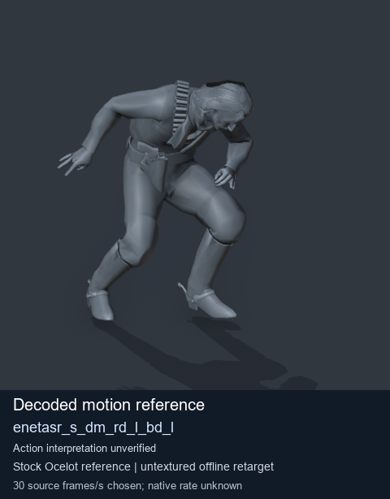
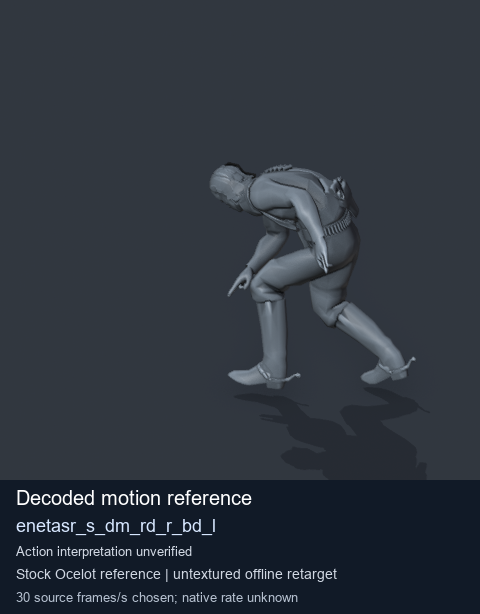
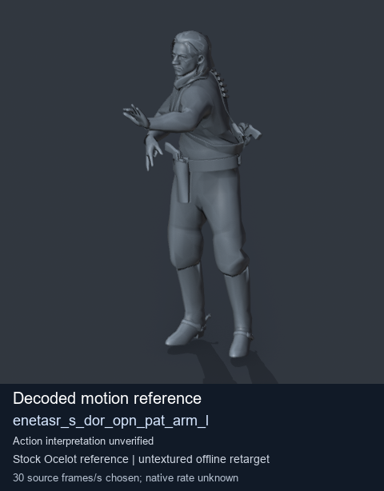
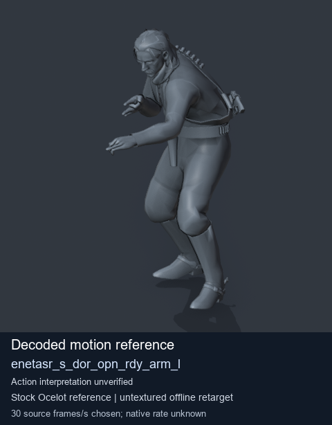

# Stock Soldier_common motion references / /Assets/tpp/motion/SI_game/fani/bodies/enet/enetasr - page 75

[Library](../README.md) · [Grouped directory](../browse/README.md) · [This source family](../browse/stock-soldier-enetasr-dd428991.md) · [Switch mode](browse-stock-soldier-enetasr-dd428991-75.md)

**Still images: no GIFs loaded** · 4 clips · 0.37 MiB downloaded.

Images reuse existing files. A small display width does not reduce download size. Open one clip for its larger titled GIF and original technical data.

Source-family grouping uses only recorded virtual directories; it does not establish an action, weapon, actor, rig or native compatibility. Existing descriptions and tags below are unchanged. Per-clip visual review may be pending; chosen preview speed is separate from unmeasured native timing.

| Preview | Animation | Category | Tags | Virtual GANI directory / file | MTAR / container location | Description | Frames / data |
| --- | --- | --- | --- | --- | --- | --- | --- |
|  | [Stock reference: enetasr_s_dm_rd_l_bd_l](../clips/mgsv-tpp-soldier_common-payloadsha256-d17c857548ed130300369eaeeffc01db8edda4c178525ca1e35447450c802aeb.md) <code>enetasr_s_dm_rd_l_bd_l</code> | Stock Soldier_common motion references | <code>stock animation reference</code> <code>Soldier_common</code> <code>source-derived label</code> <code>Ocelot reference mesh</code> | <code>/Assets/tpp/motion/SI_game/fani/bodies/enet/enetasr</code> <code>enetasr_s_dm_rd_l_bd_l.gani</code> | Retained MTAR: <code>Soldier_common.mtar</code> DAT / FPK membership unverified | Decoded stock reference enetasr_s_dm_rd_l_bd_l; action interpretation unverified. | 75 raw 2.5 s chosen; native rate unknown [Full data](../clips/mgsv-tpp-soldier_common-payloadsha256-d17c857548ed130300369eaeeffc01db8edda4c178525ca1e35447450c802aeb.md#technical-data) |
|  | [Stock reference: enetasr_s_dm_rd_r_bd_l](../clips/mgsv-tpp-soldier_common-payloadsha256-c97145c9cfb91428accfa3948c6e89cc0b7d087a59bcc452ee97cfb5f6679c11.md) <code>enetasr_s_dm_rd_r_bd_l</code> | Stock Soldier_common motion references | <code>stock animation reference</code> <code>Soldier_common</code> <code>source-derived label</code> <code>Ocelot reference mesh</code> | <code>/Assets/tpp/motion/SI_game/fani/bodies/enet/enetasr</code> <code>enetasr_s_dm_rd_r_bd_l.gani</code> | Retained MTAR: <code>Soldier_common.mtar</code> DAT / FPK membership unverified | Decoded stock reference enetasr_s_dm_rd_r_bd_l; action interpretation unverified. | 70 raw 2.33 s chosen; native rate unknown [Full data](../clips/mgsv-tpp-soldier_common-payloadsha256-c97145c9cfb91428accfa3948c6e89cc0b7d087a59bcc452ee97cfb5f6679c11.md#technical-data) |
|  | [Stock motion reference: enetasr_s_dor_opn_pat_arm_l](../clips/mgsv-tpp-soldier_common-payloadsha256-b17ac71a94867c3ed307b4df50c4991a0da0e38a672b11270e7174a07399ccdd.md) <code>enetasr_s_dor_opn_pat_arm_l</code> | Stock Soldier_common motion references | <code>stock body motion</code> <code>Soldier_common</code> <code>source-derived label</code> <code>Ocelot reference mesh</code> | <code>/Assets/tpp/motion/SI_game/fani/bodies/enet/enetasr</code> <code>enetasr_s_dor_opn_pat_arm_l.gani</code> | Retained MTAR: <code>Soldier_common.mtar</code> DAT / FPK membership unverified | Decoded stock body-motion reference enetasr_s_dor_opn_pat_arm_l; action interpretation unverified. | 96 raw 3.2 s chosen; native rate unknown [Full data](../clips/mgsv-tpp-soldier_common-payloadsha256-b17ac71a94867c3ed307b4df50c4991a0da0e38a672b11270e7174a07399ccdd.md#technical-data) |
|  | [Stock motion reference: enetasr_s_dor_opn_rdy_arm_l](../clips/mgsv-tpp-soldier_common-payloadsha256-d96142279ad235d065f728130ac023ee37abf29e593c4d5efc5ced84549995fc.md) <code>enetasr_s_dor_opn_rdy_arm_l</code> | Stock Soldier_common motion references | <code>stock body motion</code> <code>Soldier_common</code> <code>source-derived label</code> <code>Ocelot reference mesh</code> | <code>/Assets/tpp/motion/SI_game/fani/bodies/enet/enetasr</code> <code>enetasr_s_dor_opn_rdy_arm_l.gani</code> | Retained MTAR: <code>Soldier_common.mtar</code> DAT / FPK membership unverified | Decoded stock body-motion reference enetasr_s_dor_opn_rdy_arm_l; action interpretation unverified. | 60 raw 2.0 s chosen; native rate unknown [Full data](../clips/mgsv-tpp-soldier_common-payloadsha256-d96142279ad235d065f728130ac023ee37abf29e593c4d5efc5ced84549995fc.md#technical-data) |

[Source descriptions, confidence and credits](../description-sources.md) · [Complete JSON](../catalogue.json) · [CSV](../catalogue.csv)
